Airline Graph Analytics — CSE412

Selected run: `full-2015-final-001`. **Measured results for the retained historical flight network.**

# Introduction

This project implements the data preparation and graph-analysis stages of an airline network study. HDFS is the intended file store, Spark SQL processes flight rows, and Scala GraphX computes network metrics. The research questions concern centrality, weak connectivity, neighborhood clustering, hub reachability, descriptive delays, exclusions, and processing cost. The implementation preserves repeated flights as traffic, and separates missing delay values from observed zero delay.

The selected run inspected 592430817 input bytes and 5819079 records, retained 5231130 flights, and produced 322 airports and 4656 directed routes. Its storage mode is `hdfs` and Spark master is `local[2]`. These measurements do not demonstrate multi-node performance or physical data redundancy. The package includes source, tests, manifests, aggregate tables, figures, and this report.

# Literature Survey

### Literature survey and references

Sources were checked on 2026-10-13. Publisher abstracts and bibliographic
records were inspected, together with the Guimerà author preprint and the Pregel
paper hosted by UC Berkeley. Research findings motivate this design; they are
not measurements of this project.

| Research | Relevant contribution | Application and difference here |
| --- | --- | --- |
| Gonzalez et al., 2014 [1] | Combines graph abstractions with distributed dataflow | Spark ETL feeds GraphX after a persistence boundary; local fixtures do not reproduce the paper's distributed benchmarks |
| Zaharia et al., 2012 [2] | RDDs support reuse in iterative and interactive computation | Cached graph state and lineage/checkpoints support iteration; no worker-failure experiment was performed |
| Malewicz et al., 2010 [3] | Synchronous vertex programs exchange messages between supersteps; checkpointing supports recovery | GraphX supplies iterative primitives; this project uses aggregateMessages for weighted PageRank rather than a separate Pregel deployment |
| Guimerà et al., 2005 [4] | Air-network degree and centrality need not identify the same cities | Motivates comparing several metrics. Their worldwide, symmetrized city network differs from the directed US-airport baseline here; no community algorithm is implemented |
| Brin and Page, 1998 [5] | Uses hyperlink structure in a large search system | Link-based importance motivates the topology baseline; traffic counts supply this project's custom transition probabilities, not web relevance |

The practical contribution is the combination of a traceable cleaning policy,
explicit missing-delay denominators, independently checked weighted iteration,
and auditable exported results in a course-sized native pipeline. This is an
engineering reproduction and domain adaptation, not a new graph algorithm.
Synthetic fixtures establish software behavior. The selected real-data report
separately measures the airline network and describes the limits of one-machine
execution.

#### Synthesis and design implications

GraphX [1] connects graph views to the distributed dataflow model. That connection
is useful here because flight cleaning is relational while centrality and
connectivity require repeated graph operations. Persisting and reloading graph
tables makes the boundary visible and independently testable. The original
paper's distributed performance results cannot be transferred to this laptop.

RDDs [2] motivate reusing immutable distributed state across iterative work.
This implementation materializes cached results before timing ends, releases
obsolete state, and periodically checkpoints long graph iterations. Those
choices do not amount to a worker-failure experiment; that evaluation would
require a separate cluster and controlled failures.

Pregel [3] organizes a graph program into synchronized supersteps: a vertex reads
prior messages and updates its state, with messages available in the next step.
Combiners reduce associative message traffic, while aggregators supply global
reductions. This project expresses weighted incoming rank through GraphX
aggregateMessages and dangling mass through a separate reduction. It does not
implement Pregel's C++ runtime, mutable topology, or cluster recovery protocol.
The full paper is available through a [university-hosted research copy](https://dsf.berkeley.edu/cs286/papers/pregel-sigmod2010.pdf).

Guimerà et al. [4] show why degree alone cannot substitute for all notions of
air-network importance. Their worldwide city-level analysis and centrality
measure differ from this directed US-airport PageRank analysis. The comparison
motivates measuring several metrics; it does not justify treating local triangles
or weak components as community detection, or asserting that the same rankings
should recur.

Brin and Page [5] use link structure as an importance signal in web search.
Here, the unweighted baseline treats distinct destinations uniformly, while the
custom transition probability reflects retained flight counts. Comparing weighted
and uniform custom iterations holds the implementation and convergence rule
fixed. The interpretation is circulation in a defined historical flight network,
not web relevance, passenger volume, or commercial importance.

#### Research bibliography

1. Joseph E. Gonzalez, Reynold S. Xin, Ankur Dave, Daniel Crankshaw, Michael J.
   Franklin, and Ion Stoica. **GraphX: Graph Processing in a Distributed Dataflow
   Framework.** OSDI 2014, pp. 599–613.
   [Publisher](https://www.usenix.org/conference/osdi14/technical-sessions/presentation/gonzalez).
2. Matei Zaharia, Mosharaf Chowdhury, Tathagata Das, Ankur Dave, Justin Ma,
   Murphy McCauley, Michael J. Franklin, Scott Shenker, and Ion Stoica.
   **Resilient Distributed Datasets: A Fault-Tolerant Abstraction for In-Memory
   Cluster Computing.** NSDI 2012, pp. 15–28.
   [Publisher](https://www.usenix.org/conference/nsdi12/technical-sessions/presentation/zaharia).
3. Grzegorz Malewicz, Matthew H. Austern, Aart J. C. Bik, James C. Dehnert,
   Ilan Horn, Naty Leiser, and Grzegorz Czajkowski. **Pregel: a system for
   large-scale graph processing.** SIGMOD 2010, pp. 135–146.
   [Author organization](https://research.google/pubs/pregel-a-system-for-large-scale-graph-processing/).
4. Roger Guimerà, Stefano Mossa, Adrian Turtschi, and Luís A. N. Amaral.
   **The worldwide air transportation network: Anomalous centrality, community
   structure, and cities' global roles.** PNAS 102, 7794–7799 (2005).
   DOI [10.1073/pnas.0407994102](https://doi.org/10.1073/pnas.0407994102).
   [Author preprint](https://arxiv.org/abs/cond-mat/0312535).
5. Sergey Brin and Lawrence Page. **The Anatomy of a Large-Scale Hypertextual
   Web Search Engine.** Computer Networks 30 (1998), pp. 107–117.
   [Author organization](https://research.google/pubs/the-anatomy-of-a-large-scale-hypertextual-web-search-engine/).

The requested standalone PageRank technical-report server was inaccessible
during verification. Reference [5] is the verified alternative primary source;
the technical report's edition is not guessed or conflated with this article.

#### Dataset and official documentation (not peer-reviewed research)

- [US DOT dataset on Kaggle](https://www.kaggle.com/datasets/usdot/flight-delays).
  The public metadata API identifies dataset 810, version 1, published by the
  Department of Transportation, licensed "CC0: Public Domain". The acquisition
  manifest records its response, download time, archive checksum, and CSV hashes.
  [Publisher metadata](https://www.kaggle.com/api/v1/datasets/view/usdot/flight-delays).
- [Spark 3.5.9 GraphX guide](https://spark.apache.org/docs/3.5.9/graphx-programming-guide.html).
  The guide documents graph construction and aggregateMessages. API behavior
  is additionally tested against the actual installed binaries by the fixtures.
- [Hadoop supported JVMs](https://cwiki.apache.org/confluence/spaces/HADOOP/pages/100827883/Hadoop%2BJava%2BVersions).
- [Spark archive](https://archive.apache.org/dist/spark/spark-3.5.9/) and
  [Hadoop archive](https://archive.apache.org/dist/hadoop/common/hadoop-3.4.1/).

The reference GitHub project named in the build plan was not used or adapted;
there is no consulted commit or inherited source-license claim to invent.

# Problem Statement

Vertices represent active airports after cleaning. A directed edge represents one retained origin–destination pair and carries flight count, delay-observation count, delay sum/mean, and the number delayed at least 15 minutes. Traffic weights are positive; arrival delay is descriptive and may be negative. Reachability counts flight legs to a hub and is not a feasible schedule, price, or route sequence.

The input must have unambiguous airport lookup keys. Invalid dates, unknown flags, cancelled/diverted flights, numeric/malformed airport IDs, self-loops, and unresolved endpoints must be counted rather than silently lost. Success requires conservation checks, stable IDs, finite converged rank scores, correct projection and direction, reloaded output validation, and reproducible evidence. The final course acceptance additionally requires an actual HDFS run on the acquired US DOT files; local synthetic execution does not satisfy that requirement.

# Proposed Solution / Architecture

### Architecture and implemented boundary

```text
flights.csv + airports.csv + airlines.csv
                |
       CSV inspection + SHA-256 manifest
                |
      HDFS raw/<dataset_id> (default)
                |
     Scala Spark SQL: parse, audit, filter, aggregate
                |
     runs/<run_id>/clean/{vertices,edges} Parquet
                |
             Parquet reload
                |
       Scala GraphX, EdgePartition2D
       | topology PageRank / weighted & uniform PageRank
       | weak components / undirected triangles
       | directed distances TO ATL, ORD, DFW
                |
     persisted results -> reload validation
                |
       multi-part CSV export + checksums
                |
       Python aggregate checks + fixture matrix oracle
```

`--storage local --mode fixture` exercises the same Scala stages using `file://`
and is a development fallback. It does not demonstrate HDFS ingestion, HDFS
durability, or distributed performance. Full mode requires HDFS. Spark runs with
`local[2]` by default; no YARN or standalone Spark master is required.

The preprocessing stage keeps repeated flight records as traffic weights,
audits exact duplicates separately, and never collects raw flights. Airport
mapping is limited to 10,000 entries. Every run uses immutable output paths.
Partial runs remain available for diagnosis and cannot be silently overwritten.

The weighted transition probability is `num_flights / outgoing_flights`.
Scores start at `1/N`; each iteration adds `alpha/N` and distributes dangling
mass uniformly. The stopping rule is the maximum absolute score change. A
separate uniform-weight run uses exactly the same implementation. The built-in
GraphX PageRank baseline is compared separately because its normalization and
dangling handling differ. Its score is also exported divided by the score sum.

GraphX computes on a directed graph. Triangles use a separate deduplicated
undirected graph with `src < dst`; the original direction never determines
whether an undirected edge survives. Weak components are not communities.
Landmark distances count flight legs toward hubs; they are not itineraries.

The default replication factor one on a single machine offers no physical-node
redundancy. Millions of flights would reduce to a relatively small airport graph;
the project demonstrates a scalable processing design, not a claim that the
aggregated graph requires a cluster.

## Implementation sequence

| Step | Code | Purpose / evidence |
| --- | --- | --- |
| Inspect and ingest | check_environment.sh, input_manifest.py, ingest_hdfs.sh | Versions, checksums, quoted CSV parsing; HDFS idempotence compares hashes |
| Parse and audit | Preprocess.scala | Explicit string schema; ordered reasons and monthly coverage; ambiguous lookups fail |
| Build graph tables | Preprocess.scala | Sorted active IATA IDs; flight counts and observation-weighted delays; Parquet write |
| Reload and analyze | GraphAnalytics.scala, WeightedPageRank.scala | Endpoint checks; GraphX partitioning; three rankings; components, triangles, directed paths |
| Validate and export | Validation.scala, export_results.py, analyze_results.py | Read-back invariants, multipart CSV merge, independent tiny matrix oracle |
| Present and package | plot_results.py, generate_report.py, package_submission.py | Selected-run hashes; figures; full source listing; portable archive |

## Weighted iteration and output interpretation

`PR_next(v) = alpha/N + (1-alpha) * (sum_u PR(u)*w(u,v)/out_strength(u) + dangling_mass/N)`. Initialization is uniform. Vertices without incoming messages receive a zero incoming contribution; dangling mass is reduced separately and redistributed to every vertex. New cached state is materialized before old vertex state is released, with periodic checkpoints to bound lineage. Edge weights never use delays.

Triangle projection uses every unordered pair once. Local clustering is zero below degree two, otherwise `2*T/(k*(k-1))`. Global triangle count divides the sum of local counts by three. Weak component IDs are labels. The complete airport-by-landmark grid preserves unreachable entries as null hops.

### Data dictionary

Inputs are UTF-8 CSV with headers. All source columns are read as nullable
strings with an explicit schema based on the validated header; no numeric
inference is used for identifiers. Source files can contain extra columns.
Rows with a different field count receive `_corrupt_record`. CSV parsing is
single-line, matching the source dataset; multiline quoted flight records are
outside the input contract. Python manifest inspection reports width mismatches.

The baseline accepts valid 2015 calendar dates and flags literally `0` or `1`.
Only zero cancellation and diversion flags survive. Airport IDs are trimmed and
uppercased, then restricted to three ASCII letters. Lookup keys must be unique;
even identical duplicates fail to prevent accidental row multiplication.
Missing coordinates do not exclude airports. Unknown airline codes are counted
but do not remove flights. No numeric airport crosswalk is inferred.

| Table | Fields and meanings |
| --- | --- |
| clean/vertices | `vertex_id` Long: positive sorted IATA index; `iata` String: unique active airport; `airport_name`, `city`, `state`, `country` nullable Strings; `latitude`, `longitude` nullable Doubles, degrees |
| clean/edges | `src_id`, `dst_id` Long; `origin_iata`, `destination_iata` Strings; `num_flights` Long, positive; `delay_observations` Long; `sum_arrival_delay`, `avg_arrival_delay` nullable Double minutes; `delayed_flights_15min` Long, observations >=15 minutes |
| audit/cleaning_funnel | `step` Int, ordered cleaning priority; `reason` String; `records` Long assigned to exactly that reason; `remaining_records` Long after exclusion (retained row reports final total) |
| audit/exclusions_by_month | `YEAR`, `MONTH` nullable raw Strings, including invalid values; `raw_records`, `retained_records`, `numeric_excluded_records` Long. Numeric count is the exclusive funnel reason, not an overlapping diagnostic |
| audit/unmatched_airports | endpoint IATA pair and `count` Long, flights excluded at lookup stage |
| results/pagerank | `vertex_id`, `iata`; `score` raw GraphX Double; `normalized_score` Double summing to one; `rank` Int sorted by score descending and IATA ascending |
| results/weighted_pagerank | same ranking schema, custom flight-weighted scores with dangling redistribution |
| results/uniform_pagerank | same ranking schema, custom uniform-route-weight comparison |
| results/connected_components | `vertex_id`, `iata`, `component_id` Long, weak component label (not a numeric measure) |
| results/component_sizes | `component_id` Long; `airports` Long |
| results/triangle_count | `vertex_id`, `iata`; `triangles` Int per airport; `undirected_degree` Int; `clustering` Double in [0,1], zero if degree <2 |
| results/shortest_paths | `vertex_id`, `iata`, `landmark_id`, `landmark_iata`; `hops` nullable Int from vertex to landmark; `reachable` Boolean; null means unreachable, zero means landmark self-distance |
| results/airport_metrics | vertex metadata; `in_degree`, `out_degree`, `in_strength`, `out_strength` Long; `arrival_delay_observations`, `delayed_arrivals_15min` Long; nullable `arrival_delay_sum`, `avg_arrival_delay` Double minutes, weighted by observation counts |
| results/route_metrics | edge fields plus `delayed_fraction` nullable Double using delay observations as denominator |
| metrics/algorithm_timings | `algorithm` String; `materialize_seconds`, `write_seconds` Double wall seconds. Weighted iterative compute is recorded separately in each algorithm's JSON |

#### Run-level JSON and analysis

`coverage.json` records the run ID, active airports with missing names or coordinate
pairs, and unique undirected edges. Missing coordinates do not remove airports.

`artifacts/<run_id>/metrics.json` consolidates the measured ETL counts, input bytes,
retained fraction, flights per directed route, average-tie-rank Spearman ranking
comparisons, degree/traffic summaries, component membership, triangle/clustering
statistics, hub hop distributions, monthly coverage, delay observation denominators,
qualifying route delays, and stage timings. Correlation is null when undefined
(too few usable airports or constant values). Airport delay correlations give each
usable airport equal weight; the overall flight-delay mean weights individual
observations. These are different estimands.

`findings.md` is generated from that selected-run metrics object. It labels fixture
results explicitly and does not infer causality. `analysis.json` retains an older
IATA-tie-broken rank diagnostic under an explicit name; report comparisons use
the average-tied-rank statistic in `metrics.json` instead.

`run_manifest.json` version 2 embeds the immutable dataset manifest, effective
configuration, completed stages, input provenance and computation source hashes.
Wall times overlap materialized stage durations and must not be added together.
The final HDFS health record separately verifies live service state, storage
placement and daemon Java executables.

Parquet preserves types and nulls. CSV uses empty cells for null and lowercase
`true`/`false`. Delay can be negative (early arrival); missing, unparseable, NaN,
and infinite values contribute no delay observation. All-null route delays
have null sum and mean. Traffic counts still include these flights.

Files are Spark directories, not individual CSV files. The exporter reads every
part file with a CSV parser, checks matching headers, and emits one header.
Physical row order is unspecified. Use `rank`, `step`, airport codes, or endpoint
IDs for semantic ordering; never rely on part filename order as ranking order.

The JSON manifests record effective configuration, input byte hashes and record
counts, mode, status, stages, and measured versions. `validation.json` records
persisted Parquet checks; `analysis.json` records export integrity and independent
fixture oracles. A run becomes `validated` only after both pass.

## Operational findings

### Troubleshooting

| Symptom | Diagnosis and recovery |
| --- | --- |
| `Operation not permitted` creating sockets | An execution sandbox blocked Spark/HDFS networking. Run these native tools with the environment's explicit permission mechanism; changing graph code will not resolve it |
| `Connection refused` to localhost:9000 | HDFS daemons are stopped or the URI is wrong. Inspect `hdfs getconf -confKey fs.defaultFS` and daemon logs. Do not format storage |
| Hadoop 3.4.x configured with Java 17 | Configure a supported JDK 11 for daemons; preserve Spark's JDK 17 and existing data paths. The startup helper detects overrides in hadoop-env.sh |
| HDFS exits between automated commands | Keep the launching terminal session alive; some execution environments terminate its child daemons on command exit. This is separate from Hadoop storage health |
| HDFS reports a live DataNode but refuses writes in safe mode | Wait for normal block reports and the safe-mode extension to finish. The startup helper checks both DataNode health and writable state; do not force safe mode off or format data |
| HDFS permission denied | Inspect the configured project base and owner. Use a writable user directory; do not delete or change unrelated HDFS directories |
| CSV header/lookup rejection | Compare manifest columns to the data dictionary. Conflicting or duplicate airport keys are fatal to prevent multiplying flight rows |
| Empty graph | Inspect exclusive cleaning reasons and endpoint lookup coverage. A numeric-ID-heavy subset may contain no eligible IATA records |
| Missing GraphX or Scala type errors | Use the installed Spark distribution's spark-shell and its matching JARs. Do not mix SBT artifacts or replace Hadoop client JARs casually |
| Scala serialization exception | Keep executor closures free of driver-only objects. Serializable config and tuple graph attributes are used in the tested implementation |
| REPL returns zero after compilation errors | The wrapper also rejects compiler diagnostics and requires both an exact run-specific stdout marker and a persisted marker |
| `Stage already attempted` | Use a new run ID. Prior logs and output are retained for diagnosis; stale success must not be accepted |
| `Zero triangles` | It can be correct. Test the reverse-ID triangle fixture before interpreting a dataset. Projection canonicalizes every pair before deduplication |
| Missing landmark | Required hubs fail explicitly. Check input exclusions or deliberately configure a different landmark set and record it |
| PageRank non-convergence | Inspect residual and iteration count; increase cap in a new run, documenting the changed parameters |
| RowBasedKeyValueBatch spill warnings during duplicate diagnosis | Spark may spill wide aggregation data under a small heap. Monitor progress and final status; a warning alone is not an out-of-memory failure |
| Out of memory | Review input size, driver heap, Spark local threads, and partitions. Raw flights are not collected; exact-duplicate diagnosis still requires a wide shuffle |
| WindowExec single-partition warning | Sorting the bounded airport mapping/ranking is intentional. The mapping is capped at 10,000 airports; raw-flight processing remains partitioned |
| ShippableVertexPartitionOps warning | GraphX can realign indexes during joins. Fixture outputs are checked independently; the warning is not itself a correctness failure |
| No routes in delay chart | The default requires 100 flights and at least one delay observation. The tiny fixture intentionally has no qualifying routes |
| Figure or report source hash mismatch | Regenerate figures/report from the selected validated run after editing source; never mix run IDs |

The full-run route count, timings, memory use, HDFS client/server compatibility,
and real cleaning rates are not validated by a local fixture. Preserve that
distinction when presenting results.

# Results & Analysis

**Measured results for the retained historical flight network.**

| Measure | Observed |
| --- | --- |
| raw_records | 5819079 |
| retained_records | 5231130 |
| vertices | 322 |
| directed_edges | 4656 |
| delay_observations | 5231130 |
| sum_arrival_delay | 25558794.0 |
| invalid_retained_delays | 0 |
| exact_duplicate_records | 0 |
| unknown_airline_records | 0 |
| inactive_lookup_airports | 0 |

## Parameters and checks

```json
{
  "MODE": "full",
  "STORAGE": "hdfs",
  "RUN_ID": "full-2015-final-001",
  "DATASET_ID": "usdot-2015-v1",
  "DATA_DIR": "${PROJECT_ROOT}/data/raw",
  "RAW_URI": "/user/minhaj/airline_graph/raw/usdot-2015-v1",
  "RUN_URI": "/user/minhaj/airline_graph/runs/full-2015-final-001",
  "SPARK_MASTER": "local[2]",
  "DRIVER_MEMORY": "2g",
  "SHUFFLE_PARTITIONS": "4",
  "GRAPH_PARTITIONS": "4",
  "PR_RESET_PROB": "0.15",
  "BASELINE_PR_ITERATIONS": "20",
  "WEIGHTED_PR_TOL": "1e-8",
  "WEIGHTED_PR_MAX_ITERATIONS": "100",
  "LANDMARK_IATA": "ATL,ORD,DFW",
  "TOP_N": "20",
  "MIN_ROUTE_FLIGHTS": "100"
}
```

31 saved-output checks and 16 export/oracle checks passed. Weighted PageRank converged in 28 iterations, residual 6.83032e-09, and score sum 1. The comparison uses deterministic IATA tie breaks: Spearman rho 0.9120187350801652; top-20 overlap 18.

## Selected-run findings: full-2015-final-001

**Measured retained-2015-flight findings.**

### Centrality and traffic

The five leading traffic-weighted airports are ATL (0.061534), ORD (0.052170), DFW (0.044481), DEN (0.035022), LAX (0.029258). Weighted versus uniform-custom PageRank has Spearman correlation 0.9121, with 18 shared airports in their top 20. This comparison holds the iterative algorithm and stopping parameters fixed; flight-count transition probabilities are the changed input.

The largest absolute rank change is HDN: uniform rank 102 versus traffic-weighted rank 273. Route count and repeated traffic therefore need not assign the same importance.

Across active airports, weighted-rank association with incoming traffic is 0.9526673780462214; with distinct incoming routes it is 0.8859064900281126 (Spearman, average tied ranks).

### Connectivity and neighborhood structure

The graph contains 1 weak component(s); the largest contains 100.0% of active airports. The undirected projection contains 15,867 triangles, and the mean per-airport local clustering coefficient is 0.6554. A component measures weak connectivity, whereas triangles measure local neighbor interconnection; neither result is a community partition. A clustering coefficient of one can occur at low-degree airports and must be read alongside degree and raw triangle count.

| Landmark | Reachable airports | Unreachable | Maximum legs |
| --- | --- | --- | --- |
| ATL | 322 | 0 | 3 |
| ORD | 322 | 0 | 3 |
| DFW | 322 | 0 | 3 |

### Delay denominators and scope

Arrival delay is observed for 5,231,130 of 5,231,130 retained flights (100.00%); the observation-weighted mean is 4.886 minutes. At the 100-flight threshold, 4,075 routes have an observed average. Airport weighted-centrality versus mean delay uses 322 airports; Spearman correlation (average tied ranks) is 0.0646. This is descriptive association; airport mix, season, weather and scheduling are uncontrolled. It does not establish delay propagation.

The largest exclusive numeric-ID exclusion count occurs in 2015/10: 482,878 records, with 0 of 486,165 monthly records retained. The graph represents retained records, so it must not be described as complete-year service coverage.

All figures and tables derive from this run. Times are measured on one machine; the final graph is much smaller than the raw flight table.

## Weight effects with algorithm held fixed

| iata | baseline_rank | weighted_rank | improvement |
| --- | --- | --- | --- |
| HDN | 102 | 273 | -171 |
| MTJ | 99 | 250 | -151 |
| EGE | 100 | 240 | -140 |
| GUC | 163 | 297 | -134 |
| LBE | 132 | 233 | -101 |
| YUM | 321 | 223 | 98 |
| ITO | 205 | 108 | 97 |
| BLI | 176 | 271 | -95 |
| BRD | 181 | 275 | -94 |
| RKS | 171 | 264 | -93 |

## Degree and traffic distributions

| measure | airports | minimum | median | maximum | weighted_pagerank_spearman |
| --- | --- | --- | --- | --- | --- |
| in_degree | 322 | 1 | 4.0 | 168 | 0.8859064900281126 |
| out_degree | 322 | 1 | 4.0 | 168 | 0.8880483227670659 |
| in_strength | 322 | 31 | 2578.0 | 343076 | 0.9526673780462214 |
| out_strength | 322 | 30 | 2575.5 | 343506 | 0.9523126129529539 |

## Monthly data coverage

| year | month | raw_records | retained_records | numeric_excluded_records | retained_fraction |
| --- | --- | --- | --- | --- | --- |
| 2015 | 1 | 469968 | 457013 | 0 | 0.9724342933986995 |
| 2015 | 2 | 429191 | 407663 | 0 | 0.9498405138970761 |
| 2015 | 3 | 504312 | 492138 | 0 | 0.9758601817922239 |
| 2015 | 4 | 485151 | 479251 | 0 | 0.9878388378051369 |
| 2015 | 5 | 496993 | 489641 | 0 | 0.9852070351091464 |
| 2015 | 6 | 503897 | 492847 | 0 | 0.9780709152862589 |
| 2015 | 7 | 520718 | 514384 | 0 | 0.9878360264096882 |
| 2015 | 8 | 510536 | 503956 | 0 | 0.9871115846874657 |
| 2015 | 9 | 464946 | 462153 | 0 | 0.9939928507826715 |
| 2015 | 10 | 486165 | 0 | 482878 | 0.0 |
| 2015 | 11 | 467972 | 462367 | 0 | 0.9880227876881523 |
| 2015 | 12 | 479230 | 469717 | 0 | 0.980149406339336 |

## Highest mean delays among qualifying routes

| origin | destination | num_flights | delay_observations | avg_arrival_delay | delayed_fraction |
| --- | --- | --- | --- | --- | --- |
| ASE | DFW | 262 | 262 | 39.965648854961835 | 0.42748091603053434 |
| JFK | EGE | 105 | 105 | 38.00952380952381 | 0.3142857142857143 |
| OAK | IAH | 174 | 174 | 34.02873563218391 | 0.5172413793103449 |
| ACY | DTW | 145 | 145 | 30.896551724137932 | 0.41379310344827586 |
| MSP | TTN | 151 | 151 | 30.225165562913908 | 0.44370860927152317 |
| SRQ | LGA | 420 | 420 | 30.169047619047618 | 0.38571428571428573 |
| CRW | DFW | 138 | 138 | 29.615942028985508 | 0.4057971014492754 |
| ACY | BOS | 180 | 180 | 29.42222222222222 | 0.42777777777777776 |
| EGE | ORD | 102 | 102 | 28.931372549019606 | 0.28431372549019607 |
| DFW | OGG | 495 | 495 | 28.856565656565657 | 0.4101010101010101 |
| DFW | HNL | 688 | 688 | 28.566860465116278 | 0.4055232558139535 |
| LGA | SDF | 257 | 257 | 27.98443579766537 | 0.5058365758754864 |
| PIT | JFK | 161 | 161 | 27.341614906832298 | 0.4161490683229814 |
| MYR | PHL | 188 | 188 | 27.00531914893617 | 0.4095744680851064 |
| MCO | TTN | 474 | 474 | 26.80590717299578 | 0.29324894514767935 |
| ORD | HNL | 328 | 328 | 26.539634146341463 | 0.3932926829268293 |
| PHL | MYR | 189 | 189 | 26.232804232804234 | 0.3862433862433862 |
| LGA | IAD | 172 | 172 | 25.86627906976744 | 0.4127906976744186 |
| TPA | TTN | 178 | 178 | 25.803370786516854 | 0.33146067415730335 |
| DEN | SUN | 105 | 105 | 25.00952380952381 | 0.41904761904761906 |

The delayed fraction uses observed arrival delays as its denominator and a 15-minute threshold.

## Scale and lookup completeness

The input contains 592,430,817 bytes; the graph reduces 5,231,130 retained flights to 4,656 directed routes (1123.5 flights per route on average). Active-airport coverage: 0 missing names and 3 missing coordinate pairs. This demonstrates processing of the raw table, not a claim that the final graph is itself massive.

## Rankings

| rank | iata | score | normalized_score |
| --- | --- | --- | --- |
| 1 | ATL | 0.061533792700661755 | 0.06153379270066174 |
| 2 | ORD | 0.05217026966198221 | 0.052170269661982197 |
| 3 | DFW | 0.04448103891596953 | 0.04448103891596952 |
| 4 | DEN | 0.0350215172281994 | 0.03502151722819939 |
| 5 | LAX | 0.02925764078264401 | 0.029257640782644003 |
| 6 | IAH | 0.024679367049484074 | 0.024679367049484067 |
| 7 | SFO | 0.024349537328576153 | 0.024349537328576146 |
| 8 | PHX | 0.022659876404932517 | 0.022659876404932514 |
| 9 | MSP | 0.022132535405411144 | 0.02213253540541114 |
| 10 | SLC | 0.02108068442785491 | 0.021080684427854907 |
| 11 | DTW | 0.02030507831426402 | 0.020305078314264015 |
| 12 | SEA | 0.020213626278509703 | 0.0202136262785097 |
| 13 | LAS | 0.01959870645118666 | 0.019598706451186658 |
| 14 | MCO | 0.017311508891016777 | 0.017311508891016774 |
| 15 | BOS | 0.015389204249717224 | 0.015389204249717221 |
| 16 | EWR | 0.014835496493413463 | 0.01483549649341346 |
| 17 | JFK | 0.014683349248635446 | 0.014683349248635442 |
| 18 | CLT | 0.014582137846626944 | 0.01458213784662694 |
| 19 | LGA | 0.0143076087175097 | 0.014307608717509697 |
| 20 | BWI | 0.012818867907515673 | 0.01281886790751567 |

## Relation to prior research

The rank comparison follows the motivation of Guimerà et al. [4] to distinguish network importance from route count. Their worldwide city network and betweenness measure differ from this directed US-airport PageRank experiment; these results neither reproduce their numerical rankings nor identify communities.

The persisted SQL-to-GraphX workflow follows the integration approach discussed by Gonzalez et al. [1]. The measured timings below describe one machine and do not reproduce distributed benchmarks. The relationship between centrality and delay is an airport-level descriptive association, with no weather adjustment, significance test, or causal identification.

## Figures

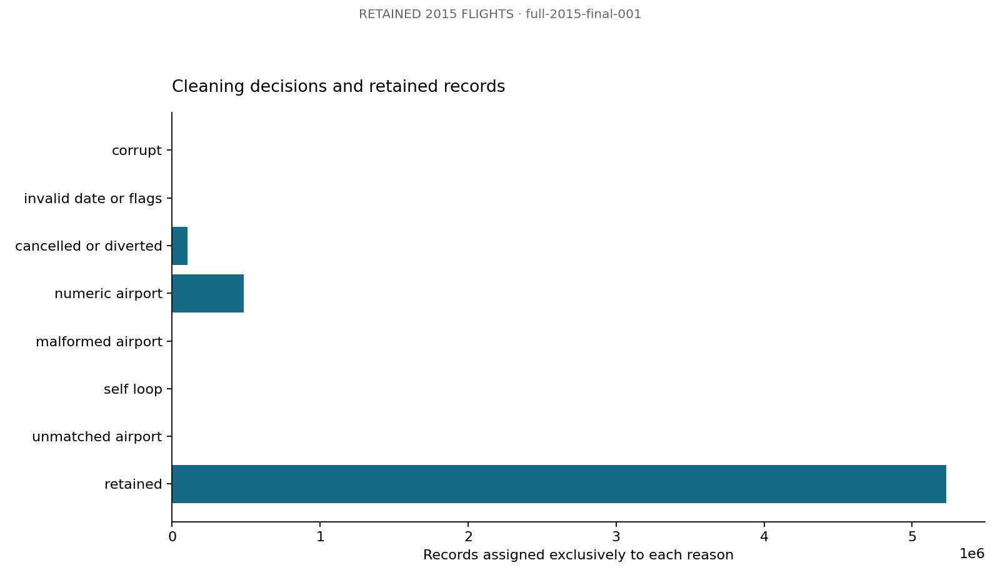

Cleaning decisions and retained records. Source: `full-2015-final-001` aggregate tables.

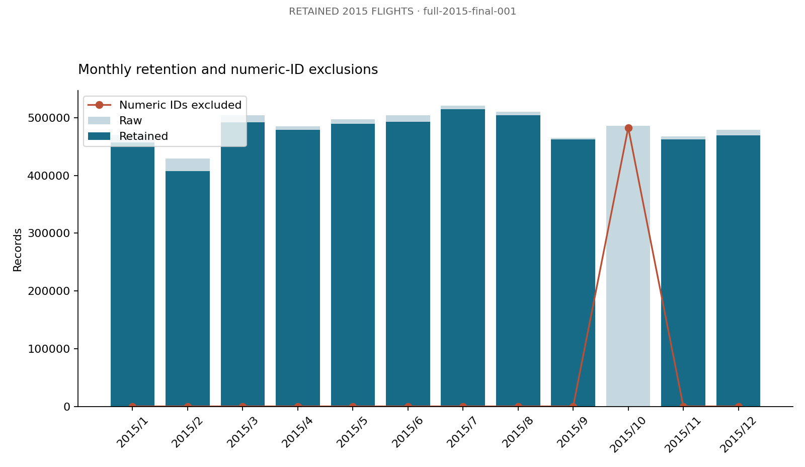

Monthly retention and numeric-ID exclusions. Source: `full-2015-final-001` aggregate tables.

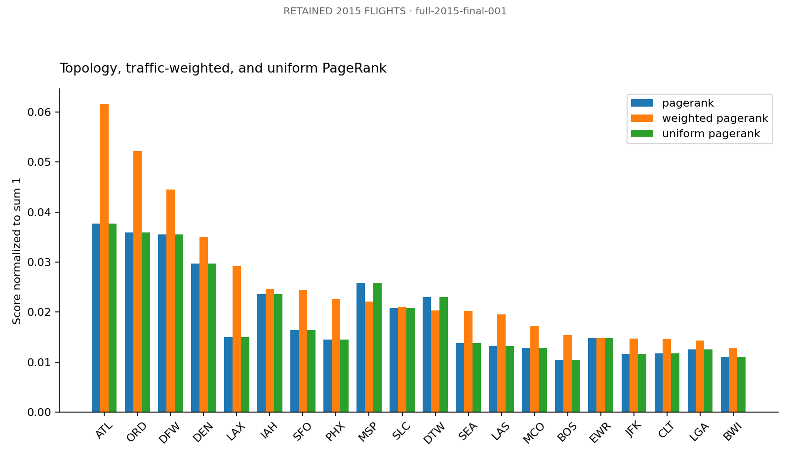

Topology, traffic-weighted, and uniform PageRank. Source: `full-2015-final-001` aggregate tables.

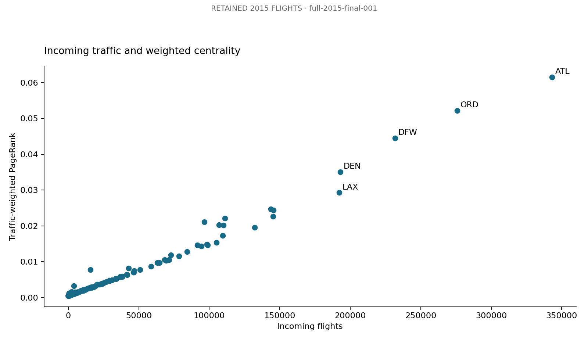

Incoming traffic and weighted centrality. Source: `full-2015-final-001` aggregate tables.

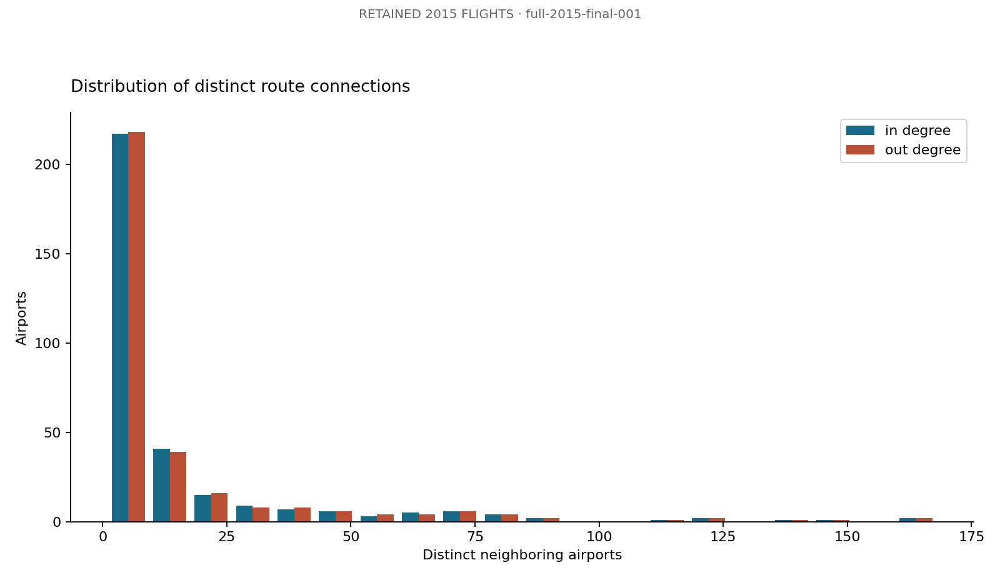

Distribution of distinct route connections. Source: `full-2015-final-001` aggregate tables.

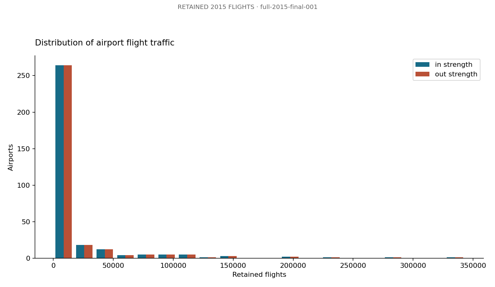

Distribution of airport flight traffic. Source: `full-2015-final-001` aggregate tables.

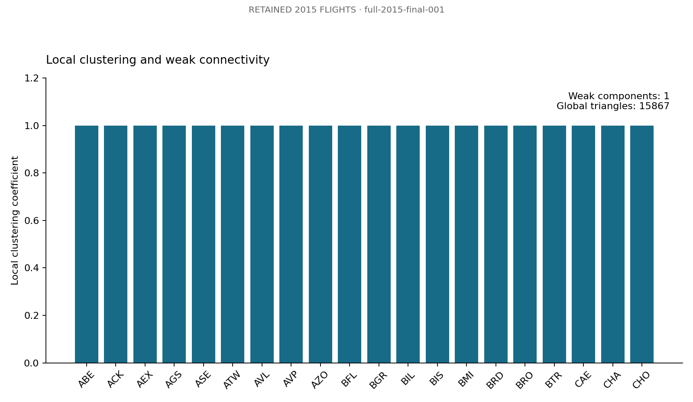

Local clustering and weak connectivity. Source: `full-2015-final-001` aggregate tables.

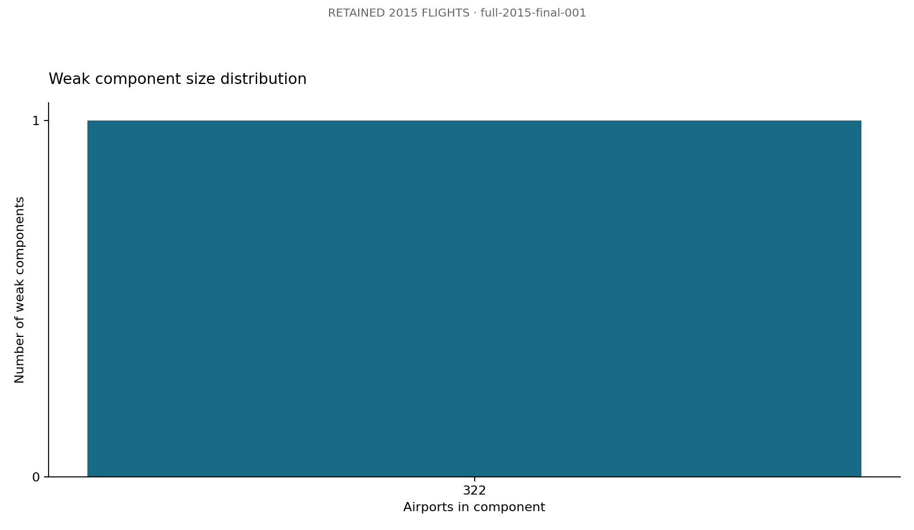

Weak component size distribution. Source: `full-2015-final-001` aggregate tables.

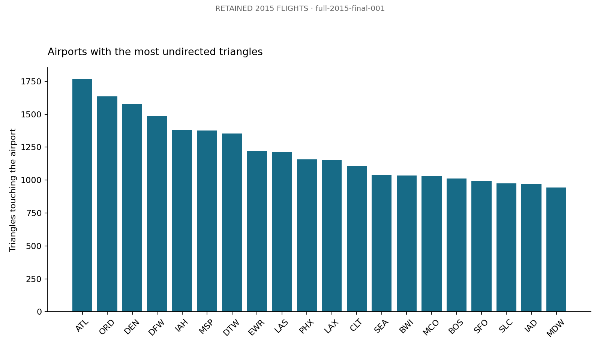

Airports with the most undirected triangles. Source: `full-2015-final-001` aggregate tables.

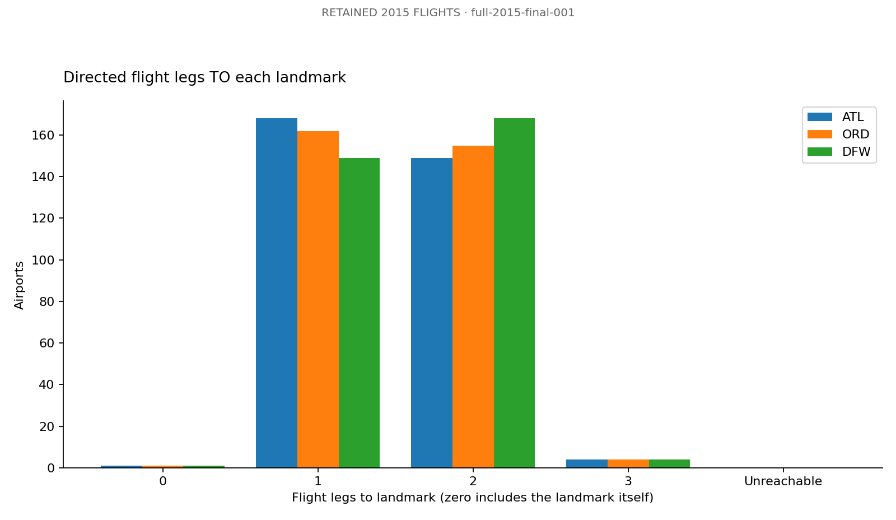

Directed flight legs TO each landmark. Source: `full-2015-final-001` aggregate tables.

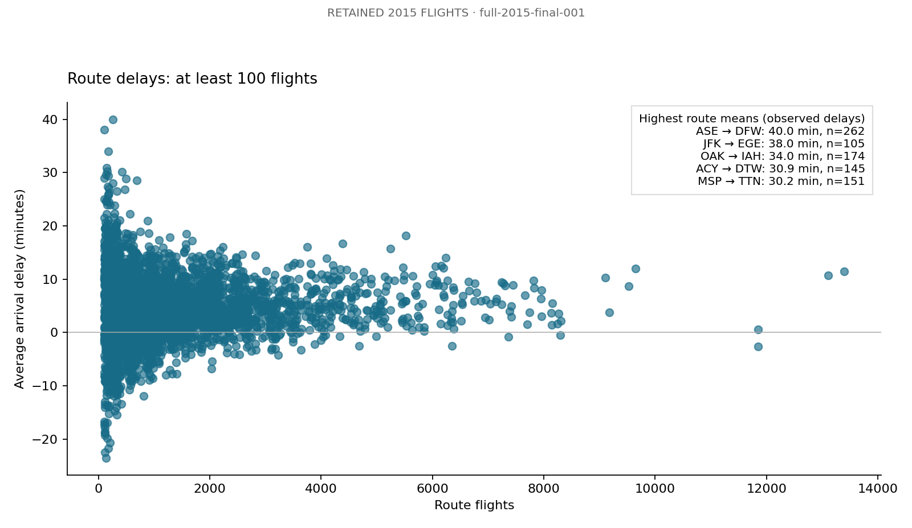

Route delays: at least 100 flights. Source: `full-2015-final-001` aggregate tables.

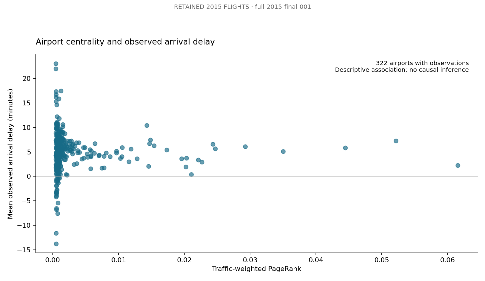

Airport centrality and observed arrival delay. Source: `full-2015-final-001` aggregate tables.

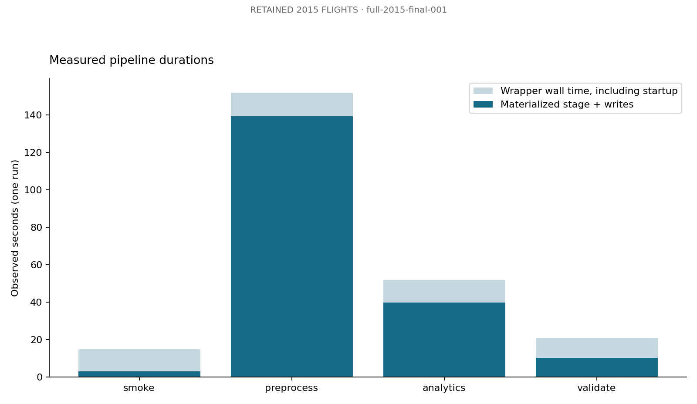

Measured pipeline durations. Source: `full-2015-final-001` aggregate tables.

## Timing boundaries

| stage | materialized_seconds | wrapper_seconds |
| --- | --- | --- |
| analytics | 39.732363202 | 52 |
| preprocess | 139.319272724 | 152 |
| smoke | 2.988209956 | 15 |
| validate | 10.221631826 | 21 |

Wrapper time includes process startup and Scala compilation. Stage time includes materialized computation and writes, but excludes REPL startup. Weighted algorithm compute is separately measured in its JSON; its row in algorithm_timings measures result materialization and writing after iteration. No statistical performance or multi-node scalability claim is supported by these measurements.

# Conclusion

The native HDFS, Spark SQL, and GraphX pipeline processed the acquired 2015 flight files and passed the recorded checks. Traffic-weighted and topology centrality, connectivity, local structure, directed hub distances, and delay associations are reported from the same retained network. The monthly exclusions are material to their interpretation.

The experiment uses a single machine and cannot demonstrate multi-node speedup or physical replication. A clean-machine installation is documented but was not executed on a separate computer. Future extensions include a verified date-specific numeric-ID crosswalk, temporal networks, community detection, weather-adjusted delay models, and a multi-node evaluation. Replace the editable member names before submission; equal contributions were requested by the team.

# Appendix A — Complete Reproduction Procedure

### Airline graph analytics

CSE412, Track C: native Spark SQL and Scala GraphX, with HDFS as the intended
storage boundary. The build specification is preserved in [plan.md](plan.md).

**Current status:** the complete native HDFS → Spark SQL → GraphX pipeline has
passed on the real US DOT dataset. Selected run: `full-2015-final-001`.
It read 5,819,079 flight records, retained 5,231,130, and produced 322 airports
and 4,656 directed routes. All 31 saved-output checks and 16 full-export checks
passed. The HDFS fixture also passed its 57 export/oracle checks and seven
explicit graph cases. The final report includes 13 measured figures. A second full HDFS run,
`full-2015-final-002`, passed and reproduced all 14 non-timing exported tables
within tolerance 1e-8; input hashes, parameters and algorithm source matched.

**Coverage limitation:** all October records are excluded from the retained
network. Numeric identifiers account for 482,878 October exclusions after the
cancellation/diversion filter. Do not present these results as complete-year
service coverage. [Measured findings](docs/full_data_findings.md),
[dataset provenance](docs/dataset_provenance.md), and the
[execution log](docs/execution_log.md) describe the exact scope.

#### What is implemented

Environment inspection, dataset manifests and hashes, guarded HDFS ingestion,
Scala cleaning and Parquet persistence, GraphX algorithms, saved-output
validation, fixture oracles, export, plotting, report generation, and source
packaging. Scripts use native tools already on PATH; no Docker, SBT, database,
web application, or Python graph library is required.

```text
CSV inputs -> inspect/hash -> HDFS raw files
  -> Spark SQL cleaning/audit -> clean Parquet vertices/edges
  -> reload -> Scala GraphX -> results Parquet + CSV parts
  -> reload validation -> aggregate exports -> Python checks/figures/report
```

HDFS, Spark preprocessing, and GraphX are three course-tool capabilities;
GraphX runs within Spark. The default Spark master is `local[2]`. Single-node
HDFS with replication one does not provide physical-node redundancy.

The research questions compare topology and traffic centrality, weak
connectivity, neighborhood triangles, directed distances to hubs, descriptive
delays, numeric-ID exclusions, and observed processing cost. PageRank is not a
safety or profitability score. Delay association does not demonstrate causality.

#### Tested environment

| Component | Observed version / condition |
| --- | --- |
| OS | Fedora Linux 44, x86_64 |
| Spark | 3.5.9, Hadoop 3 / Scala 2.13 distribution |
| Scala | 2.13.8 |
| Spark JVM | Temurin OpenJDK 17.0.16+8 |
| Hadoop installation | 3.4.1; HDFS read/write and fsck verified |
| Hadoop daemon JVM | Temurin 11.0.32.1+1; separate from Spark JVM |
| Hadoop client in Spark | 3.3.4 (recorded in stage metadata) |
| Python / matplotlib | 3.14.8 / 3.10.8 |
| Resources | About 14 GiB RAM and 42 GiB free disk at initial inspection; 2 GiB driver heap |

Exact CPU count, version output, filesystem URI, and probe errors are recorded
in each run's `artifacts/<run_id>/environment.txt`. Recheck resources before a
full run. The fixture takes a few minutes, mostly separate REPL startup and
compilation. Recorded timings are observations, not a performance guarantee.

#### Reuse the existing installation

Run from this directory:

```bash
cp -n config/project.env.example config/project.env
### Edit config/project.env for this machine if discovery is insufficient.
bash scripts/check_environment.sh --run-id environment-check
python3 -m venv .venv
source .venv/bin/activate
python3 -m pip install -r requirements.txt
```

The environment checker returns nonzero if a probe fails and retains evidence.
The fixture pipeline permits an unavailable HDFS probe only in the explicit
local development mode; actual stage failures always stop the run.

Hadoop 3.3/3.4 daemons use JDK 11 in this project. Keep Spark on JDK 17. Install
a supported JDK 11 using your distribution or [Temurin](https://adoptium.net/temurin/releases?version=11),
set `HADOOP_JAVA_HOME` in the project config, and make the existing
`hadoop-env.sh` honor that path. Its current unconditional `JAVA_HOME` assignment
must honor the daemon JDK; setting the shell variable alone is insufficient.
For an existing installation with one active JAVA_HOME assignment and no local
project.env yet, `bash scripts/configure_native.sh /absolute/path/to/jdk11`
backs up hadoop-env.sh, changes that assignment, and writes project.env.
It never initializes or formats HDFS storage.
See [Hadoop Java compatibility](https://cwiki.apache.org/confluence/spaces/HADOOP/pages/100827883/Hadoop%2BJava%2BVersions).

```bash
bash scripts/start_hdfs.sh
hdfs getconf -confKey fs.defaultFS
hdfs dfsadmin -report
bash scripts/run_pipeline.sh --mode fixture --run-id fixture-hdfs-check
```

Startup uses direct local daemons, so passwordless SSH is unnecessary. The script
never formats a NameNode. The existing `hdfs://localhost:9000` URI is preserved.
Inspect the configured NameNode UI address using `hdfs getconf -confKey
dfs.namenode.http-address`; commonly it is localhost:9870. This wrapper disables
Spark's application UI for automated runs. An enabled application UI usually
uses 4040; 8080 belongs to an optional standalone master, not this execution mode.

Ordinary service shutdown, when no other work uses this cluster:

```bash
hdfs --daemon stop datanode
hdfs --daemon stop namenode
```

#### Clean Linux installation

This installation route is documented, not executed on a clean machine during
this implementation. Prerequisites are Bash, Python >=3.11, curl, tar, sha512sum,
JDK 17 for Spark, and JDK 11 for Hadoop 3.4.1. Use separate JDK directories.
Archive filenames were verified against the Apache listings on 2026-10-13.
They reproduce the inspected versions, not a recommendation for an exposed
production cluster.

```bash
mkdir -p "$HOME/airline-tools"
cd "$HOME/airline-tools"
curl -fLO https://archive.apache.org/dist/spark/spark-3.5.9/spark-3.5.9-bin-hadoop3-scala2.13.tgz
curl -fLO https://archive.apache.org/dist/spark/spark-3.5.9/spark-3.5.9-bin-hadoop3-scala2.13.tgz.sha512
sha512sum -c spark-3.5.9-bin-hadoop3-scala2.13.tgz.sha512
curl -fLO https://archive.apache.org/dist/hadoop/common/hadoop-3.4.1/hadoop-3.4.1.tar.gz
curl -fLO https://archive.apache.org/dist/hadoop/common/hadoop-3.4.1/hadoop-3.4.1.tar.gz.sha512
sha512sum -c hadoop-3.4.1.tar.gz.sha512
tar -xzf spark-3.5.9-bin-hadoop3-scala2.13.tgz
tar -xzf hadoop-3.4.1.tar.gz
export SPARK_HOME="$HOME/airline-tools/spark-3.5.9-bin-hadoop3-scala2.13"
export HADOOP_HOME="$HOME/airline-tools/hadoop-3.4.1"
export HADOOP_CONF_DIR="$HADOOP_HOME/etc/hadoop"
export PATH="$SPARK_HOME/bin:$HADOOP_HOME/bin:$PATH"
```

Set `JAVA_HOME` to the actual JDK 17 directory and `HADOOP_JAVA_HOME` to the
actual JDK 11 directory. For a **new installation with verified empty storage**,
adapt the three templates in `config/hadoop/`. They use a project-specific
directory under the account home, replication one, and port 9000. Apply them
only to the new installation. Initialize that new NameNode once with
`hdfs namenode -format`, then use the ordinary startup command above. Never run
format against existing storage, including the machine inspected here.

#### Configuration

Scripts resolve `PROJECT_ROOT` from their location. `config/project.env` is a
trusted shell file, ignored by source control; never store dataset tokens there.
Command flags override its defaults and child stages inherit the effective
configuration. Tool homes are discovered from PATH when absent.

| Variable | Default / validation |
| --- | --- |
| PROJECT_ROOT | Script-relative project root |
| JAVA_HOME | Existing environment; use Spark-compatible JDK 17 |
| HADOOP_JAVA_HOME | No guessed default; startup requires supported daemon JDK |
| HADOOP_HOME / SPARK_HOME | Discovered from installed commands |
| HADOOP_CONF_DIR | `$HADOOP_HOME/etc/hadoop` |
| HDFS_BASE | `/user/${USER}/airline_graph`; absolute safe path, no dots or traversal |
| MODE | `fixture` or `full` |
| STORAGE | `hdfs`; `local` allowed only with fixture mode |
| RUN_ID / DATASET_ID | Mode-prefixed UTC timestamp and process ID; safe letters/digits/underscores/hyphens, max 96 characters |
| DATA_DIR | `tests/fixtures` in fixture mode; `data/raw` in full mode |
| SPARK_MASTER | `local[2]`; passed to Spark for validation |
| DRIVER_MEMORY | `2g`; Spark validates memory syntax |
| SHUFFLE_PARTITIONS / GRAPH_PARTITIONS | `4`; positive integers |
| PR_RESET_PROB | `0.15`, strictly between 0 and 1 |
| BASELINE_PR_ITERATIONS | `20`, positive integer |
| WEIGHTED_PR_TOL | `1e-8`, strictly between 0 and 1 |
| WEIGHTED_PR_MAX_ITERATIONS | `100`, positive integer |
| LANDMARK_IATA | `ATL,ORD,DFW`; distinct three-letter uppercase codes, all must exist |
| TOP_N / MIN_ROUTE_FLIGHTS | `20` / `100`; positive integers; latter is a chart threshold only |

Flags: `--mode`, `--storage`, `--run-id`, `--dataset-id`, `--data-dir`.
Every run gets a manifest with configuration, input hashes, mode, stage markers,
timestamps, and status. Reuse a dataset ID only for identical input bytes.
Use a new run ID for every attempt; failed runs are preserved, never overwritten.

#### Reproduce the tested fixture

```bash
bash scripts/run_pipeline.sh --mode fixture --storage local --run-id fixture-demo
bash scripts/validate_results.sh --run-id fixture-demo
python3 src/python/collect_test_evidence.py --run-id fixture-demo
python3 src/python/plot_results.py --run-id fixture-demo
python3 src/python/generate_report.py --run-id fixture-demo
python3 -m unittest discover -s tests -v
bash tests/test_failure_handling.sh
bash scripts/run_pipeline.sh --mode fixture --storage local --run-id fixture-repeat
python3 tests/compare_runs.py fixture-demo fixture-repeat
bash scripts/package_submission.sh --run-id fixture-demo
```

The current HDFS correctness run is `fixture-hdfs-final-002`. The historical
local runs `fixture-local-001` and `fixture-local-002` are retained as earlier evidence. The fixture has 21 raw records, 10 retained flights, five
active airports, seven directed routes, seven numeric delay observations, and
75 summed delay minutes. All-null delays stay null and negative delays remain
negative. The HDFS fixture passed 31 Scala checks and 57 export/oracle checks.
The two historical local runs agreed across 17 non-timing export tables within 1e-8.

Run-specific CSVs live in `data/exported/<run_id>`, diagnostics in
`artifacts/<run_id>`, and figures in `report/figures/<run_id>`. `_SUCCESS` files
alone are insufficient evidence: the wrapper checks its exact completion line,
persisted stage marker, and validation. The report generator requires a fully
validated run, correct figure hashes, and matching run IDs.

#### Acquire and run real data

Use [US DOT 2015 Flight Delays and Cancellations](https://www.kaggle.com/datasets/usdot/flight-delays).
The acquisition helper downloads the public archive and publisher metadata,
checks its dataset identity and three-file inventory, verifies ZIP integrity,
and records source, version, license, acquisition time and SHA-256 checksums.
This retrieval requires no credentials. If the service changes its access
requirements, obtain access through Kaggle and retain the same provenance
contract rather than inventing metadata. Raw data and runtime downloads are
excluded from submission archives.

```bash
bash scripts/download_dataset.sh --mode full --dataset-id usdot-2015
bash scripts/run_pipeline.sh --mode full --dataset-id usdot-2015 --run-id full-2015
bash scripts/validate_results.sh --run-id full-2015
bash scripts/capture_hdfs_evidence.sh --mode full --dataset-id usdot-2015 --run-id full-2015
python3 src/python/plot_results.py --run-id full-2015
python3 src/python/generate_report.py --run-id full-2015
bash scripts/package_submission.sh --run-id full-2015
```

The pipeline includes ingestion and export. `ingest_hdfs.sh` may also be run
independently with matching mode/dataset flags. `export_results.sh` uses the
recorded run manifest and refuses to overwrite an existing export. Its result
is already present after a successful pipeline run.

To inspect HDFS, use the effective base from the manifest:

```bash
hdfs dfs -ls -h "/user/${USER}/airline_graph/raw/usdot-2015"
hdfs dfs -du -h "/user/${USER}/airline_graph/raw/usdot-2015"
hdfs dfs -ls "/user/${USER}/airline_graph/runs/full-2015/results"
```

For individual stages in a fresh run, pass the same mode, storage, dataset ID,
and run ID to `run_scala_stage.sh smoke`, `preprocess`, `analytics`, `validate`,
and `test` (fixture only), in that order. The full wrapper is preferred because
it also constructs the run manifest and handles failed-run status.

#### Policies and operational limits

The cleaning funnel is ordered: corrupt row, invalid date/flags, cancellation
or diversion, numeric airport ID, malformed airport ID, self-loop, unmatched
airport, retained. The exclusive counts reconcile to raw records. Numeric IDs
can bias monthly coverage, so retained data must not be described as complete
2015 coverage without inspecting the audit. Exact duplicates are diagnosed but
retained; repeated flight routes are traffic, not duplicate graph edges.

IDs are deterministic lexicographic IATA indexes over active airports. Route
delays use non-null observation denominators. Airport mean delay is weighted by
those denominators. The directed graph retains reciprocal edges. All algorithms
reload the persisted graph, and validation reloads all saved result tables.

Weighted PageRank uses `alpha/N + (1-alpha)*(incoming_weighted_mass + dangling_mass/N)`.
It starts at `1/N`, checkpoints every ten iterations, and fails validation if
it does not converge or conserve score mass. A uniform custom baseline helps
separate weighting effects from the built-in fixed-iteration GraphX baseline.
Triangle sum divided by three gives the global count; clustering is
`2*T/(degree*(degree-1))`, zero for degree below two. Paths go **to** each hub;
null is unreachable, zero is a self-distance. Missing required hubs fail explicitly.

See [architecture](docs/architecture.md), [data dictionary](docs/data_dictionary.md),
[troubleshooting](docs/troubleshooting.md), [execution log](docs/execution_log.md),
and [literature survey](docs/literature_survey.md). No external reference-repository
code was adapted. HDFS connectivity and full-data behavior have been executed
and validated. Clean-machine installation on a second computer and multi-node
performance remain untested. Edit the Member 1/2/3 labels in contributions.md
before submission; the team requested an equal one-third contribution split.

#### Selected deliverables and reruns

- `artifacts/submission-full-2015-final-001.zip`: source, report, figures and compact evidence; extracted tests pass.
- `report/project_report.md`: six main sections, required appendices and full current source listings.
- `report/figures/full-2015-final-001/`: thirteen verified figures and their manifest.
- `artifacts/full-2015-final-001/metrics.json`: consolidated measured analysis.
- `artifacts/test_evidence.json`: compact synthetic correctness evidence, explicitly separate from full findings.
- `guide.md`: detailed setup, execution, recovery and acceptance procedure.

The configured machine is ready to reproduce the pipeline after `bash scripts/start_hdfs.sh`.
The project-local JDK under `.runtime` is deliberately omitted from the ZIP; a
new machine must install its own supported JDKs and set its configuration.
Some automated execution environments terminate background daemons when their
launching command exits. Keep a terminal session open throughout the HDFS run.
A normal interactive shell does not require the automation-specific workaround.

To rebuild the selected report after editing member names or documentation:

```bash
python3 src/python/plot_results.py --run-id full-2015-final-001
python3 src/python/generate_report.py --run-id full-2015-final-001
python3 -m unittest discover -s tests -v
### If an archive already exists, preserve it under a different name first.
bash scripts/package_submission.sh --run-id full-2015-final-001
```

Reproduction commands use fresh run IDs; existing runs and archive paths are
never silently overwritten. Changes to computational Scala code or the stage
runner require a new full run before the report can be regenerated.

At handoff, the project-started HDFS daemons were stopped cleanly after verification.
All HDFS data remains intact. Run `bash scripts/start_hdfs.sh` before a live demo
or new Spark/HDFS run; the saved report and exported-result analysis need no service.

# Appendix B — Complete Source Code and Configuration

| file | sha256 |
| --- | --- |
| .gitignore | 57f5631e4b9ff92eea74acd9c357aa4bf780f25b939030860d0400d6fdc3534e |
| README.md | 6b1c3201aede69d6fb9f7632378af8c043cdda4cbc488f18871b9d1642f26892 |
| config/hadoop/core-site.xml.example | 0610568f517b17edf690bf99783d649f73ec95a683ffd63a6d6c733aeaf79ed7 |
| config/hadoop/hadoop-env.sh.example | d8895105a6bc59534598014bae250f0ef99b31ebf34a92c343d096682c54efa8 |
| config/hadoop/hdfs-site.xml.example | 990e720afb247818f6e9cecca91b37551a749256067b78aa7c0e14247b9533b8 |
| config/project.env.example | 326d38ca6169a024f98c68c0b6e8a3512e1e70590801150247413b77fe6d56f0 |
| requirements.txt | 0e97de6da22c7c903f31dd290ef2e4416e92ea89187c6a159fd2644a3eed0b46 |
| scripts/capture_hdfs_evidence.sh | 8a175315c0cfdf9862beefff8d6915f454ef5e7817ab173683d0e1fc46ab8313 |
| scripts/check_environment.sh | 00f1bb53230850c903775afd8172b0ade3a679b314400243dffb5552f69ca16c |
| scripts/common.sh | 75e3276b4024a4d7609a498788afc4fd421e80eaa3e7d32ca1505d53e412cbd3 |
| scripts/configure_native.sh | bc033b91ae82888c8321e1a400707f64cad2bde93ad2c5f80ba5a7790e9040f5 |
| scripts/download_dataset.sh | 30bf939891d623b51aee36b6928b038316998d18e7802eaeabaaab8dc0331c14 |
| scripts/export_results.sh | c619aa907969b33bab7cd3f4054948a17b6cb7802d006e8ea40f462358388d1e |
| scripts/ingest_hdfs.sh | a535fad1e5dedb7dbd358f12904d6076036c2c26fe800e9b4bd6c8a91bbe5be6 |
| scripts/package_submission.sh | ee460a732785406b8aaa901a09be1a8dedd11e79c275d1c7f13d64c4a6eaa590 |
| scripts/run_pipeline.sh | 971dc889564b13117206d661e0926778acb516b10ce026c6783e2c065b538060 |
| scripts/run_scala_stage.sh | faf2208711bddb426daa2ff126e45edb5b50dd2203ef41fe72ae9057b60fd609 |
| scripts/start_hdfs.sh | 231830bbcfcef140a0eee0d962c0a84613ea5d0bba5f2b8d3431fc565ee09c6f |
| scripts/validate_results.sh | b8d5e4ed603ada47c3b7d83fdd45a23f183badd9a5fadc9bdd7b72b30fa18179 |
| src/python/acquire_dataset.py | e18b38f835e5d470973ad77dbf9e92ef10c95f5039329101a8d2c59d2e3cc5b6 |
| src/python/analyze_results.py | 3157c13eb6ded369d7b54f7ddb74b2912594509240f80decb53913c7e765b04a |
| src/python/collect_test_evidence.py | d3599cf584135d681bccbd6b7f6b83aafbd5672215789bed80d76ee3f854b43e |
| src/python/export_results.py | a7c6a6f3b99ad224bed6cdf1b32cd8e70992aac1ccddbef2d76923e03adaaf7c |
| src/python/generate_report.py | c475c1e6981d2727cecab709b0be8d16cd00955810ebf1c747f0b45f328fee96 |
| src/python/input_manifest.py | 4cd3f472c6b47ab50c8f23d936727078dea838ccfd2a1dfc4f966c09731b7451 |
| src/python/package_submission.py | 98ef7db0c173caa3d31a0837f80bf9ff2822e5e940f3ed792404ecf8131d0445 |
| src/python/plot_results.py | d5bd57358cc091bef180e170ecb793a7f8ddbc97a968c1513c4cb0bda7ba698c |
| src/python/run_manifest.py | 2de46641dcd38456893bcee5dfca3ffd61b6dfc308bf6bae7634eca379a09735 |
| src/python/summarize_results.py | a17b4e855aa49301ef486008955e3197517bec2332e36f43b467c8d0748a2ec4 |
| src/scala/GraphAnalytics.scala | dc24fcf3185629de8099addbc292321e9b1954d503f23c68cbd067d2c3372e70 |
| src/scala/Pipeline.scala | 9358fc25368e8e705d86457c26344ec1845b529c1d56480354f1e41be7e79df0 |
| src/scala/Preprocess.scala | 636190e128b62e06c5bba685704390cd6acffe5a5a41c2d45a65b6bc83fe57b1 |
| src/scala/ProjectConfig.scala | 6e9d9cf5e5a2ee5dc303d8ba2c50d2f5f5d0d6bd235a064626b2f6ef31868494 |
| src/scala/Validation.scala | 84eddd70152e89afcbd342218ec40b7254af91049e978b74a9ee8a4b952b3ebc |
| src/scala/WeightedPageRank.scala | 61b0d18025d3eea9d6dca176dd0841064414c4c91725b8d21ff157b45709e12a |
| tests/compare_runs.py | 678695860d94d52e21cb591572bf22fdad064f50a1a684abdce7f5eb36a94be0 |
| tests/expected_fixture_results.json | bbe44bcdc93baeec78ee6c258a9e3f2fb0fa102029ef60724622e710b271e97d |
| tests/fixtures/airlines.csv | 8493db4a1ad05edbcc9e735a8c6885792cf2fd7d05481de16913a41594e9d2a3 |
| tests/fixtures/airports.csv | f62f429f771a58fe8c8af37ea346928175f98fd3fbb7b34bf79e96dd6d854db5 |
| tests/fixtures/flights.csv | ea01640cf3a67b0f9140c5ecb3eac98987337e659377c12861c0cac21896456c |
| tests/graph_correctness.scala | 897d741d502a3e38d53929986389d5e7cbc0612898caa15974ecbab20b827502 |
| tests/test_exports_and_report.py | 8d4f72bfb253e5e537a47044a8edc54755b85541157b9fb557cc8b54b22bc569 |
| tests/test_failure_handling.sh | 8596d50994ff80a5f10f9ffc6ac0e85e8d4ca065feda22c0811a4b6693a056ee |

## .gitignore

```text
config/project.env
data/raw/
data/exported/
artifacts/
.venv/
__pycache__/
*.pyc
*.zip
.sparkStaging/
metastore_db/
derby.log
spark-warehouse/
.runtime/
```

## README.md

````md
# Airline graph analytics

CSE412, Track C: native Spark SQL and Scala GraphX, with HDFS as the intended
storage boundary. The build specification is preserved in [plan.md](plan.md).

**Current status:** the complete native HDFS → Spark SQL → GraphX pipeline has
passed on the real US DOT dataset. Selected run: `full-2015-final-001`.
It read 5,819,079 flight records, retained 5,231,130, and produced 322 airports
and 4,656 directed routes. All 31 saved-output checks and 16 full-export checks
passed. The HDFS fixture also passed its 57 export/oracle checks and seven
explicit graph cases. The final report includes 13 measured figures. A second full HDFS run,
`full-2015-final-002`, passed and reproduced all 14 non-timing exported tables
within tolerance 1e-8; input hashes, parameters and algorithm source matched.

**Coverage limitation:** all October records are excluded from the retained
network. Numeric identifiers account for 482,878 October exclusions after the
cancellation/diversion filter. Do not present these results as complete-year
service coverage. [Measured findings](docs/full_data_findings.md),
[dataset provenance](docs/dataset_provenance.md), and the
[execution log](docs/execution_log.md) describe the exact scope.

## What is implemented

Environment inspection, dataset manifests and hashes, guarded HDFS ingestion,
Scala cleaning and Parquet persistence, GraphX algorithms, saved-output
validation, fixture oracles, export, plotting, report generation, and source
packaging. Scripts use native tools already on PATH; no Docker, SBT, database,
web application, or Python graph library is required.

```text
CSV inputs -> inspect/hash -> HDFS raw files
  -> Spark SQL cleaning/audit -> clean Parquet vertices/edges
  -> reload -> Scala GraphX -> results Parquet + CSV parts
  -> reload validation -> aggregate exports -> Python checks/figures/report
```

HDFS, Spark preprocessing, and GraphX are three course-tool capabilities;
GraphX runs within Spark. The default Spark master is `local[2]`. Single-node
HDFS with replication one does not provide physical-node redundancy.

The research questions compare topology and traffic centrality, weak
connectivity, neighborhood triangles, directed distances to hubs, descriptive
delays, numeric-ID exclusions, and observed processing cost. PageRank is not a
safety or profitability score. Delay association does not demonstrate causality.

## Tested environment

| Component | Observed version / condition |
| --- | --- |
| OS | Fedora Linux 44, x86_64 |
| Spark | 3.5.9, Hadoop 3 / Scala 2.13 distribution |
| Scala | 2.13.8 |
| Spark JVM | Temurin OpenJDK 17.0.16+8 |
| Hadoop installation | 3.4.1; HDFS read/write and fsck verified |
| Hadoop daemon JVM | Temurin 11.0.32.1+1; separate from Spark JVM |
| Hadoop client in Spark | 3.3.4 (recorded in stage metadata) |
| Python / matplotlib | 3.14.8 / 3.10.8 |
| Resources | About 14 GiB RAM and 42 GiB free disk at initial inspection; 2 GiB driver heap |

Exact CPU count, version output, filesystem URI, and probe errors are recorded
in each run's `artifacts/<run_id>/environment.txt`. Recheck resources before a
full run. The fixture takes a few minutes, mostly separate REPL startup and
compilation. Recorded timings are observations, not a performance guarantee.

## Reuse the existing installation

Run from this directory:

```bash
cp -n config/project.env.example config/project.env
# Edit config/project.env for this machine if discovery is insufficient.
bash scripts/check_environment.sh --run-id environment-check
python3 -m venv .venv
source .venv/bin/activate
python3 -m pip install -r requirements.txt
```

The environment checker returns nonzero if a probe fails and retains evidence.
The fixture pipeline permits an unavailable HDFS probe only in the explicit
local development mode; actual stage failures always stop the run.

Hadoop 3.3/3.4 daemons use JDK 11 in this project. Keep Spark on JDK 17. Install
a supported JDK 11 using your distribution or [Temurin](https://adoptium.net/temurin/releases?version=11),
set `HADOOP_JAVA_HOME` in the project config, and make the existing
`hadoop-env.sh` honor that path. Its current unconditional `JAVA_HOME` assignment
must honor the daemon JDK; setting the shell variable alone is insufficient.
For an existing installation with one active JAVA_HOME assignment and no local
project.env yet, `bash scripts/configure_native.sh /absolute/path/to/jdk11`
backs up hadoop-env.sh, changes that assignment, and writes project.env.
It never initializes or formats HDFS storage.
See [Hadoop Java compatibility](https://cwiki.apache.org/confluence/spaces/HADOOP/pages/100827883/Hadoop%2BJava%2BVersions).

```bash
bash scripts/start_hdfs.sh
hdfs getconf -confKey fs.defaultFS
hdfs dfsadmin -report
bash scripts/run_pipeline.sh --mode fixture --run-id fixture-hdfs-check
```

Startup uses direct local daemons, so passwordless SSH is unnecessary. The script
never formats a NameNode. The existing `hdfs://localhost:9000` URI is preserved.
Inspect the configured NameNode UI address using `hdfs getconf -confKey
dfs.namenode.http-address`; commonly it is localhost:9870. This wrapper disables
Spark's application UI for automated runs. An enabled application UI usually
uses 4040; 8080 belongs to an optional standalone master, not this execution mode.

Ordinary service shutdown, when no other work uses this cluster:

```bash
hdfs --daemon stop datanode
hdfs --daemon stop namenode
```

## Clean Linux installation

This installation route is documented, not executed on a clean machine during
this implementation. Prerequisites are Bash, Python >=3.11, curl, tar, sha512sum,
JDK 17 for Spark, and JDK 11 for Hadoop 3.4.1. Use separate JDK directories.
Archive filenames were verified against the Apache listings on 2026-10-13.
They reproduce the inspected versions, not a recommendation for an exposed
production cluster.

```bash
mkdir -p "$HOME/airline-tools"
cd "$HOME/airline-tools"
curl -fLO https://archive.apache.org/dist/spark/spark-3.5.9/spark-3.5.9-bin-hadoop3-scala2.13.tgz
curl -fLO https://archive.apache.org/dist/spark/spark-3.5.9/spark-3.5.9-bin-hadoop3-scala2.13.tgz.sha512
sha512sum -c spark-3.5.9-bin-hadoop3-scala2.13.tgz.sha512
curl -fLO https://archive.apache.org/dist/hadoop/common/hadoop-3.4.1/hadoop-3.4.1.tar.gz
curl -fLO https://archive.apache.org/dist/hadoop/common/hadoop-3.4.1/hadoop-3.4.1.tar.gz.sha512
sha512sum -c hadoop-3.4.1.tar.gz.sha512
tar -xzf spark-3.5.9-bin-hadoop3-scala2.13.tgz
tar -xzf hadoop-3.4.1.tar.gz
export SPARK_HOME="$HOME/airline-tools/spark-3.5.9-bin-hadoop3-scala2.13"
export HADOOP_HOME="$HOME/airline-tools/hadoop-3.4.1"
export HADOOP_CONF_DIR="$HADOOP_HOME/etc/hadoop"
export PATH="$SPARK_HOME/bin:$HADOOP_HOME/bin:$PATH"
```

Set `JAVA_HOME` to the actual JDK 17 directory and `HADOOP_JAVA_HOME` to the
actual JDK 11 directory. For a **new installation with verified empty storage**,
adapt the three templates in `config/hadoop/`. They use a project-specific
directory under the account home, replication one, and port 9000. Apply them
only to the new installation. Initialize that new NameNode once with
`hdfs namenode -format`, then use the ordinary startup command above. Never run
format against existing storage, including the machine inspected here.

## Configuration

Scripts resolve `PROJECT_ROOT` from their location. `config/project.env` is a
trusted shell file, ignored by source control; never store dataset tokens there.
Command flags override its defaults and child stages inherit the effective
configuration. Tool homes are discovered from PATH when absent.

| Variable | Default / validation |
| --- | --- |
| PROJECT_ROOT | Script-relative project root |
| JAVA_HOME | Existing environment; use Spark-compatible JDK 17 |
| HADOOP_JAVA_HOME | No guessed default; startup requires supported daemon JDK |
| HADOOP_HOME / SPARK_HOME | Discovered from installed commands |
| HADOOP_CONF_DIR | `$HADOOP_HOME/etc/hadoop` |
| HDFS_BASE | `/user/${USER}/airline_graph`; absolute safe path, no dots or traversal |
| MODE | `fixture` or `full` |
| STORAGE | `hdfs`; `local` allowed only with fixture mode |
| RUN_ID / DATASET_ID | Mode-prefixed UTC timestamp and process ID; safe letters/digits/underscores/hyphens, max 96 characters |
| DATA_DIR | `tests/fixtures` in fixture mode; `data/raw` in full mode |
| SPARK_MASTER | `local[2]`; passed to Spark for validation |
| DRIVER_MEMORY | `2g`; Spark validates memory syntax |
| SHUFFLE_PARTITIONS / GRAPH_PARTITIONS | `4`; positive integers |
| PR_RESET_PROB | `0.15`, strictly between 0 and 1 |
| BASELINE_PR_ITERATIONS | `20`, positive integer |
| WEIGHTED_PR_TOL | `1e-8`, strictly between 0 and 1 |
| WEIGHTED_PR_MAX_ITERATIONS | `100`, positive integer |
| LANDMARK_IATA | `ATL,ORD,DFW`; distinct three-letter uppercase codes, all must exist |
| TOP_N / MIN_ROUTE_FLIGHTS | `20` / `100`; positive integers; latter is a chart threshold only |

Flags: `--mode`, `--storage`, `--run-id`, `--dataset-id`, `--data-dir`.
Every run gets a manifest with configuration, input hashes, mode, stage markers,
timestamps, and status. Reuse a dataset ID only for identical input bytes.
Use a new run ID for every attempt; failed runs are preserved, never overwritten.

## Reproduce the tested fixture

```bash
bash scripts/run_pipeline.sh --mode fixture --storage local --run-id fixture-demo
bash scripts/validate_results.sh --run-id fixture-demo
python3 src/python/collect_test_evidence.py --run-id fixture-demo
python3 src/python/plot_results.py --run-id fixture-demo
python3 src/python/generate_report.py --run-id fixture-demo
python3 -m unittest discover -s tests -v
bash tests/test_failure_handling.sh
bash scripts/run_pipeline.sh --mode fixture --storage local --run-id fixture-repeat
python3 tests/compare_runs.py fixture-demo fixture-repeat
bash scripts/package_submission.sh --run-id fixture-demo
```

The current HDFS correctness run is `fixture-hdfs-final-002`. The historical
local runs `fixture-local-001` and `fixture-local-002` are retained as earlier evidence. The fixture has 21 raw records, 10 retained flights, five
active airports, seven directed routes, seven numeric delay observations, and
75 summed delay minutes. All-null delays stay null and negative delays remain
negative. The HDFS fixture passed 31 Scala checks and 57 export/oracle checks.
The two historical local runs agreed across 17 non-timing export tables within 1e-8.

Run-specific CSVs live in `data/exported/<run_id>`, diagnostics in
`artifacts/<run_id>`, and figures in `report/figures/<run_id>`. `_SUCCESS` files
alone are insufficient evidence: the wrapper checks its exact completion line,
persisted stage marker, and validation. The report generator requires a fully
validated run, correct figure hashes, and matching run IDs.

## Acquire and run real data

Use [US DOT 2015 Flight Delays and Cancellations](https://www.kaggle.com/datasets/usdot/flight-delays).
The acquisition helper downloads the public archive and publisher metadata,
checks its dataset identity and three-file inventory, verifies ZIP integrity,
and records source, version, license, acquisition time and SHA-256 checksums.
This retrieval requires no credentials. If the service changes its access
requirements, obtain access through Kaggle and retain the same provenance
contract rather than inventing metadata. Raw data and runtime downloads are
excluded from submission archives.

```bash
bash scripts/download_dataset.sh --mode full --dataset-id usdot-2015
bash scripts/run_pipeline.sh --mode full --dataset-id usdot-2015 --run-id full-2015
bash scripts/validate_results.sh --run-id full-2015
bash scripts/capture_hdfs_evidence.sh --mode full --dataset-id usdot-2015 --run-id full-2015
python3 src/python/plot_results.py --run-id full-2015
python3 src/python/generate_report.py --run-id full-2015
bash scripts/package_submission.sh --run-id full-2015
```

The pipeline includes ingestion and export. `ingest_hdfs.sh` may also be run
independently with matching mode/dataset flags. `export_results.sh` uses the
recorded run manifest and refuses to overwrite an existing export. Its result
is already present after a successful pipeline run.

To inspect HDFS, use the effective base from the manifest:

```bash
hdfs dfs -ls -h "/user/${USER}/airline_graph/raw/usdot-2015"
hdfs dfs -du -h "/user/${USER}/airline_graph/raw/usdot-2015"
hdfs dfs -ls "/user/${USER}/airline_graph/runs/full-2015/results"
```

For individual stages in a fresh run, pass the same mode, storage, dataset ID,
and run ID to `run_scala_stage.sh smoke`, `preprocess`, `analytics`, `validate`,
and `test` (fixture only), in that order. The full wrapper is preferred because
it also constructs the run manifest and handles failed-run status.

## Policies and operational limits

The cleaning funnel is ordered: corrupt row, invalid date/flags, cancellation
or diversion, numeric airport ID, malformed airport ID, self-loop, unmatched
airport, retained. The exclusive counts reconcile to raw records. Numeric IDs
can bias monthly coverage, so retained data must not be described as complete
2015 coverage without inspecting the audit. Exact duplicates are diagnosed but
retained; repeated flight routes are traffic, not duplicate graph edges.

IDs are deterministic lexicographic IATA indexes over active airports. Route
delays use non-null observation denominators. Airport mean delay is weighted by
those denominators. The directed graph retains reciprocal edges. All algorithms
reload the persisted graph, and validation reloads all saved result tables.

Weighted PageRank uses `alpha/N + (1-alpha)*(incoming_weighted_mass + dangling_mass/N)`.
It starts at `1/N`, checkpoints every ten iterations, and fails validation if
it does not converge or conserve score mass. A uniform custom baseline helps
separate weighting effects from the built-in fixed-iteration GraphX baseline.
Triangle sum divided by three gives the global count; clustering is
`2*T/(degree*(degree-1))`, zero for degree below two. Paths go **to** each hub;
null is unreachable, zero is a self-distance. Missing required hubs fail explicitly.

See [architecture](docs/architecture.md), [data dictionary](docs/data_dictionary.md),
[troubleshooting](docs/troubleshooting.md), [execution log](docs/execution_log.md),
and [literature survey](docs/literature_survey.md). No external reference-repository
code was adapted. HDFS connectivity and full-data behavior have been executed
and validated. Clean-machine installation on a second computer and multi-node
performance remain untested. Edit the Member 1/2/3 labels in contributions.md
before submission; the team requested an equal one-third contribution split.

## Selected deliverables and reruns

- `artifacts/submission-full-2015-final-001.zip`: source, report, figures and compact evidence; extracted tests pass.
- `report/project_report.md`: six main sections, required appendices and full current source listings.
- `report/figures/full-2015-final-001/`: thirteen verified figures and their manifest.
- `artifacts/full-2015-final-001/metrics.json`: consolidated measured analysis.
- `artifacts/test_evidence.json`: compact synthetic correctness evidence, explicitly separate from full findings.
- `guide.md`: detailed setup, execution, recovery and acceptance procedure.

The configured machine is ready to reproduce the pipeline after `bash scripts/start_hdfs.sh`.
The project-local JDK under `.runtime` is deliberately omitted from the ZIP; a
new machine must install its own supported JDKs and set its configuration.
Some automated execution environments terminate background daemons when their
launching command exits. Keep a terminal session open throughout the HDFS run.
A normal interactive shell does not require the automation-specific workaround.

To rebuild the selected report after editing member names or documentation:

```bash
python3 src/python/plot_results.py --run-id full-2015-final-001
python3 src/python/generate_report.py --run-id full-2015-final-001
python3 -m unittest discover -s tests -v
# If an archive already exists, preserve it under a different name first.
bash scripts/package_submission.sh --run-id full-2015-final-001
```

Reproduction commands use fresh run IDs; existing runs and archive paths are
never silently overwritten. Changes to computational Scala code or the stage
runner require a new full run before the report can be regenerated.

At handoff, the project-started HDFS daemons were stopped cleanly after verification.
All HDFS data remains intact. Run `bash scripts/start_hdfs.sh` before a live demo
or new Spark/HDFS run; the saved report and exported-result analysis need no service.
````

## config/hadoop/core-site.xml.example

```example
<?xml version="1.0"?>
<!-- New installation only. Preserve an existing cluster's configuration. -->
<configuration>
  <property><name>fs.defaultFS</name><value>hdfs://localhost:9000</value></property>
  <property><name>hadoop.tmp.dir</name><value>${user.home}/airline-hadoop/tmp</value></property>
</configuration>
```

## config/hadoop/hadoop-env.sh.example

```example
# Adapt the existing hadoop-env.sh instead of replacing it.
# Hadoop 3.4.x daemon runtime: provide a supported JDK 11 installation.
export JAVA_HOME="${HADOOP_JAVA_HOME:?Set HADOOP_JAVA_HOME to the daemon JDK}"
```

## config/hadoop/hdfs-site.xml.example

```example
<?xml version="1.0"?>
<!-- Never point an existing cluster at new storage as a troubleshooting shortcut. -->
<configuration>
  <property><name>dfs.replication</name><value>1</value></property>
  <property><name>dfs.namenode.name.dir</name><value>file://${user.home}/airline-hadoop/namenode</value></property>
  <property><name>dfs.datanode.data.dir</name><value>file://${user.home}/airline-hadoop/datanode</value></property>
  <property><name>dfs.namenode.http-address</name><value>localhost:9870</value></property>
</configuration>
```

## config/project.env.example

```example
# Copy to project.env. This is sourced as trusted shell configuration.
# PROJECT_ROOT is resolved by scripts/common.sh; no caller-specific paths needed.
# JAVA_HOME=/absolute/path/to/jdk17
# HADOOP_JAVA_HOME=/absolute/path/to/jdk11  # Hadoop 3.4.x daemon JVM
# HADOOP_HOME=/absolute/path/to/hadoop
# SPARK_HOME=/absolute/path/to/spark
# HADOOP_CONF_DIR=/absolute/path/to/hadoop/etc/hadoop
HDFS_BASE="/user/${USER}/airline_graph"
MODE=fixture
STORAGE=hdfs
SPARK_MASTER='local[2]'
DRIVER_MEMORY=2g
SHUFFLE_PARTITIONS=4
GRAPH_PARTITIONS=4
PR_RESET_PROB=0.15
BASELINE_PR_ITERATIONS=20
WEIGHTED_PR_TOL=1e-8
WEIGHTED_PR_MAX_ITERATIONS=100
LANDMARK_IATA=ATL,ORD,DFW
TOP_N=20
MIN_ROUTE_FLIGHTS=100
# DATASET_ID and RUN_ID default to unique mode-prefixed UTC timestamps.
# DATA_DIR defaults to tests/fixtures in fixture mode, data/raw in full mode.
```

## requirements.txt

```txt
# Core pipeline, independent oracle, and report tools use Python standard library.
# Tested plotting dependency on Python 3.14.8.
matplotlib==3.10.8
```

## scripts/capture_hdfs_evidence.sh

```sh
#!/usr/bin/env bash
# Capture health and output placement for a completed HDFS run.
source "$(dirname "$0")/common.sh" "$@"
[[ "$STORAGE" == hdfs && -f "$ARTIFACT_DIR/run_manifest.json" ]] || die 'Select an existing HDFS run'
python3 - "$ARTIFACT_DIR/run_manifest.json" "$RUN_ID" "$DATASET_ID" <<'PY'
import json, sys
manifest = json.load(open(sys.argv[1]))
assert manifest['run_id'] == sys.argv[2] and manifest['status'] == 'validated'
assert manifest['configuration']['DATASET_ID'] == sys.argv[3]
assert manifest['configuration']['STORAGE'] == 'hdfs'
PY
{
  date -u +%FT%TZ
  hdfs getconf -confKey fs.defaultFS
  hdfs dfsadmin -report
  hdfs dfs -ls -h "$RAW_URI"
  hdfs dfs -ls "$RUN_URI/clean" "$RUN_URI/results" "$RUN_URI/validation"
  hdfs fsck "$RAW_URI"
  hdfs fsck "$RUN_URI"
  "$HADOOP_JAVA_HOME/bin/java" -version 2>&1
  python3 - <<'PY'
from pathlib import Path
for process in Path('/proc').iterdir():
    if not process.name.isdigit():
        continue
    try:
        args = (process / 'cmdline').read_bytes().split(b'\0')
        classes = (b'org.apache.hadoop.hdfs.server.namenode.NameNode', b'org.apache.hadoop.hdfs.server.datanode.DataNode')
        for name in classes:
            if name in args:
                print(name.decode(), 'pid=' + process.name, 'java=' + str((process / 'exe').resolve()))
    except (PermissionError, FileNotFoundError, ProcessLookupError):
        pass
PY
} > "$ARTIFACT_DIR/hdfs-health.txt" 2>&1
echo "Saved HDFS health, file placement, and daemon JVM evidence for $RUN_ID"
```

## scripts/check_environment.sh

```sh
#!/usr/bin/env bash
source "$(dirname "$0")/common.sh" "$@"
mkdir -p "$ARTIFACT_DIR"
failed=0
probe() { echo; echo "> $*"; "$@" || { echo "FAILED: $*"; failed=1; }; }
{
  date -u +%FT%TZ
  uname -a
  cat /etc/os-release
  probe getconf _NPROCESSORS_ONLN
  probe free -h
  probe df -h "$PROJECT_ROOT"
  probe java -version
  probe hadoop version
  probe spark-submit --version
  probe spark-shell --version
  probe python3 --version
  probe hdfs getconf -confKey fs.defaultFS
  probe timeout 20 hdfs dfsadmin -report
  echo "HADOOP_CONF_DIR=$HADOOP_CONF_DIR"
  echo "HADOOP_JAVA_HOME=${HADOOP_JAVA_HOME:-not configured}"
  echo "Spark Hadoop client jars:"
  find "${SPARK_HOME:-/nonexistent}/jars" -maxdepth 1 -name 'hadoop-client-*.jar' -printf '%f\n'
  echo "environment_probe_failed=$failed"
  exit "$failed"
} 2>&1 | tee "$ARTIFACT_DIR/environment.txt"
```

## scripts/common.sh

```sh
#!/usr/bin/env bash
set -euo pipefail
PROJECT_ROOT="$(cd -- "$(dirname -- "${BASH_SOURCE[0]}")/.." && pwd)"
export PROJECT_ROOT
if [[ -z "${AIRLINE_CONFIG_LOADED:-}" && -f "$PROJECT_ROOT/config/project.env" ]]; then
  set -a
  source "$PROJECT_ROOT/config/project.env"
  set +a
fi
export AIRLINE_CONFIG_LOADED=1
die() { echo "ERROR: $*" >&2; exit 1; }
need() { command -v "$1" >/dev/null || die "Missing prerequisite: $1"; }
MODE=${MODE:-fixture}
STORAGE=${STORAGE:-hdfs}
while (($#)); do
  case "$1" in
    --mode|--storage|--run-id|--dataset-id|--data-dir)
      (($# >= 2)) || die "Missing value for $1"
      case "$1" in
        --mode) MODE=$2;; --storage) STORAGE=$2;; --run-id) RUN_ID=$2;;
        --dataset-id) DATASET_ID=$2;; --data-dir) DATA_DIR=$2;;
      esac
      shift 2;;
    *) die "Unknown option: $1";;
  esac
done
[[ "$MODE" =~ ^(fixture|full)$ ]] || die 'MODE must be fixture or full'
[[ "$STORAGE" =~ ^(hdfs|local)$ ]] || die 'STORAGE must be hdfs or local'
[[ "$STORAGE" != local || "$MODE" == fixture ]] || die 'Local storage is only allowed for fixture development'
RUN_ID=${RUN_ID:-${MODE}-$(date -u +%Y%m%dT%H%M%S)-$$}
DATASET_ID=${DATASET_ID:-$RUN_ID}
for identifier in "$RUN_ID" "$DATASET_ID"; do
  [[ "$identifier" =~ ^[A-Za-z0-9][A-Za-z0-9_-]{0,95}$ ]] || die "Unsafe identifier: $identifier"
done
[[ "${USER:-}" =~ ^[A-Za-z0-9_-]+$ ]] || die 'Unsafe or missing USER'
HDFS_BASE=${HDFS_BASE:-/user/${USER}/airline_graph}
[[ "$HDFS_BASE" =~ ^/[A-Za-z0-9_/-]+$ && "$HDFS_BASE" != *..* && "$HDFS_BASE" != / ]] || die 'Unsafe HDFS_BASE'
if [[ "$MODE" == fixture ]]; then DATA_DIR=${DATA_DIR:-$PROJECT_ROOT/tests/fixtures};
else DATA_DIR=${DATA_DIR:-$PROJECT_ROOT/data/raw}; fi
SPARK_MASTER=${SPARK_MASTER:-local[2]}
DRIVER_MEMORY=${DRIVER_MEMORY:-2g}
SHUFFLE_PARTITIONS=${SHUFFLE_PARTITIONS:-4}
GRAPH_PARTITIONS=${GRAPH_PARTITIONS:-4}
PR_RESET_PROB=${PR_RESET_PROB:-0.15}
BASELINE_PR_ITERATIONS=${BASELINE_PR_ITERATIONS:-20}
WEIGHTED_PR_TOL=${WEIGHTED_PR_TOL:-1e-8}
WEIGHTED_PR_MAX_ITERATIONS=${WEIGHTED_PR_MAX_ITERATIONS:-100}
LANDMARK_IATA=${LANDMARK_IATA:-ATL,ORD,DFW}
TOP_N=${TOP_N:-20}
MIN_ROUTE_FLIGHTS=${MIN_ROUTE_FLIGHTS:-100}
for number in "$SHUFFLE_PARTITIONS" "$GRAPH_PARTITIONS" "$BASELINE_PR_ITERATIONS" "$WEIGHTED_PR_MAX_ITERATIONS" "$TOP_N" "$MIN_ROUTE_FLIGHTS"; do
  [[ "$number" =~ ^[1-9][0-9]*$ ]] || die "Expected positive integer: $number"
done
if [[ -z "${HADOOP_HOME:-}" ]] && command -v hadoop >/dev/null; then HADOOP_HOME=$(dirname "$(dirname "$(readlink -f "$(command -v hadoop)")")"); fi
if [[ -z "${SPARK_HOME:-}" ]] && command -v spark-shell >/dev/null; then SPARK_HOME=$(dirname "$(dirname "$(readlink -f "$(command -v spark-shell)")")"); fi
HADOOP_CONF_DIR=${HADOOP_CONF_DIR:-${HADOOP_HOME:-/nonexistent}/etc/hadoop}
ARTIFACT_DIR="$PROJECT_ROOT/artifacts/$RUN_ID"
if [[ "$STORAGE" == hdfs ]]; then
  RAW_URI="$HDFS_BASE/raw/$DATASET_ID"
  RUN_URI="$HDFS_BASE/runs/$RUN_ID"
else
  RAW_URI="file://$DATA_DIR"
  RUN_URI="file://$ARTIFACT_DIR/local-store"
fi
export MODE STORAGE RUN_ID DATASET_ID DATA_DIR HDFS_BASE HADOOP_HOME SPARK_HOME HADOOP_CONF_DIR
export SPARK_MASTER DRIVER_MEMORY SHUFFLE_PARTITIONS GRAPH_PARTITIONS PR_RESET_PROB
export BASELINE_PR_ITERATIONS WEIGHTED_PR_TOL WEIGHTED_PR_MAX_ITERATIONS LANDMARK_IATA
export TOP_N MIN_ROUTE_FLIGHTS ARTIFACT_DIR RAW_URI RUN_URI
```

## scripts/configure_native.sh

```sh
#!/usr/bin/env bash
# Explicit environment setup: preserves HDFS data and backs up the one edited file.
set -euo pipefail
root=$(cd "$(dirname "$0")/.." && pwd)
jdk=${1:?Usage: configure_native.sh ABSOLUTE_JDK11_DIRECTORY}
[[ "$jdk" == /* && -x "$jdk/bin/java" ]] || { echo 'Invalid JDK directory' >&2; exit 1; }
version=$("$jdk/bin/java" -version 2>&1)
[[ "$version" == *'version "11.'* ]] || { echo 'JDK 11 required' >&2; exit 1; }
hadoop_home=$(dirname "$(dirname "$(readlink -f "$(command -v hadoop)")")")
spark_home=$(dirname "$(dirname "$(readlink -f "$(command -v spark-shell)")")")
spark_java=$(dirname "$(dirname "$(readlink -f "$(command -v java)")")")
evidence="$root/artifacts/setup-completion"
mkdir -p "$evidence"
python3 - "$root" "$jdk" "$hadoop_home" "$spark_home" "$spark_java" <<'PY'
import pathlib, re, shlex, sys
root, jdk, hadoop, spark, java = sys.argv[1:]
root = pathlib.Path(root)
config = root / 'config/project.env'
if config.exists():
    raise SystemExit('Project config already exists; inspect it before reconfiguring')
path = pathlib.Path(hadoop) / 'etc/hadoop/hadoop-env.sh'
text = path.read_text()
backup = root / 'artifacts/setup-completion/hadoop-env.sh.before'
if not backup.exists():
    backup.write_text(text)
assignments = list(re.finditer(r'(?m)^export JAVA_HOME=.*$', text))
if len(assignments) != 1:
    raise SystemExit('Expected one active JAVA_HOME assignment; inspect configuration')
match = assignments[0]
updated = text[:match.start()] + 'export JAVA_HOME=' + shlex.quote(jdk) + text[match.end():]
path.write_text(updated)
values = dict(JAVA_HOME=java, HADOOP_JAVA_HOME=jdk, HADOOP_HOME=hadoop,
              SPARK_HOME=spark, HADOOP_CONF_DIR=str(path.parent))
config.write_text('\n'.join(k + '=' + shlex.quote(v) for k, v in values.items()) + '\n' +
                  'MODE=fixture\nSTORAGE=hdfs\nSPARK_MASTER="local[2]"\nDRIVER_MEMORY=2g\n')
print('Configured separate Hadoop/Spark JVMs; original Hadoop environment backed up. No storage changes.')
PY
```

## scripts/download_dataset.sh

```sh
#!/usr/bin/env bash
source "$(dirname "$0")/common.sh" --mode full "$@"
need curl
python3 "$PROJECT_ROOT/src/python/acquire_dataset.py" --data-dir "$DATA_DIR"
python3 "$PROJECT_ROOT/src/python/input_manifest.py"
```

## scripts/export_results.sh

```sh
#!/usr/bin/env bash
source "$(dirname "$0")/common.sh" "$@"
python3 "$PROJECT_ROOT/src/python/export_results.py"
```

## scripts/ingest_hdfs.sh

```sh
#!/usr/bin/env bash
source "$(dirname "$0")/common.sh" "$@"
need hdfs
[[ "$STORAGE" == hdfs ]] || die 'ingest_hdfs requires HDFS storage'
[[ $(hdfs getconf -confKey fs.defaultFS) == hdfs://* ]] || die 'fs.defaultFS must point to HDFS'
python3 "$PROJECT_ROOT/src/python/input_manifest.py"
manifest="$PROJECT_ROOT/data/manifests/$DATASET_ID.json"
if hdfs dfs -test -e "$RAW_URI"; then
  hdfs dfs -cat "$RAW_URI/manifest.json" | python3 "$PROJECT_ROOT/src/python/input_manifest.py" --compare "$manifest"
  for f in flights airports airlines; do
    remote=$(hdfs dfs -cat "$RAW_URI/$f.csv" | sha256sum | cut -d' ' -f1)
    local_hash=$(sha256sum "$DATA_DIR/$f.csv" | cut -d' ' -f1)
    [[ "$remote" == "$local_hash" ]] || die "Existing $f.csv checksum mismatch; choose a new dataset ID"
  done
else
  hdfs dfs -mkdir -p "$RAW_URI"
  for f in flights airports airlines; do hdfs dfs -put "$DATA_DIR/$f.csv" "$RAW_URI/"; done
  hdfs dfs -put "$manifest" "$RAW_URI/manifest.json"
fi
mkdir -p "$ARTIFACT_DIR/logs"
hdfs dfs -ls -h "$RAW_URI" | tee "$ARTIFACT_DIR/logs/ingestion.txt"
hdfs dfs -du -h "$RAW_URI" | tee -a "$ARTIFACT_DIR/logs/ingestion.txt"
```

## scripts/package_submission.sh

```sh
#!/usr/bin/env bash
source "$(dirname "$0")/common.sh" "$@"
python3 "$PROJECT_ROOT/src/python/package_submission.py" --run-id "$RUN_ID"
```

## scripts/run_pipeline.sh

```sh
#!/usr/bin/env bash
source "$(dirname "$0")/common.sh" "$@"
[[ ! -e "$ARTIFACT_DIR" ]] || die "Run $RUN_ID already exists; use a fresh ID (partial runs are preserved)"
mkdir -p "$ARTIFACT_DIR/logs"
status=failed
finish() { python3 "$PROJECT_ROOT/src/python/run_manifest.py" "$status"; }
trap finish EXIT
python3 "$PROJECT_ROOT/src/python/run_manifest.py" running
python3 "$PROJECT_ROOT/src/python/input_manifest.py"
bash "$PROJECT_ROOT/scripts/check_environment.sh" > "$ARTIFACT_DIR/logs/environment-check.log" 2>&1 || true
if [[ "$STORAGE" == hdfs ]]; then bash "$PROJECT_ROOT/scripts/ingest_hdfs.sh"; fi
for stage in smoke preprocess analytics validate; do
  bash "$PROJECT_ROOT/scripts/run_scala_stage.sh" "$stage"
done
if [[ "$MODE" == fixture ]]; then bash "$PROJECT_ROOT/scripts/run_scala_stage.sh" test; fi
bash "$PROJECT_ROOT/scripts/export_results.sh"
python3 "$PROJECT_ROOT/src/python/run_manifest.py" running
python3 "$PROJECT_ROOT/src/python/analyze_results.py" --run-id "$RUN_ID"
status=validated
echo "Validated $MODE run: $RUN_ID (storage=$STORAGE)"
```

## scripts/run_scala_stage.sh

```sh
#!/usr/bin/env bash
set -euo pipefail
stage=${1:?Usage: run_scala_stage.sh STAGE [configuration flags]}
shift
source "$(dirname "$0")/common.sh" "$@"
[[ "$stage" =~ ^(preprocess|analytics|validate|test|smoke)$ ]] || die "Unknown stage $stage"
need spark-shell
mkdir -p "$ARTIFACT_DIR/logs"
[[ ! -e "$ARTIFACT_DIR/$stage.complete" && ! -e "$ARTIFACT_DIR/logs/$stage.log" ]] || die "Stage already attempted for $RUN_ID; use a fresh run ID"
if [[ "$STORAGE" == hdfs ]]; then
  [[ $(hdfs getconf -confKey fs.defaultFS) == hdfs://* ]] || die 'Expected HDFS default filesystem'
  if hdfs dfs -test -e "$RUN_URI/markers/$stage.json"; then die 'Stale remote stage marker; use a fresh run ID'; fi
else
  [[ ! -e "$ARTIFACT_DIR/local-store/markers/$stage.json" ]] || die 'Stale local stage marker'
fi
input="$ARTIFACT_DIR/$stage.repl"
python3 - "$stage" "$input" <<'PY'
import os, sys
from pathlib import Path
root = Path(os.environ['PROJECT_ROOT'])
# Paste one compilation unit so failed imports/definitions cannot leave stale objects.
files = ['src/scala/ProjectConfig.scala', 'src/scala/Preprocess.scala',
         'src/scala/WeightedPageRank.scala', 'src/scala/GraphAnalytics.scala',
         'src/scala/Validation.scala', 'tests/graph_correctness.scala', 'src/scala/Pipeline.scala']
code = '\n'.join((root / f).read_text() for f in files)
call = 'try { Pipeline.run(spark, "' + sys.argv[1] + '"); println("\\nAIRLINE_STAGE_OK:' + os.environ['RUN_ID'] + ':' + sys.argv[1] + '"); System.exit(0) } catch { case t: Throwable => t.printStackTrace(); System.exit(1) }'
source = Path(sys.argv[2]).with_suffix('.scala')
source.write_text(code)
Path(sys.argv[2]).write_text(':paste ' + str(source) + '\n' + call + '\n:quit\n')
PY
started=$SECONDS
spark-shell --master "$SPARK_MASTER" --driver-memory "$DRIVER_MEMORY" \
  --conf spark.ui.enabled=false --conf spark.sql.warehouse.dir="$ARTIFACT_DIR/warehouse" \
  < "$input" 2>&1 | tee "$ARTIFACT_DIR/logs/$stage.log"
elapsed=$((SECONDS - started))
if grep -Eq '(^|[[:space:]])error:|[0-9]+ errors? found|org.apache.spark.SparkException:' "$ARTIFACT_DIR/logs/$stage.log"; then die 'Spark reported a compilation or execution failure'; fi
grep -Fxq "AIRLINE_STAGE_OK:$RUN_ID:$stage" "$ARTIFACT_DIR/logs/$stage.log" || die 'Run-specific completion message missing'
if [[ "$STORAGE" == hdfs ]]; then
  hdfs dfs -cat "$RUN_URI/markers/$stage.json" > "$ARTIFACT_DIR/$stage.complete"
else
  cp "$ARTIFACT_DIR/local-store/markers/$stage.json" "$ARTIFACT_DIR/$stage.complete"
fi
python3 - "$ARTIFACT_DIR/$stage.complete" "$RUN_ID" "$stage" "$elapsed" <<'PY'
import json, sys
from pathlib import Path
p = Path(sys.argv[1]); marker = json.loads(p.read_text())
assert marker['run_id'] == sys.argv[2] and marker['stage'] == sys.argv[3] and marker['status'] == 'complete'
marker['wall_seconds_including_startup'] = int(sys.argv[4])
p.write_text(json.dumps(marker, indent=2) + '\n')
PY
```

## scripts/start_hdfs.sh

```sh
#!/usr/bin/env bash
source "$(dirname "$0")/common.sh" "$@"
need hdfs
[[ -n "${HADOOP_JAVA_HOME:-}" && -x "$HADOOP_JAVA_HOME/bin/java" ]] || die 'Set HADOOP_JAVA_HOME to a supported daemon JDK; Hadoop 3.4.x requires JDK 11. No daemon started.'
version=$(hadoop version | head -n 1)
daemon_java=$("$HADOOP_JAVA_HOME/bin/java" -version 2>&1)
case "$version" in
  'Hadoop 3.3.'*|'Hadoop 3.4.'*) [[ "$daemon_java" == *'version "11.'* ]] || die 'This Hadoop line requires daemon JDK 11 for this project';;
  'Hadoop 3.5.'*) [[ "$daemon_java" == *'version "17.'* ]] || die 'Use daemon JDK 17 for Hadoop 3.5';;
  *) die 'Review Java compatibility for this Hadoop version before starting daemons';;
esac
# Existing hadoop-env.sh may override JAVA_HOME; require operator to configure it.
effective=$(JAVA_HOME="$HADOOP_JAVA_HOME" hdfs envvars 2>/dev/null)
printf '%s\n' "$effective" | python3 -c 'import os,re,sys; text=sys.stdin.read(); match=re.search(r"(?m)^JAVA_HOME=[\x27\x22]?([^\x27\x22\n]+)",text); sys.exit(0 if match and os.path.realpath(match[1]) == os.path.realpath(os.environ["HADOOP_JAVA_HOME"]) else 1)' || die 'hadoop-env.sh overrides HADOOP_JAVA_HOME; configure its JAVA_HOME explicitly before startup.'
if ! timeout 15 hdfs dfsadmin -report >/dev/null 2>&1; then
  JAVA_HOME="$HADOOP_JAVA_HOME" hdfs --daemon start namenode
fi
if ! timeout 15 hdfs dfsadmin -report 2>/dev/null | grep -q 'Live datanodes ([1-9]'; then
  JAVA_HOME="$HADOOP_JAVA_HOME" hdfs --daemon start datanode
fi
for attempt in {1..45}; do
  if timeout 5 hdfs dfsadmin -report 2>/dev/null | grep -q 'Live datanodes ([1-9]' &&
     timeout 5 hdfs dfsadmin -safemode get 2>/dev/null | grep -q 'Safe mode is OFF'; then exit 0; fi
  sleep 1
done
die 'HDFS is not writable (DataNode unavailable or safe mode remains on); inspect daemon logs. This script never formats storage.'
```

## scripts/validate_results.sh

```sh
#!/usr/bin/env bash
source "$(dirname "$0")/common.sh" "$@"
# Validation of persisted Parquet runs as the validate stage before export.
# Revalidation here checks exported bytes and independent graph oracles.
python3 "$PROJECT_ROOT/src/python/analyze_results.py" --run-id "$RUN_ID"
```

## src/python/acquire_dataset.py

```py
"""Acquire the specified public Kaggle dataset, retaining verifiable provenance."""
import argparse
import hashlib
import json
import subprocess
import zipfile
from datetime import datetime, timezone
from pathlib import Path

SOURCE = 'https://www.kaggle.com/datasets/usdot/flight-delays'
DOWNLOAD = 'https://www.kaggle.com/api/v1/datasets/download/usdot/flight-delays'
METADATA = 'https://www.kaggle.com/api/v1/datasets/view/usdot/flight-delays'
FILES = ('flights.csv', 'airports.csv', 'airlines.csv')


def digest(path):
    with path.open('rb') as stream:
        return hashlib.file_digest(stream, 'sha256').hexdigest()


def acquire(directory, existing_archive=False, metadata_file=None):
    directory.mkdir(parents=True, exist_ok=True)
    if any((directory / name).exists() for name in FILES):
        raise ValueError('CSV inputs already exist; select a new data directory')
    archive = directory / 'flight-delays.zip'
    if not existing_archive:
        if archive.exists():
            raise ValueError('Archive already exists; use --existing-archive after download completes')
        subprocess.run(['curl', '-fLsS', '--retry', '3', '--connect-timeout', '30', DOWNLOAD, '-o', str(archive)], check=True)
    if metadata_file is None:
        metadata_file = directory / 'dataset-metadata.json'
        subprocess.run(['curl', '-fLsS', '--retry', '3', '--max-time', '60', METADATA, '-o', str(metadata_file)], check=True)
    metadata = json.loads(metadata_file.read_text())
    if metadata.get('id') != 810 or metadata.get('ref') != 'usdot/flight-delays':
        raise ValueError('Unexpected dataset identity')
    with zipfile.ZipFile(archive) as bundle:
        if set(bundle.namelist()) != set(FILES):
            raise ValueError('Unexpected archive inventory; inspect before extraction')
        if bundle.testzip() is not None:
            raise ValueError('ZIP CRC check failed')
        for name in FILES:
            with bundle.open(name) as source, (directory / name).open('xb') as out:
                while chunk := source.read(1024 * 1024):
                    out.write(chunk)
    provenance = dict(source_url=SOURCE, download_url=DOWNLOAD, metadata_url=METADATA,
        acquired_at=datetime.fromtimestamp(archive.stat().st_mtime, timezone.utc).isoformat(),
        inspected_at=datetime.now(timezone.utc).isoformat(), dataset_id=810,
        dataset_version=metadata['currentVersionNumber'], publisher=metadata['ownerName'],
        source_last_updated=metadata['lastUpdated'], license=metadata['licenseName'],
        license_url=SOURCE, archive_bytes=archive.stat().st_size, archive_sha256=digest(archive),
        files_sha256={name: digest(directory / name) for name in FILES},
        acquisition_method='Public Kaggle download endpoint; no credentials required for this retrieval')
    (directory / 'provenance.json').write_text(json.dumps(provenance, indent=2) + '\n')
    print(json.dumps(provenance, indent=2))


if __name__ == '__main__':
    parser = argparse.ArgumentParser()
    parser.add_argument('--data-dir', type=Path, required=True)
    parser.add_argument('--existing-archive', action='store_true')
    parser.add_argument('--metadata-file', type=Path)
    args = parser.parse_args()
    acquire(args.data_dir, args.existing_archive, args.metadata_file)
```

## src/python/analyze_results.py

```py
"""Validate aggregate exports; Python is an independent tiny-graph oracle only."""
import argparse
import csv
import hashlib
import itertools
import json
import math
from collections import deque
from pathlib import Path

ROOT = Path(__file__).resolve().parents[2]


def read_csv(path):
    with path.open(newline='') as stream:
        return list(csv.DictReader(stream))


def power_iteration(ids, edges, alpha=0.15, tolerance=1e-13):
    """Independent dense transition matrix including dangling columns."""
    n = len(ids)
    index = {vertex: i for i, vertex in enumerate(ids)}
    matrix = [[0.0] * n for _ in ids]
    strengths = {vertex: sum(w for s, _, w in edges if s == vertex) for vertex in ids}
    for src, dst, weight in edges:
        matrix[index[dst]][index[src]] += weight / strengths[src]
    for src in ids:
        if strengths[src] == 0:
            for row in matrix:
                row[index[src]] = 1 / n
    scores = [1 / n] * n
    for _ in range(10000):
        next_scores = [alpha / n + (1 - alpha) * sum(a * b for a, b in zip(row, scores)) for row in matrix]
        residual = max(abs(a - b) for a, b in zip(scores, next_scores))
        scores = next_scores
        if residual < tolerance:
            return dict(zip(ids, scores))
    raise ValueError('Independent PageRank oracle failed to converge')


def distances_to(ids, edges, landmark):
    reverse = {v: [] for v in ids}
    for src, dst, _ in edges:
        reverse[dst].append(src)
    result = {landmark: 0}
    queue = deque([landmark])
    while queue:
        current = queue.popleft()
        for predecessor in reverse[current]:
            if predecessor not in result:
                result[predecessor] = result[current] + 1
                queue.append(predecessor)
    return result


def fixture_checks(export, artifact, config, check):
    expected = json.loads((ROOT / 'tests/expected_fixture_results.json').read_text())
    etl = json.loads((artifact / 'etl.json').read_text())
    for key, value in expected.items():
        if key not in ('reasons', 'ids', 'routes'):
            check('fixture_' + key, etl[key] == value, etl[key])
    actual_ids = {r['iata']: int(r['vertex_id']) for r in read_csv(export / 'clean/vertices.csv')}
    check('fixture_ids', actual_ids == expected['ids'], actual_ids)
    funnel = {r['reason']: int(r['records']) for r in read_csv(export / 'audit/cleaning_funnel.csv')}
    check('fixture_funnel', funnel == expected['reasons'], funnel)
    routes = read_csv(export / 'clean/edges.csv')
    actual_routes = {r['origin_iata'] + '-' + r['destination_iata']:
                     [int(r['num_flights']), int(r['delay_observations']), float(r['sum_arrival_delay']) if r['sum_arrival_delay'] else None]
                     for r in routes}
    check('fixture_routes', actual_routes == expected['routes'], actual_routes)
    ids = sorted(actual_ids.values())
    edges = [(int(r['src_id']), int(r['dst_id']), int(r['num_flights'])) for r in routes]
    for name, weights in [('weighted_pagerank', edges), ('uniform_pagerank', [(s, d, 1) for s, d, _ in edges])]:
        oracle = power_iteration(ids, weights, float(config['PR_RESET_PROB']))
        actual = {int(r['vertex_id']): float(r['score']) for r in read_csv(export / f'results/{name}.csv')}
        difference = max(abs(actual[i] - oracle[i]) for i in ids)
        check(name + '_matrix_oracle', difference < 1e-6, difference)
    pairs = {frozenset((s, d)) for s, d, _ in edges}
    triangles = [t for t in itertools.combinations(ids, 3) if all(frozenset(pair) in pairs for pair in itertools.combinations(t, 2))]
    for row in read_csv(export / 'results/triangle_count.csv'):
        vertex = int(row['vertex_id'])
        count = sum(vertex in t for t in triangles)
        degree = sum(vertex in p for p in pairs)
        coefficient = 2 * count / (degree * (degree - 1)) if degree >= 2 else 0
        check(f'triangle_oracle_{vertex}', count == int(row['triangles']) and degree == int(row['undirected_degree']) and abs(coefficient - float(row['clustering'])) < 1e-10, count)
    for row in read_csv(export / 'results/shortest_paths.csv'):
        distance = distances_to(ids, edges, int(row['landmark_id'])).get(int(row['vertex_id']))
        actual = int(row['hops']) if row['hops'] else None
        check(f"path_oracle_{row['vertex_id']}_{row['landmark_id']}", distance == actual and (distance is not None) == (row['reachable'] == 'true'), actual)
    tests = [
        ('asymmetric_weighted', [(1, 2, 9), (1, 3, 1), (2, 1, 1), (3, 2, 1), (5, 6, 1)]),
        ('asymmetric_uniform', [(1, 2, 1), (1, 3, 1), (2, 1, 1), (3, 2, 1), (5, 6, 1)]),
        ('chain_rank', [(1, 2, 1), (2, 3, 1), (5, 6, 1)]),
    ]
    for name, edges in tests:
        oracle = power_iteration(list(range(1, 7)), edges)
        actual = {int(r['vertex_id']): float(r['score']) for r in read_csv(export / f'tests/{name}.csv')}
        difference = max(abs(actual[i] - oracle[i]) for i in oracle)
        check(name + '_matrix_oracle', difference < 1e-8, difference)


def analyze(run_id):
    artifact = ROOT / 'artifacts' / run_id
    export = ROOT / 'data/exported' / run_id
    manifest = json.loads((artifact / 'run_manifest.json').read_text())
    exported = json.loads((export / 'export_manifest.json').read_text())
    validation = json.loads((artifact / 'validation.json').read_text())
    if any(m['run_id'] != run_id for m in (manifest, exported, validation)):
        raise ValueError('Mixed run IDs')
    if exported['mode'] != manifest['configuration']['MODE']:
        raise ValueError('Export mode differs from selected run')
    for name, digest in manifest.get('algorithm_source_sha256', {}).items():
        if hashlib.sha256((ROOT / name).read_bytes()).hexdigest() != digest:
            raise ValueError('Algorithm source differs from executed run: ' + name)
    required = {'results/' + name + '.csv' for name in ('pagerank', 'weighted_pagerank', 'uniform_pagerank', 'connected_components', 'component_sizes', 'triangle_count', 'shortest_paths', 'airport_metrics', 'route_metrics')}
    required |= {'clean/vertices.csv', 'clean/edges.csv', 'audit/cleaning_funnel.csv', 'audit/exclusions_by_month.csv', 'audit/unmatched_airports.csv'}
    if not required <= set(exported['sha256']):
        raise ValueError('Export manifest is missing required tables')
    checks = []

    def check(name, passed, observed):
        checks.append(dict(check=name, passed=bool(passed), observed=observed))

    for name, digest in exported['sha256'].items():
        check('sha256_' + name, hashlib.sha256((export / name).read_bytes()).hexdigest() == digest, digest)
    check('scala_saved_output_validation', validation['passed'], len(validation['checks']))
    if manifest['configuration']['MODE'] == 'fixture':
        fixture_checks(export, artifact, manifest['configuration'], check)
    ranks = {name: read_csv(export / f'results/{name}.csv') for name in ('pagerank', 'weighted_pagerank', 'uniform_pagerank')}
    baseline = {r['iata']: int(r['rank']) for r in ranks['pagerank']}
    weighted = {r['iata']: int(r['rank']) for r in ranks['weighted_pagerank']}
    n = len(baseline)
    rho = 1 - 6 * sum((baseline[i] - weighted[i]) ** 2 for i in baseline) / (n * (n * n - 1)) if n > 1 else None
    top_n = min(int(manifest['configuration']['TOP_N']), n)
    overlap = len({i for i, r in baseline.items() if r <= top_n} & {i for i, r in weighted.items() if r <= top_n})
    result = dict(run_id=run_id, mode=manifest['configuration']['MODE'], passed=all(c['passed'] for c in checks), checks=checks,
                  comparison=dict(spearman_rho_iata_tiebreak=rho, top_n=top_n, top_n_overlap=overlap,
                                  rank_changes={i: baseline[i] - weighted[i] for i in baseline}),
                  interpretation='Synthetic correctness results only; no real airline findings.' if exported['mode'] == 'fixture' else 'Descriptive historical network; numeric-ID exclusions restrict coverage.')
    (artifact / 'analysis.json').write_text(json.dumps(result, indent=2, allow_nan=False) + '\n')
    if not result['passed']:
        raise ValueError('Failed checks: ' + ', '.join(c['check'] for c in checks if not c['passed']))
    from summarize_results import summarize, findings
    metrics = summarize(ROOT, run_id)
    (artifact / 'findings.md').write_text(findings(metrics))
    print(f"{len(checks)} export/oracle checks passed for {run_id}")
    return result


if __name__ == '__main__':
    parser = argparse.ArgumentParser()
    parser.add_argument('--run-id', required=True)
    analyze(parser.parse_args().run_id)
```

## src/python/collect_test_evidence.py

```py
"""Preserve compact fixture evidence separately from a selected full-data run."""
import argparse
import hashlib
import json
from analyze_results import ROOT, analyze


def collect(run_id):
    folder = ROOT / 'artifacts' / run_id
    manifest = json.loads((folder / 'run_manifest.json').read_text())
    if manifest['configuration']['MODE'] != 'fixture' or manifest['status'] != 'validated':
        raise ValueError('Select a validated fixture run')
    analyze(run_id)
    names = ('validation.json', 'analysis.json', 'graph_correctness.json')
    records = {name: json.loads((folder / name).read_text()) for name in names}
    if any(record.get('run_id') != run_id or record.get('passed') is not True for record in records.values()):
        raise ValueError('Mixed or failed fixture evidence')
    result = dict(run_id=run_id, scope='Synthetic fixture correctness; not real-airline findings',
                  configuration=manifest['configuration'],
                  algorithm_source_sha256=manifest['algorithm_source_sha256'], records=records,
                  evidence_sha256={name: hashlib.sha256((folder / name).read_bytes()).hexdigest() for name in names})
    (ROOT / 'artifacts/test_evidence.json').write_text(json.dumps(result, indent=2) + '\n')
    print('Saved fixture evidence:', run_id)


if __name__ == '__main__':
    parser = argparse.ArgumentParser()
    parser.add_argument('--run-id', required=True)
    collect(parser.parse_args().run_id)
```

## src/python/export_results.py

```py
"""Merge every Spark CSV part with one header, then record export byte hashes."""
import csv
import hashlib
import json
import os
import shutil
import subprocess
from pathlib import Path


def merge_parts(source, target):
    parts = sorted(source.glob('part-*.csv'))
    if not parts:
        raise ValueError(f'No CSV parts: {source}')
    target.parent.mkdir(parents=True, exist_ok=True)
    header = None
    with target.open('w', newline='') as out:
        writer = csv.writer(out)
        for part in parts:
            with part.open(newline='') as stream:
                reader = csv.reader(stream)
                candidate = next(reader, None)
                if candidate is None:
                    continue
                if header is None:
                    header = candidate
                    writer.writerow(header)
                if candidate != header:
                    raise ValueError(f'Inconsistent part headers: {part}')
                writer.writerows(reader)
    if header is None:
        raise ValueError(f'Missing headers: {source}')


def main():
    root = Path(os.environ['PROJECT_ROOT'])
    artifact = Path(os.environ['ARTIFACT_DIR'])
    manifest = json.loads((artifact / 'run_manifest.json').read_text())
    config = manifest['configuration']
    run = manifest['run_id']
    output = root / 'data/exported' / run
    if output.exists():
        raise ValueError('Export already exists; refusing overwrite')
    if config['STORAGE'] == 'hdfs':
        source = artifact / 'downloaded-store'
        source.mkdir()
        for name in ('csv', 'metrics', 'validation', 'tests'):
            if name == 'tests' and config['MODE'] != 'fixture':
                continue
            subprocess.run(['hdfs', 'dfs', '-get', config['RUN_URI'] + '/' + name, str(source)], check=True)
    else:
        source = artifact / 'local-store'
    validation = json.loads((source / 'validation/validation.json').read_text())
    if validation['run_id'] != run or not validation['passed']:
        raise ValueError('Saved output validation missing or failed')
    for directory in sorted((source / 'csv').rglob('*')):
        if directory.is_dir() and list(directory.glob('part-*.csv')):
            merge_parts(directory, output / directory.relative_to(source / 'csv').with_suffix('.csv'))
    for path in sorted((source / 'metrics').glob('*.json')):
        value = json.loads(path.read_text())
        if value['run_id'] != run:
            raise ValueError('Mixed run IDs')
        shutil.copyfile(path, artifact / path.name)
    shutil.copyfile(source / 'validation/validation.json', artifact / 'validation.json')
    if config['MODE'] == 'fixture':
        shutil.copyfile(source / 'tests/graph_correctness.json', artifact / 'graph_correctness.json')
    hashes = {str(p.relative_to(output)): hashlib.sha256(p.read_bytes()).hexdigest()
              for p in sorted(output.rglob('*.csv'))}
    (output / 'export_manifest.json').write_text(json.dumps({'run_id': run, 'mode': config['MODE'], 'sha256': hashes}, indent=2) + '\n')
    print(output)


if __name__ == '__main__':
    main()
```

## src/python/generate_report.py

```py
"""Assemble a truthful selected-run report with full current source listings."""
import argparse
import hashlib
import json
import re
from pathlib import Path
from analyze_results import ROOT, analyze, read_csv

HEADINGS = ['Introduction', 'Literature Survey', 'Problem Statement',
            'Proposed Solution / Architecture', 'Results & Analysis', 'Conclusion']
APPENDICES = ['Appendix A — Complete Reproduction Procedure',
              'Appendix B — Complete Source Code and Configuration',
              'Appendix C — Execution Evidence and Validation',
              'Appendix D — Team Contributions and Demo', 'Appendix E — References']


def sources():
    result = [ROOT / f for f in ('README.md', '.gitignore', 'requirements.txt')]
    for directory in ('scripts', 'src', 'tests', 'config'):
        result.extend(p for p in sorted((ROOT / directory).rglob('*')) if p.is_file()
                      and '__pycache__' not in p.parts and p.name != 'project.env')
    return sorted(result)


def fenced(text, language='text'):
    length = max([3] + [len(m) + 1 for m in re.findall(r'`+', text)])
    fence = '`' * length
    return f'{fence}{language}\n{text.rstrip()}\n{fence}\n'


def subordinate(text):
    return re.sub(r'(?m)^(#{1,5}) ', r'##\1 ', text)


def table(rows, columns):
    def cell(value):
        return str(value).replace('|', '\\|').replace('\n', ' ')
    return '| ' + ' | '.join(columns) + ' |\n| ' + ' | '.join('---' for _ in columns) + ' |\n' + ''.join(
        '| ' + ' | '.join(cell(row.get(c, '')) for c in columns) + ' |\n' for row in rows)


def visible_markdown(text):
    output = []
    fence = None
    for line in text.splitlines():
        match = re.match(r'^(`{3,})(.*)$', line)
        if fence:
            if line == fence:
                fence = None
        elif match:
            fence = match.group(1)
        else:
            output.append(line)
    if fence:
        raise ValueError('Unbalanced report code fences')
    return '\n'.join(output)


def validate_report(path, inventory):
    text = path.read_text()
    visible = visible_markdown(text)
    top = re.findall(r'^# (.+)$', visible, re.M)
    if top != HEADINGS + APPENDICES:
        raise ValueError('Report headings missing, duplicated, or out of order')
    for link in re.findall(r'!\[[^\]]*\]\(([^)]+)\)', visible):
        if not (path.parent / link).is_file():
            raise ValueError('Missing report figure: ' + link)
    for name, digest in inventory.items():
        source = ROOT / name
        if hashlib.sha256(source.read_bytes()).hexdigest() != digest:
            raise ValueError('Obsolete source hash: ' + name)
        if fenced(source.read_text(), source.suffix.lstrip('.') or 'text') not in text:
            raise ValueError('Incomplete source listing: ' + name)


def generate(run_id):
    analysis = analyze(run_id)
    artifact = ROOT / 'artifacts' / run_id
    export = ROOT / 'data/exported' / run_id
    manifest = json.loads((artifact / 'run_manifest.json').read_text())
    if manifest['status'] != 'validated':
        raise ValueError('Cannot report an incompletely validated run')
    figures = json.loads((ROOT / 'report/figures' / run_id / 'manifest.json').read_text())
    etl = json.loads((artifact / 'etl.json').read_text())
    weighted = json.loads((artifact / 'weighted_pagerank.json').read_text())
    validation = json.loads((artifact / 'validation.json').read_text())
    if any(value['run_id'] != run_id for value in (manifest, figures, etl, weighted, validation, analysis)):
        raise ValueError('Mixed run IDs')
    expected_figures = {'cleaning', 'monthly', 'pagerank', 'strength', 'clustering', 'reachability', 'delay', 'timings', 'degree_distribution', 'traffic_distribution', 'component_sizes', 'triangles', 'delay_centrality'}
    if {Path(f['file']).stem for f in figures['figures']} != expected_figures or len(figures['figures']) != len(expected_figures):
        raise ValueError('Figure inventory differs from required analyses')
    for entry in figures['figures']:
        path = ROOT / 'report' / entry['file']
        if hashlib.sha256(path.read_bytes()).hexdigest() != entry['sha256']:
            raise ValueError('Figure changed since generation: ' + str(path))
    metrics = json.loads((artifact / 'metrics.json').read_text())
    config = manifest['configuration']
    synthetic = config['MODE'] == 'fixture'
    scope = 'Synthetic fixture results; real airline findings unavailable.' if synthetic else 'Measured results for the retained historical flight network.'
    data_bytes = sum(v['bytes'] for v in manifest['input_manifest']['files'].values())
    ranks = sorted(read_csv(export / 'results/weighted_pagerank.csv'), key=lambda r: int(r['rank']))
    baseline = sorted(read_csv(export / 'results/pagerank.csv'), key=lambda r: int(r['rank']))
    components = read_csv(export / 'results/component_sizes.csv')
    triangles = read_csv(export / 'results/triangle_count.csv')
    paths = read_csv(export / 'results/shortest_paths.csv')
    unreachable = sum(r['reachable'] == 'false' for r in paths)
    numeric = next(int(r['records']) for r in read_csv(export / 'audit/cleaning_funnel.csv') if r['reason'] == 'numeric_airport')
    coverage = etl['delay_observations'] / etl['retained_records']
    mean = etl['sum_arrival_delay'] / etl['delay_observations'] if etl['delay_observations'] else None
    parts = [f'Airline Graph Analytics — CSE412\n\nSelected run: `{run_id}`. **{scope}**\n\n']
    parts.append('# Introduction\n\n' +
        'This project implements the data preparation and graph-analysis stages of an airline network study. '
        'HDFS is the intended file store, Spark SQL processes flight rows, and Scala GraphX computes network metrics. '
        'The research questions concern centrality, weak connectivity, neighborhood clustering, hub reachability, '
        'descriptive delays, exclusions, and processing cost. The implementation preserves repeated flights as traffic, '
        'and separates missing delay values from observed zero delay.\n\n' +
        f'The selected run inspected {data_bytes} input bytes and {etl["raw_records"]} records, retained '
        f'{etl["retained_records"]} flights, and produced {etl["vertices"]} airports and {etl["directed_edges"]} '
        f'directed routes. Its storage mode is `{config["STORAGE"]}` and Spark master is `{config["SPARK_MASTER"]}`. '
        'These measurements do not demonstrate multi-node performance or physical data redundancy. '
        'The package includes source, tests, manifests, aggregate tables, figures, and this report.\n\n')
    parts.append('# Literature Survey\n\n' + subordinate((ROOT / 'docs/literature_survey.md').read_text()) + '\n')
    parts.append('# Problem Statement\n\n' +
        'Vertices represent active airports after cleaning. A directed edge represents one retained origin–destination '
        'pair and carries flight count, delay-observation count, delay sum/mean, and the number delayed at least 15 minutes. '
        'Traffic weights are positive; arrival delay is descriptive and may be negative. Reachability counts flight legs '
        'to a hub and is not a feasible schedule, price, or route sequence.\n\n'
        'The input must have unambiguous airport lookup keys. Invalid dates, unknown flags, cancelled/diverted flights, '
        'numeric/malformed airport IDs, self-loops, and unresolved endpoints must be counted rather than silently lost. '
        'Success requires conservation checks, stable IDs, finite converged rank scores, correct projection and direction, '
        'reloaded output validation, and reproducible evidence. The final course acceptance additionally requires an actual '
        'HDFS run on the acquired US DOT files; local synthetic execution does not satisfy that requirement.\n\n')
    parts.append('# Proposed Solution / Architecture\n\n' + subordinate((ROOT / 'docs/architecture.md').read_text()) + '\n')
    parts.append('## Implementation sequence\n\n' + table([
        {'Step': 'Inspect and ingest', 'Code': 'check_environment.sh, input_manifest.py, ingest_hdfs.sh', 'Purpose / evidence': 'Versions, checksums, quoted CSV parsing; HDFS idempotence compares hashes'},
        {'Step': 'Parse and audit', 'Code': 'Preprocess.scala', 'Purpose / evidence': 'Explicit string schema; ordered reasons and monthly coverage; ambiguous lookups fail'},
        {'Step': 'Build graph tables', 'Code': 'Preprocess.scala', 'Purpose / evidence': 'Sorted active IATA IDs; flight counts and observation-weighted delays; Parquet write'},
        {'Step': 'Reload and analyze', 'Code': 'GraphAnalytics.scala, WeightedPageRank.scala', 'Purpose / evidence': 'Endpoint checks; GraphX partitioning; three rankings; components, triangles, directed paths'},
        {'Step': 'Validate and export', 'Code': 'Validation.scala, export_results.py, analyze_results.py', 'Purpose / evidence': 'Read-back invariants, multipart CSV merge, independent tiny matrix oracle'},
        {'Step': 'Present and package', 'Code': 'plot_results.py, generate_report.py, package_submission.py', 'Purpose / evidence': 'Selected-run hashes; figures; full source listing; portable archive'},
    ], ['Step', 'Code', 'Purpose / evidence']) + '\n')
    parts.append('## Weighted iteration and output interpretation\n\n'
        '`PR_next(v) = alpha/N + (1-alpha) * (sum_u PR(u)*w(u,v)/out_strength(u) + dangling_mass/N)`. '
        'Initialization is uniform. Vertices without incoming messages receive a zero incoming contribution; dangling '
        'mass is reduced separately and redistributed to every vertex. New cached state is materialized before old '
        'vertex state is released, with periodic checkpoints to bound lineage. Edge weights never use delays.\n\n'
        'Triangle projection uses every unordered pair once. Local clustering is zero below degree two, otherwise '
        '`2*T/(k*(k-1))`. Global triangle count divides the sum of local counts by three. Weak component IDs are labels. '
        'The complete airport-by-landmark grid preserves unreachable entries as null hops.\n\n' +
        subordinate((ROOT / 'docs/data_dictionary.md').read_text()) + '\n')
    parts.append('## Operational findings\n\n' + subordinate((ROOT / 'docs/troubleshooting.md').read_text()) + '\n')
    parts.append('# Results & Analysis\n\n**' + scope + '**\n\n')
    parts.append(table([{'Measure': k, 'Observed': v} for k, v in etl.items() if k != 'run_id'], ['Measure', 'Observed']) + '\n')
    safe_config = json.dumps(config, indent=2).replace(str(ROOT), '${PROJECT_ROOT}').replace(str(Path.home()), '${HOME}')
    parts.append('## Parameters and checks\n\n' + fenced(safe_config, 'json') + '\n')
    parts.append(f'{len(validation["checks"])} saved-output checks and {len(analysis["checks"])} export/oracle checks passed. '
        f'Weighted PageRank converged in {weighted["iterations"]} iterations, residual {weighted["residual"]:.6g}, '
        f'and score sum {weighted["score_sum"]:.12g}. The comparison uses deterministic IATA tie breaks: '
        f'Spearman rho {analysis["comparison"]["spearman_rho_iata_tiebreak"]}; top-{analysis["comparison"]["top_n"]} '
        f'overlap {analysis["comparison"]["top_n_overlap"]}.\n\n')
    parts.append((artifact / 'findings.md').read_text() + '\n')
    parts.append('## Weight effects with algorithm held fixed\n\n' + table(
        metrics['comparisons']['uniform_pagerank']['largest_rank_changes'],
        ['iata', 'baseline_rank', 'weighted_rank', 'improvement']) + '\n')
    parts.append('## Degree and traffic distributions\n\n' + table(
        [dict(measure=k, **v) for k, v in metrics['degree_and_traffic'].items()],
        ['measure', 'airports', 'minimum', 'median', 'maximum', 'weighted_pagerank_spearman']) + '\n')
    parts.append('## Monthly data coverage\n\n' + table(metrics['monthly'],
        ['year', 'month', 'raw_records', 'retained_records', 'numeric_excluded_records', 'retained_fraction']) + '\n')
    parts.append('## Highest mean delays among qualifying routes\n\n' + table(
        metrics['delay']['highest_delay_routes'],
        ['origin', 'destination', 'num_flights', 'delay_observations', 'avg_arrival_delay', 'delayed_fraction']) + '\n'
        'The delayed fraction uses observed arrival delays as its denominator and a 15-minute threshold.\n\n')
    graph_coverage = metrics.get('graph_coverage', {})
    parts.append('## Scale and lookup completeness\n\n' +
        f"The input contains {metrics['input_bytes']:,} bytes; the graph reduces {etl['retained_records']:,} retained flights "
        f"to {etl['directed_edges']:,} directed routes ({metrics['retained_records_per_directed_route']:.1f} flights per route on average). "
        f"Active-airport coverage: {graph_coverage.get('active_airports_missing_names', 'unmeasured')} missing names and "
        f"{graph_coverage.get('active_airports_missing_coordinates', 'unmeasured')} missing coordinate pairs. "
        'This demonstrates processing of the raw table, not a claim that the final graph is itself massive.\n\n')
    parts.append('## Rankings\n\n' + table(ranks[:int(config['TOP_N'])], ['rank', 'iata', 'score', 'normalized_score']) + '\n')
    if not synthetic:
        parts.append('## Relation to prior research\n\n'
            'The rank comparison follows the motivation of Guimerà et al. [4] to distinguish network importance '
            'from route count. Their worldwide city network and betweenness measure differ from this directed '
            'US-airport PageRank experiment; these results neither reproduce their numerical rankings nor identify communities.\n\n'
            'The persisted SQL-to-GraphX workflow follows the integration approach discussed by Gonzalez et al. [1]. '
            'The measured timings below describe one machine and do not reproduce distributed benchmarks. '
            'The relationship between centrality and delay is an airport-level descriptive association, with no '
            'weather adjustment, significance test, or causal identification.\n\n')
    parts.append('## Figures\n\n' + ''.join(f"![{f['title']}]({f['file']})\n\n{f['title']}. Source: `{run_id}` aggregate tables.\n\n" for f in figures['figures']))
    timing_rows = [dict(stage=s, materialized_seconds=json.loads((artifact / f'{s}-stage.json').read_text())['seconds'],
                        wrapper_seconds=info['wall_seconds_including_startup']) for s, info in manifest['stages'].items()]
    parts.append('## Timing boundaries\n\n' + table(timing_rows, ['stage', 'materialized_seconds', 'wrapper_seconds']) + '\n'
        'Wrapper time includes process startup and Scala compilation. Stage time includes materialized computation and '
        'writes, but excludes REPL startup. Weighted algorithm compute is separately measured in its JSON; its row in '
        'algorithm_timings measures result materialization and writing after iteration. No statistical performance or '
        'multi-node scalability claim is supported by these measurements.\n\n')
    parts.append('# Conclusion\n\n' +
        ('The selected synthetic run validates software behavior. It does not establish real-airline findings.\n\n' if synthetic else
         'The native HDFS, Spark SQL, and GraphX pipeline processed the acquired 2015 flight files and passed the recorded checks. '
         'Traffic-weighted and topology centrality, connectivity, local structure, directed hub distances, and delay associations '
         'are reported from the same retained network. The monthly exclusions are material to their interpretation.\n\n') +
        'The experiment uses a single machine and cannot demonstrate multi-node speedup or physical replication. '
        'A clean-machine installation is documented but was not executed on a separate computer. Future extensions include '
        'a verified date-specific numeric-ID crosswalk, temporal networks, community detection, weather-adjusted delay models, '
        'and a multi-node evaluation. Replace the editable member names before submission; equal contributions were requested by the team.\n\n')
    parts.append('# ' + APPENDICES[0] + '\n\n' + subordinate((ROOT / 'README.md').read_text()) + '\n')
    inventory = {str(p.relative_to(ROOT)): hashlib.sha256(p.read_bytes()).hexdigest() for p in sources()}
    parts.append('# ' + APPENDICES[1] + '\n\n' + table([dict(file=k, sha256=v) for k, v in inventory.items()], ['file', 'sha256']) + '\n')
    for name in inventory:
        path = ROOT / name
        parts.append(f'## {name}\n\n' + fenced(path.read_text(), path.suffix.lstrip('.') or 'text') + '\n')
    parts.append('# ' + APPENDICES[2] + '\n\n')
    for name in ('run_manifest.json', 'etl.json', 'weighted_pagerank.json', 'validation.json', 'analysis.json', 'coverage.json', 'metrics.json', 'environment.txt'):
        evidence = (artifact / name).read_text().replace(str(ROOT), '${PROJECT_ROOT}').replace(str(Path.home()), '${HOME}')
        parts.append(f'## {name}\n\n' + fenced(evidence, 'json' if name.endswith('.json') else 'text') + '\n')
    health = artifact / 'hdfs-health.txt'
    if health.exists():
        parts.append('## HDFS health evidence\n\n' + fenced(health.read_text().replace(str(Path.home()), '${HOME}')) + '\n')
    for name in ('test_evidence.json', 'failure-handling.json', 'repeatability.json'):
        path = ROOT / 'artifacts' / name
        if path.exists():
            evidence = path.read_text().replace(str(ROOT), '${PROJECT_ROOT}').replace(str(Path.home()), '${HOME}')
            parts.append(f'## {name}\n\n' + fenced(evidence, 'json') + '\n')
    parts.append('# ' + APPENDICES[3] + '\n\n' + subordinate((ROOT / 'docs/contributions.md').read_text()) + '\n' +
                 subordinate((ROOT / 'docs/demo_script.md').read_text()) + '\n')
    parts.append('# ' + APPENDICES[4] + '\n\nSee the complete linked bibliography in Literature Survey. '
        'Research, dataset, and official documentation are distinguished there. Source code was authored for this '
        'project; no reference repository code was adapted.\n')
    report = ROOT / 'report/project_report.md'
    report.write_text(''.join(parts))
    validate_report(report, inventory)
    documents = sorted((ROOT / 'docs').glob('*.md')) + [ROOT / 'guide.md', ROOT / 'plan.md']
    document_hashes = {str(p.relative_to(ROOT)): hashlib.sha256(p.read_bytes()).hexdigest() for p in documents}
    (report.parent / 'source_manifest.json').write_text(json.dumps(dict(run_id=run_id, source_sha256=inventory, document_sha256=document_hashes,
        report_sha256=hashlib.sha256(report.read_bytes()).hexdigest(), full_data_findings=not synthetic), indent=2) + '\n')
    print(report)


if __name__ == '__main__':
    parser = argparse.ArgumentParser(); parser.add_argument('--run-id', required=True)
    generate(parser.parse_args().run_id)
```

## src/python/input_manifest.py

```py
"""Stream input CSV validation and provenance without collecting flight rows."""
import csv
import hashlib
import json
import os
import sys
from datetime import datetime, timezone
from pathlib import Path

REQUIRED = {
    'flights': 'YEAR MONTH DAY AIRLINE FLIGHT_NUMBER TAIL_NUMBER ORIGIN_AIRPORT DESTINATION_AIRPORT ARRIVAL_DELAY CANCELLED DIVERTED'.split(),
    'airports': 'IATA_CODE AIRPORT CITY STATE COUNTRY LATITUDE LONGITUDE'.split(),
    'airlines': 'IATA_CODE AIRLINE'.split(),
}


def inspect(directory):
    files = {}
    for name, required in REQUIRED.items():
        path = directory / f'{name}.csv'
        with path.open('rb') as binary:
            digest = hashlib.file_digest(binary, 'sha256').hexdigest()
        with path.open(newline='', encoding='utf-8-sig') as stream:
            reader = csv.reader(stream, strict=True)
            header = next(reader)
            if len(header) != len(set(header)) or not set(required) <= set(header):
                raise ValueError(f'{path}: missing or duplicate columns')
            count = corrupt = 0
            for row in reader:
                count += 1
                corrupt += len(row) != len(header)
        files[path.name] = dict(bytes=path.stat().st_size, sha256=digest,
                                columns=header, parsed_records=count, width_mismatches=corrupt)
    return files


def main():
    if len(sys.argv) == 3 and sys.argv[1] == '--compare':
        remote = json.load(sys.stdin)
        local = json.loads(Path(sys.argv[2]).read_text())
        if (remote['files'], remote['mode']) != (local['files'], local['mode']):
            raise ValueError('Existing HDFS dataset differs; select a new dataset ID')
        return
    root = Path(os.environ['PROJECT_ROOT'])
    mode = os.environ['MODE']
    manifest = dict(dataset_id=os.environ['DATASET_ID'], mode=mode,
                    inspected_at=datetime.now(timezone.utc).isoformat(),
                    source='synthetic correctness fixture' if mode == 'fixture' else 'https://www.kaggle.com/datasets/usdot/flight-delays',
                    publisher='project authors' if mode == 'fixture' else 'US Department of Transportation (Kaggle distribution)',
                    redistribution='Raw files excluded from submission. Check dataset terms before redistribution.',
                    files=inspect(Path(os.environ['DATA_DIR'])))
    if mode == 'full':
        provenance_file = Path(os.environ['DATA_DIR']) / 'provenance.json'
        if not provenance_file.exists():
            raise ValueError('Full input requires provenance.json from acquire_dataset.py or a documented manual acquisition')
        provenance = json.loads(provenance_file.read_text())
        if provenance['files_sha256'] != {name: item['sha256'] for name, item in manifest['files'].items()}:
            raise ValueError('Acquired input hashes differ from the files being inspected')
        manifest['provenance'] = provenance
    target = root / 'data/manifests' / f"{manifest['dataset_id']}.json"
    target.parent.mkdir(parents=True, exist_ok=True)
    if target.exists():
        previous = json.loads(target.read_text())
        if (previous['mode'], previous['files'], previous.get('provenance')) != (mode, manifest['files'], manifest.get('provenance')):
            raise ValueError('Dataset ID already identifies different input; choose a new ID')
    else:
        target.write_text(json.dumps(manifest, indent=2) + '\n')
    print(target)


if __name__ == '__main__':
    main()
```

## src/python/package_submission.py

```py
"""Allowlisted source/evidence ZIP with extraction and report-link checks."""
import argparse
import hashlib
import json
import re
import tempfile
import zipfile
import subprocess
import sys
from pathlib import Path
from generate_report import ROOT, sources, validate_report, visible_markdown


def package(run_id):
    report = ROOT / 'report/project_report.md'
    metadata = json.loads((ROOT / 'report/source_manifest.json').read_text())
    if metadata['run_id'] != run_id:
        raise ValueError('Regenerate the report for the selected run before packaging')
    validate_report(report, metadata['source_sha256'])
    for name, digest in metadata.get('document_sha256', {}).items():
        if hashlib.sha256((ROOT / name).read_bytes()).hexdigest() != digest:
            raise ValueError('Documentation changed after report generation: ' + name)
    if hashlib.sha256(report.read_bytes()).hexdigest() != metadata['report_sha256']:
        raise ValueError('Report was changed after validation')
    files = sources() + [ROOT / 'plan.md', ROOT / 'guide.md', report, ROOT / 'report/source_manifest.json']
    files += sorted((ROOT / 'docs').glob('*.md'))
    files += sorted((ROOT / 'report/figures' / run_id).glob('*'))
    files += sorted((ROOT / 'data/exported' / run_id).rglob('*.csv'))
    files += [ROOT / 'data/exported' / run_id / 'export_manifest.json']
    artifact = ROOT / 'artifacts' / run_id
    evidence_names = ['run_manifest.json', 'validation.json', 'analysis.json', 'etl.json',
                      'weighted_pagerank.json', 'uniform_pagerank.json', 'environment.txt',
                      'metrics.json', 'coverage.json', 'findings.md', 'hdfs-health.txt',
                      'graph_correctness.json', 'smoke-stage.json', 'preprocess-stage.json',
                      'analytics-stage.json', 'validate-stage.json', 'test-stage.json']
    evidence = [artifact / name for name in evidence_names if (artifact / name).exists()]
    evidence += [p for p in (ROOT / 'artifacts/failure-handling.json', ROOT / 'artifacts/repeatability.json') if p.exists()]
    if (ROOT / 'artifacts/test_evidence.json').exists():
        evidence.append(ROOT / 'artifacts/test_evidence.json')
    repeat_file = ROOT / 'artifacts/repeatability.json'
    if repeat_file.exists():
        repeated = json.loads(repeat_file.read_text())
        if run_id in (repeated['left'], repeated['right']):
            for other_id in {repeated['left'], repeated['right']} - {run_id}:
                if not re.fullmatch(r'[A-Za-z0-9][A-Za-z0-9_-]{0,95}', other_id):
                    raise ValueError('Invalid repeat-run identifier')
                other = ROOT / 'artifacts' / other_id
                evidence.extend(other / name for name in ('run_manifest.json', 'validation.json', 'analysis.json',
                    'smoke-stage.json', 'preprocess-stage.json', 'analytics-stage.json', 'validate-stage.json'))
    for name in ('logs/ingestion.txt',):
        if (artifact / name).exists():
            evidence.append(artifact / name)
    archive_path = ROOT / 'artifacts' / f'submission-{run_id}.zip'
    if archive_path.exists():
        raise ValueError('Submission archive already exists; move it aside before rebuilding')
    inventory = {}
    with zipfile.ZipFile(archive_path, 'w', zipfile.ZIP_DEFLATED) as archive:
        for path in sorted(set(files + evidence)):
            if path.is_symlink() or not path.is_file():
                raise ValueError('Unexpected artifact: ' + str(path))
            relative = str(path.relative_to(ROOT))
            data = path.read_bytes()
            if path in evidence:
                data = data.decode().replace(str(ROOT), '${PROJECT_ROOT}').replace(str(Path.home()), '${HOME}').encode()
            archive.writestr('airline/' + relative, data)
            inventory[relative] = hashlib.sha256(data).hexdigest()
        archive.writestr('airline/SUBMISSION_MANIFEST.json', json.dumps(dict(run_id=run_id, sha256=inventory), indent=2) + '\n')
    with tempfile.TemporaryDirectory() as directory, zipfile.ZipFile(archive_path) as archive:
        archive.extractall(directory)
        extracted = Path(directory) / 'airline'
        for name, digest in inventory.items():
            if hashlib.sha256((extracted / name).read_bytes()).hexdigest() != digest:
                raise ValueError('Archive checksum mismatch: ' + name)
        text = visible_markdown((extracted / 'report/project_report.md').read_text())
        for link in re.findall(r'!\[[^\]]*\]\(([^)]+)\)', text):
            if not (extracted / 'report' / link).is_file():
                raise ValueError('Broken extracted report image: ' + link)
        tested = subprocess.run([sys.executable, '-m', 'unittest', 'discover', '-s', 'tests', '-v'],
                                cwd=extracted, capture_output=True, text=True)
        if tested.returncode:
            raise ValueError('Extracted submission tests failed:\n' + tested.stdout + tested.stderr)
    print(f'{archive_path} ({len(inventory)} files, extraction and portable unit/report tests verified)')


if __name__ == '__main__':
    parser = argparse.ArgumentParser(); parser.add_argument('--run-id', required=True)
    package(parser.parse_args().run_id)
```

## src/python/plot_results.py

```py
"""Generate measured figures from one validated export; no raw flight processing."""
import argparse
import hashlib
import json
import os
from pathlib import Path
from collections import Counter
from analyze_results import ROOT, analyze, read_csv

os.environ.setdefault('MPLCONFIGDIR', str(ROOT / 'artifacts/matplotlib-cache'))
import matplotlib
matplotlib.use('Agg')
import matplotlib.pyplot as plt


def plot(run_id):
    analyze(run_id)
    artifact = ROOT / 'artifacts' / run_id
    manifest = json.loads((artifact / 'run_manifest.json').read_text())
    if manifest['status'] != 'validated':
        raise ValueError('Only validated runs may produce figures')
    config = manifest['configuration']
    export = ROOT / 'data/exported' / run_id
    output = ROOT / 'report/figures' / run_id
    output.mkdir(parents=True, exist_ok=True)
    figures = []
    plt.rcParams.update({'font.size': 10, 'axes.spines.top': False, 'axes.spines.right': False})
    color = '#176b87'
    qualifier = 'SYNTHETIC FIXTURE' if config['MODE'] == 'fixture' else 'RETAINED 2015 FLIGHTS'

    def figure(name, title, draw):
        fig, ax = plt.subplots(figsize=(10, 5.8))
        draw(ax)
        ax.set_title(title, loc='left', pad=15)
        fig.suptitle(f'{qualifier} · {run_id}', fontsize=9, color='#666666', y=.985)
        fig.tight_layout(rect=(0, 0, 1, .94))
        path = output / f'{name}.png'
        fig.savefig(path, dpi=160)
        plt.close(fig)
        figures.append(dict(file=str(path.relative_to(ROOT / 'report')), title=title,
                            sha256=hashlib.sha256(path.read_bytes()).hexdigest()))

    funnel = sorted(read_csv(export / 'audit/cleaning_funnel.csv'), key=lambda r: int(r['step']))
    def cleaning(ax):
        ax.barh([r['reason'].replace('_', ' ') for r in funnel][::-1], [int(r['records']) for r in funnel][::-1], color=color)
        ax.set_xlabel('Records assigned exclusively to each reason')
    figure('cleaning', 'Cleaning decisions and retained records', cleaning)

    months = sorted(read_csv(export / 'audit/exclusions_by_month.csv'), key=lambda r: (r['YEAR'], int(r['MONTH']) if r['MONTH'].isdigit() else -1))
    def monthly(ax):
        labels = [f"{r['YEAR'] or '?'}/{r['MONTH'] or '?'}" for r in months]
        x = list(range(len(labels)))
        ax.bar(x, [int(r['raw_records']) for r in months], color='#c6d8df', label='Raw')
        ax.bar(x, [int(r['retained_records']) for r in months], color=color, label='Retained')
        ax.plot(x, [int(r['numeric_excluded_records']) for r in months], color='#b95036', marker='o', label='Numeric IDs excluded')
        ax.set_xticks(x, labels, rotation=45); ax.set_ylabel('Records'); ax.legend()
    figure('monthly', 'Monthly retention and numeric-ID exclusions', monthly)

    ranks = {name: {r['iata']: r for r in read_csv(export / f'results/{name}.csv')}
             for name in ('pagerank', 'weighted_pagerank', 'uniform_pagerank')}
    top = sorted(ranks['weighted_pagerank'], key=lambda i: int(ranks['weighted_pagerank'][i]['rank']))[:int(config['TOP_N'])]
    def ranking(ax):
        for index, name in enumerate(ranks):
            ax.bar([i + (index - 1) * .25 for i in range(len(top))],
                   [float(ranks[name][i]['normalized_score']) for i in top], width=.25,
                   label=name.replace('_', ' '))
        ax.set_xticks(range(len(top)), top, rotation=45); ax.set_ylabel('Score normalized to sum 1'); ax.legend()
    figure('pagerank', 'Topology, traffic-weighted, and uniform PageRank', ranking)

    airports = read_csv(export / 'results/airport_metrics.csv')
    def strength(ax):
        ax.scatter([int(r['in_strength']) for r in airports], [float(ranks['weighted_pagerank'][r['iata']]['score']) for r in airports], color=color)
        for r in airports:
            if r['iata'] in top[:5]:
                ax.annotate(r['iata'], (int(r['in_strength']), float(ranks['weighted_pagerank'][r['iata']]['score'])), xytext=(4, 4), textcoords='offset points')
        ax.set_xlabel('Incoming flights'); ax.set_ylabel('Traffic-weighted PageRank')
    figure('strength', 'Incoming traffic and weighted centrality', strength)

    def distribution(ax, fields, xlabel):
        ax.hist([[int(r[field]) for r in airports] for field in fields], bins=min(20, max(3, len(airports)//10)),
                label=[f.replace('_', ' ') for f in fields], color=[color, '#b95036'])
        ax.set_xlabel(xlabel); ax.set_ylabel('Airports'); ax.legend()
    figure('degree_distribution', 'Distribution of distinct route connections',
           lambda ax: distribution(ax, ('in_degree', 'out_degree'), 'Distinct neighboring airports'))
    figure('traffic_distribution', 'Distribution of airport flight traffic',
           lambda ax: distribution(ax, ('in_strength', 'out_strength'), 'Retained flights'))

    components = read_csv(export / 'results/component_sizes.csv')
    triangles = read_csv(export / 'results/triangle_count.csv')
    def clustering(ax):
        labels = [r['iata'] for r in sorted(triangles, key=lambda r: (-float(r['clustering']), r['iata']))[:20]]
        by_code = {r['iata']: r for r in triangles}
        ax.bar(labels, [float(by_code[i]['clustering']) for i in labels], color=color)
        ax.set_ylim(0, 1.2); ax.set_ylabel('Local clustering coefficient'); ax.tick_params(axis='x', rotation=45)
        ax.text(.98, .95, f"Weak components: {len(components)}\nGlobal triangles: {sum(int(r['triangles']) for r in triangles) // 3}", ha='right', va='top', transform=ax.transAxes)
    figure('clustering', 'Local clustering and weak connectivity', clustering)

    def component_plot(ax):
        counts = Counter(int(r['airports']) for r in components)
        ax.bar([str(k) for k in sorted(counts)], [counts[k] for k in sorted(counts)], width=.45, color=color)
        ax.set_xlabel('Airports in component'); ax.set_ylabel('Number of weak components')
        ax.yaxis.get_major_locator().set_params(integer=True)
    figure('component_sizes', 'Weak component size distribution', component_plot)
    def triangle_plot(ax):
        selected = sorted(triangles, key=lambda r: (-int(r['triangles']), r['iata']))[:20]
        ax.bar([r['iata'] for r in selected], [int(r['triangles']) for r in selected], color=color)
        ax.set_ylabel('Triangles touching the airport'); ax.tick_params(axis='x', rotation=45)
    figure('triangles', 'Airports with the most undirected triangles', triangle_plot)

    paths = read_csv(export / 'results/shortest_paths.csv')
    def reachability(ax):
        labels = config['LANDMARK_IATA'].split(',')
        bins = sorted({int(r['hops']) for r in paths if r['hops']})
        categories = [str(h) for h in bins] + ['Unreachable']
        width = .8 / len(labels)
        for index, label in enumerate(labels):
            subset = [r for r in paths if r['landmark_iata'] == label]
            counts = Counter(int(r['hops']) for r in subset if r['hops'])
            values = [counts[h] for h in bins] + [sum(r['reachable'] == 'false' for r in subset)]
            ax.bar([x + (index-(len(labels)-1)/2)*width for x in range(len(categories))], values, width=width, label=label)
        ax.set_xticks(range(len(categories)), categories)
        ax.set_xlabel('Flight legs to landmark (zero includes the landmark itself)')
        ax.set_ylabel('Airports'); ax.legend()
    figure('reachability', 'Directed flight legs TO each landmark', reachability)

    routes = read_csv(export / 'results/route_metrics.csv')
    threshold = int(config['MIN_ROUTE_FLIGHTS'])
    displayed = [r for r in routes if int(r['num_flights']) >= threshold and r['avg_arrival_delay']]
    def delays(ax):
        if displayed:
            ax.scatter([int(r['num_flights']) for r in displayed], [float(r['avg_arrival_delay']) for r in displayed], color=color, alpha=.65)
            highest = sorted(displayed, key=lambda r: (-float(r['avg_arrival_delay']), r['origin_iata'], r['destination_iata']))[:5]
            label = 'Highest route means (observed delays)\n' + '\n'.join(
                f"{r['origin_iata']} → {r['destination_iata']}: {float(r['avg_arrival_delay']):.1f} min, n={int(r['delay_observations']):,}" for r in highest)
            ax.text(.98, .97, label, ha='right', va='top', transform=ax.transAxes, fontsize=9,
                    bbox=dict(facecolor='white', edgecolor='#dddddd', alpha=.95, pad=6))
        else:
            ax.text(.5, .5, f'No routes meet the {threshold}-flight threshold\nwith an observed average delay.', ha='center', va='center', transform=ax.transAxes)
        ax.set_xlabel('Route flights'); ax.set_ylabel('Average arrival delay (minutes)')
        ax.axhline(0, color='#aaaaaa', lw=.7)
    figure('delay', f'Route delays: at least {threshold} flights', delays)

    def delay_centrality(ax):
        observed = [r for r in airports if r['avg_arrival_delay']]
        ax.scatter([float(ranks['weighted_pagerank'][r['iata']]['score']) for r in observed],
                   [float(r['avg_arrival_delay']) for r in observed], color=color, alpha=.65)
        ax.axhline(0, color='#aaaaaa', lw=.7)
        ax.set_xlabel('Traffic-weighted PageRank'); ax.set_ylabel('Mean observed arrival delay (minutes)')
        ax.text(.98, .97, f'{len(observed)} airports with observations\nDescriptive association; no causal inference',
                ha='right', va='top', transform=ax.transAxes, fontsize=9)
    figure('delay_centrality', 'Airport centrality and observed arrival delay', delay_centrality)

    stages = manifest['stages']
    def timing(ax):
        labels = [s for s in ('smoke', 'preprocess', 'analytics', 'validate', 'test') if s in stages]
        measured = [json.loads((artifact / f'{s}-stage.json').read_text())['seconds'] for s in labels]
        wall = [stages[s]['wall_seconds_including_startup'] for s in labels]
        ax.bar(labels, wall, color='#c6d8df', label='Wrapper wall time, including startup')
        ax.bar(labels, measured, color=color, label='Materialized stage + writes')
        ax.set_ylabel('Observed seconds (one run)'); ax.legend()
    figure('timings', 'Measured pipeline durations', timing)
    (output / 'manifest.json').write_text(json.dumps(dict(run_id=run_id, mode=config['MODE'], figures=figures), indent=2) + '\n')
    print(f'{len(figures)} figures written to {output}')


if __name__ == '__main__':
    parser = argparse.ArgumentParser(); parser.add_argument('--run-id', required=True)
    plot(parser.parse_args().run_id)
```

## src/python/run_manifest.py

```py
import json
import hashlib
import os
import sys
from datetime import datetime, timezone
from pathlib import Path

KEYS = 'MODE STORAGE RUN_ID DATASET_ID DATA_DIR RAW_URI RUN_URI SPARK_MASTER DRIVER_MEMORY SHUFFLE_PARTITIONS GRAPH_PARTITIONS PR_RESET_PROB BASELINE_PR_ITERATIONS WEIGHTED_PR_TOL WEIGHTED_PR_MAX_ITERATIONS LANDMARK_IATA TOP_N MIN_ROUTE_FLIGHTS'.split()
root = Path(os.environ['PROJECT_ROOT'])
folder = Path(os.environ['ARTIFACT_DIR'])
target = folder / 'run_manifest.json'
result = json.loads(target.read_text()) if target.exists() else {
    'started_at': datetime.now(timezone.utc).isoformat(),
    'run_id': os.environ['RUN_ID'], 'configuration': {key: os.environ[key] for key in KEYS},
}
result.update(status=sys.argv[1], updated_at=datetime.now(timezone.utc).isoformat())
result['manifest_version'] = 2
if 'algorithm_source_sha256' not in result:
    paths = sorted((root / 'src/scala').glob('*.scala')) + [root / 'tests/graph_correctness.scala', root / 'scripts/run_scala_stage.sh']
    result['algorithm_source_sha256'] = {str(p.relative_to(root)): hashlib.sha256(p.read_bytes()).hexdigest() for p in paths}
result['stages'] = {p.stem: json.loads(p.read_text()) for p in sorted(folder.glob('*.complete'))}
if 'source_sha256' not in result:
    result['source_sha256'] = {str(p.relative_to(root)): hashlib.sha256(p.read_bytes()).hexdigest()
                               for directory in ('src', 'scripts', 'tests')
                               for p in sorted((root / directory).rglob('*'))
                               if p.is_file() and '__pycache__' not in p.parts}
source = root / 'data/manifests' / (os.environ['DATASET_ID'] + '.json')
if source.exists():
    result['input_manifest'] = json.loads(source.read_text())
target.write_text(json.dumps(result, indent=2) + '\n')
```

## src/python/summarize_results.py

```py
"""Descriptive analysis of bounded exported graph tables, with explicit denominators."""
import csv
import json
import statistics
from collections import Counter


def rows(path):
    with path.open(newline='') as stream:
        return list(csv.DictReader(stream))


def average_ranks(values):
    ordered = sorted(range(len(values)), key=values.__getitem__)
    result = [0.0] * len(values)
    start = 0
    while start < len(ordered):
        end = start + 1
        while end < len(ordered) and values[ordered[end]] == values[ordered[start]]:
            end += 1
        for index in ordered[start:end]:
            result[index] = (start + 1 + end) / 2
        start = end
    return result


def correlation(x, y, ranks=False):
    if len(x) != len(y) or len(x) < 2 or len(set(x)) < 2 or len(set(y)) < 2:
        return None
    return statistics.correlation(average_ranks(x), average_ranks(y)) if ranks else statistics.correlation(x, y)


def summarize(root, run_id):
    artifact, export = root / 'artifacts' / run_id, root / 'data/exported' / run_id
    def read_json(name):
        value = json.loads((artifact / name).read_text())
        if value['run_id'] != run_id:
            raise ValueError('Mixed run IDs: ' + name)
        return value
    manifest = read_json('run_manifest.json')
    etl = read_json('etl.json')
    config = manifest['configuration']
    vertices = rows(export / 'clean/vertices.csv')
    airports = rows(export / 'results/airport_metrics.csv')
    routes = rows(export / 'results/route_metrics.csv')
    triangles = rows(export / 'results/triangle_count.csv')
    components = rows(export / 'results/component_sizes.csv')
    membership = rows(export / 'results/connected_components.csv')
    paths = rows(export / 'results/shortest_paths.csv')
    ranks = {name: {r['iata']: r for r in rows(export / f'results/{name}.csv')}
             for name in ('pagerank', 'weighted_pagerank', 'uniform_pagerank')}
    labels = sorted(ranks['weighted_pagerank'])
    weighted = [float(ranks['weighted_pagerank'][i]['score']) for i in labels]
    comparisons = {}
    for name in ('pagerank', 'uniform_pagerank'):
        other = [float(ranks[name][i]['score']) for i in labels]
        changes = sorted([dict(iata=i, baseline_rank=int(ranks[name][i]['rank']),
                              weighted_rank=int(ranks['weighted_pagerank'][i]['rank']),
                              improvement=int(ranks[name][i]['rank']) - int(ranks['weighted_pagerank'][i]['rank'])) for i in labels],
                         key=lambda r: (-abs(r['improvement']), r['iata']))
        k = min(int(config['TOP_N']), len(labels))
        top_a = {i for i in labels if int(ranks[name][i]['rank']) <= k}
        top_b = {i for i in labels if int(ranks['weighted_pagerank'][i]['rank']) <= k}
        comparisons[name] = dict(spearman_average_ties=correlation(weighted, other, ranks=True),
                                 top_n=k, top_n_overlap=len(top_a & top_b), largest_rank_changes=changes[:10])
    by_code = {r['iata']: r for r in airports}
    centrality = {}
    for field in ('in_degree', 'out_degree', 'in_strength', 'out_strength'):
        values = [int(by_code[i][field]) for i in labels]
        centrality[field] = dict(airports=len(labels), minimum=min(values), maximum=max(values),
            median=statistics.median(values), weighted_pagerank_spearman=correlation(weighted, values, ranks=True))
    observed = [i for i in labels if by_code[i]['avg_arrival_delay'] != '' and int(by_code[i]['arrival_delay_observations']) > 0]
    delays = [float(by_code[i]['avg_arrival_delay']) for i in observed]
    scores = [float(ranks['weighted_pagerank'][i]['score']) for i in observed]
    threshold = int(config['MIN_ROUTE_FLIGHTS'])
    busy = [dict(origin=r['origin_iata'], destination=r['destination_iata'], num_flights=int(r['num_flights']),
                 delay_observations=int(r['delay_observations']), avg_arrival_delay=float(r['avg_arrival_delay']),
                 delayed_fraction=float(r['delayed_fraction'])) for r in routes
            if int(r['num_flights']) >= threshold and r['avg_arrival_delay'] != '']
    busy.sort(key=lambda r: (-r['avg_arrival_delay'], r['origin'], r['destination']))
    reachability = {}
    for hub in config['LANDMARK_IATA'].split(','):
        subset = [r for r in paths if r['landmark_iata'] == hub]
        hops = Counter(int(r['hops']) for r in subset if r['reachable'] == 'true')
        reachability[hub] = dict(reachable=sum(hops.values()), unreachable=len(subset)-sum(hops.values()),
            maximum_hops=max(hops, default=None), hop_distribution={str(k): v for k, v in sorted(hops.items())},
            unreachable_airports=sorted(r['iata'] for r in subset if r['reachable'] == 'false'))
    component_list = sorted([dict(component_id=int(r['component_id']), airports=int(r['airports']),
        members=sorted(m['iata'] for m in membership if m['component_id'] == r['component_id'])) for r in components],
        key=lambda r: (-r['airports'], r['component_id']))
    monthly = rows(export / 'audit/exclusions_by_month.csv')
    monthly = [dict(year=r['YEAR'], month=r['MONTH'], raw_records=int(r['raw_records']),
                    retained_records=int(r['retained_records']), numeric_excluded_records=int(r['numeric_excluded_records']),
                    retained_fraction=int(r['retained_records']) / int(r['raw_records'])) for r in monthly]
    monthly.sort(key=lambda r: (r['year'], int(r['month']) if r['month'].isdigit() else -1))
    bytes_total = sum(r['bytes'] for r in manifest['input_manifest']['files'].values())
    global_triangles = sum(int(r['triangles']) for r in triangles) // 3
    metrics = dict(run_id=run_id, mode=config['MODE'], storage=config['STORAGE'], etl=etl,
        input_bytes=bytes_total, raw_flights_bytes=manifest['input_manifest']['files']['flights.csv']['bytes'],
        retained_fraction=etl['retained_records']/etl['raw_records'],
        raw_records_per_directed_route=etl['raw_records']/etl['directed_edges'],
        retained_records_per_directed_route=etl['retained_records']/etl['directed_edges'],
        comparisons=comparisons, degree_and_traffic=centrality,
        top_weighted=sorted(ranks['weighted_pagerank'].values(), key=lambda r: int(r['rank']))[:int(config['TOP_N'])],
        components=component_list, largest_component_fraction=component_list[0]['airports']/len(vertices),
        global_triangles=global_triangles, mean_local_clustering=statistics.mean(float(r['clustering']) for r in triangles),
        triangles_top=sorted(triangles, key=lambda r: (-int(r['triangles']), r['iata']))[:int(config['TOP_N'])],
        reachability=reachability, monthly=monthly,
        delay=dict(observations=etl['delay_observations'], traffic_flights=etl['retained_records'],
            coverage=etl['delay_observations']/etl['retained_records'],
            mean_minutes=etl['sum_arrival_delay']/etl['delay_observations'] if etl['delay_observations'] else None,
            airport_correlation=dict(airports=len(observed), pearson=correlation(scores, delays),
                                     spearman_average_ties=correlation(scores, delays, ranks=True)),
            busy_route_threshold=threshold, qualifying_routes=len(busy), highest_delay_routes=busy[:int(config['TOP_N'])]),
        stage_timings={stage: dict(materialized_stage_seconds=read_json(f'{stage}-stage.json')['seconds'],
                                   wrapper_seconds=info['wall_seconds_including_startup']) for stage, info in manifest['stages'].items()},
        weighted_pagerank=read_json('weighted_pagerank.json'), uniform_pagerank=read_json('uniform_pagerank.json'))
    coverage_path = artifact / 'coverage.json'
    if coverage_path.exists():
        metrics['graph_coverage'] = read_json('coverage.json')
    (artifact / 'metrics.json').write_text(json.dumps(metrics, indent=2, allow_nan=False) + '\n')
    return metrics


def findings(metrics):
    m = metrics
    synthetic = m['mode'] == 'fixture'
    lines = [f'## Selected-run findings: {m["run_id"]}\n',
             '**Synthetic correctness observations only.**\n' if synthetic else '**Measured retained-2015-flight findings.**\n']
    top = m['top_weighted'][:5]
    rho = m['comparisons']['uniform_pagerank']['spearman_average_ties']
    rho_text = f'{rho:.4f}' if rho is not None else 'undefined (constant scores)'
    lines.append('### Centrality and traffic\n\nThe five leading traffic-weighted airports are ' +
        ', '.join(f"{r['iata']} ({float(r['score']):.6f})" for r in top) + '. ' +
        f"Weighted versus uniform-custom PageRank has Spearman correlation {rho_text}, " +
        f"with {m['comparisons']['uniform_pagerank']['top_n_overlap']} shared airports in their top {m['comparisons']['uniform_pagerank']['top_n']}. " +
        'This comparison holds the iterative algorithm and stopping parameters fixed; flight-count transition probabilities are the changed input.\n')
    changes = m['comparisons']['uniform_pagerank']['largest_rank_changes']
    if changes:
        shift = changes[0]
        lines.append(f"The largest absolute rank change is {shift['iata']}: uniform rank {shift['baseline_rank']} versus " +
            f"traffic-weighted rank {shift['weighted_rank']}. Route count and repeated traffic therefore need not assign the same importance.\n")
    traffic_rho = m['degree_and_traffic']['in_strength']['weighted_pagerank_spearman']
    degree_rho = m['degree_and_traffic']['in_degree']['weighted_pagerank_spearman']
    lines.append(f'Across active airports, weighted-rank association with incoming traffic is {traffic_rho}; '
                 f'with distinct incoming routes it is {degree_rho} (Spearman, average tied ranks).\n')
    lines.append('### Connectivity and neighborhood structure\n\n' +
        f"The graph contains {len(m['components'])} weak component(s); the largest contains {m['largest_component_fraction']:.1%} of active airports. " +
        f"The undirected projection contains {m['global_triangles']:,} triangles, and the mean per-airport local clustering coefficient is {m['mean_local_clustering']:.4f}. " +
        'A component measures weak connectivity, whereas triangles measure local neighbor interconnection; neither result is a community partition. '
        'A clustering coefficient of one can occur at low-degree airports and must be read alongside degree and raw triangle count.\n')
    lines.append('| Landmark | Reachable airports | Unreachable | Maximum legs |\n| --- | --- | --- | --- |\n' +
                 ''.join(f"| {hub} | {value['reachable']} | {value['unreachable']} | {value['maximum_hops']} |\n" for hub, value in m['reachability'].items()))
    d = m['delay']
    mean_text = f"{d['mean_minutes']:.3f}" if d['mean_minutes'] is not None else 'undefined'
    delay_rho = d['airport_correlation']['spearman_average_ties']
    delay_rho_text = f'{delay_rho:.4f}' if delay_rho is not None else 'undefined'
    lines.append('### Delay denominators and scope\n\n' +
        f"Arrival delay is observed for {d['observations']:,} of {d['traffic_flights']:,} retained flights ({d['coverage']:.2%}); " +
        f"the observation-weighted mean is {mean_text} minutes. " +
        f"At the {d['busy_route_threshold']}-flight threshold, {d['qualifying_routes']:,} routes have an observed average. " +
        f"Airport weighted-centrality versus mean delay uses {d['airport_correlation']['airports']} airports; " +
        f"Spearman correlation (average tied ranks) is {delay_rho_text}. " +
        'This is descriptive association; airport mix, season, weather and scheduling are uncontrolled. It does not establish delay propagation.\n')
    worst = sorted(m['monthly'], key=lambda r: (-r['numeric_excluded_records'], r['month']))[0]
    lines.append(f"The largest exclusive numeric-ID exclusion count occurs in {worst['year']}/{worst['month']}: " +
        f"{worst['numeric_excluded_records']:,} records, with {worst['retained_records']:,} of {worst['raw_records']:,} monthly records retained. " +
        'The graph represents retained records, so it must not be described as complete-year service coverage.\n')
    lines.append('All figures and tables derive from this run. Times are measured on one machine; the final graph is much smaller than the raw flight table.\n')
    return '\n'.join(lines)
```

## src/scala/GraphAnalytics.scala

```scala
import org.apache.spark.graphx.lib.{TriangleCount, ShortestPaths}

object GraphAnalytics {
  def projection(graph: Graph[String, Double], partitions: Int): Graph[String, Int] = {
    val pairs = graph.edges.filter(e => e.srcId != e.dstId)
      .map(e => (math.min(e.srcId, e.dstId), math.max(e.srcId, e.dstId))).distinct()
    Graph(graph.vertices, pairs.map { case (a, b) => Edge(a, b, 1) }, "")
      .partitionBy(PartitionStrategy.EdgePartition2D, partitions)
  }
  def run(spark: SparkSession, c: ProjectConfig): Unit = {
    import spark.implicits._
    val vertices = spark.read.parquet(s"${c.run}/clean/vertices").cache()
    val edges = spark.read.parquet(s"${c.run}/clean/edges").cache()
    require(edges.join(vertices, edges("src_id") === vertices("vertex_id"), "left_anti").count() == 0 &&
      edges.join(vertices, edges("dst_id") === vertices("vertex_id"), "left_anti").count() == 0, "Unknown edge endpoint")
    val graph = Graph(vertices.select("vertex_id", "iata").as[(Long, String)].rdd,
      edges.select("src_id", "dst_id", "num_flights").as[(Long, Long, Long)].rdd
        .map { case (src, dst, flights) => Edge(src, dst, flights.toDouble) }, "")
      .partitionBy(PartitionStrategy.EdgePartition2D, c.graphPartitions).cache()
    graph.vertices.count(); graph.edges.count()
    val timings = scala.collection.mutable.ArrayBuffer.empty[(String, Double, Double)]
    def save(name: String)(compute: => DataFrame): Unit = {
      val start = System.nanoTime()
      val result = compute.cache()
      result.count()
      val computed = System.nanoTime()
      Output.table(result, c, s"results/$name")
      timings += ((name, (computed - start) / 1e9, (System.nanoTime() - computed) / 1e9))
      result.unpersist()
    }
    def ranks(scores: DataFrame): DataFrame = {
      val total = scores.agg(sum("score")).first().getDouble(0)
      scores.join(vertices.select("vertex_id", "iata"), Seq("vertex_id"))
        .withColumn("normalized_score", col("score") / total)
        .withColumn("rank", row_number().over(Window.orderBy(col("score").desc, col("iata"))))
    }
    save("pagerank") {
      val result = graph.staticPageRank(c.baselineIterations, c.alpha)
      ranks(result.vertices.toDF("vertex_id", "score"))
    }
    for ((name, input) <- Seq("weighted_pagerank" -> graph, "uniform_pagerank" -> graph.mapEdges(_ => 1.0))) {
      val start = System.nanoTime()
      val result = WeightedPageRank.run(input, c.alpha, c.tolerance, c.maxIterations)
      val seconds = (System.nanoTime() - start) / 1e9
      save(name) { ranks(result.graph.vertices.toDF("vertex_id", "score")) }
      Output.json(spark, s"${c.run}/metrics/$name.json",
        s"""{"run_id":"${c.runId}","iterations":${result.iterations},"residual":${result.residual},"converged":${result.converged},"score_sum":${result.mass},"compute_seconds":$seconds}""")
      result.graph.unpersistVertices(false)
    }
    save("connected_components") {
      graph.connectedComponents().vertices.toDF("vertex_id", "component_id")
        .join(vertices.select("vertex_id", "iata"), Seq("vertex_id"))
    }
    save("component_sizes") {
      spark.read.parquet(s"${c.run}/results/connected_components").groupBy("component_id")
        .agg(count(lit(1)).as("airports"))
    }
    val undirected = projection(graph, c.graphPartitions).cache()
    save("triangle_count") {
      val triangles = TriangleCount.runPreCanonicalized(undirected).vertices.toDF("vertex_id", "triangles")
      vertices.select("vertex_id", "iata").join(triangles, Seq("vertex_id"), "left")
        .join(undirected.degrees.toDF("vertex_id", "undirected_degree"), Seq("vertex_id"), "left")
        .na.fill(0, Seq("triangles", "undirected_degree"))
        .withColumn("clustering", when(col("undirected_degree") < 2, 0.0)
          .otherwise(col("triangles") * 2.0 / (col("undirected_degree").cast("double") * (col("undirected_degree") - 1))))
    }
    val labels = vertices.select("vertex_id", "iata").as[(Long, String)].collect().toMap
    val landmarks = c.landmarks.map(code => labels.find(_._2 == code).map(_._1)
      .getOrElse(throw new IllegalArgumentException(s"Required landmark missing: $code")))
    save("shortest_paths") {
      ShortestPaths.run(graph, landmarks).vertices.flatMap { case (id, distances) =>
        landmarks.map(l => (id, l, distances.get(l), distances.contains(l)))
      }.toDF("vertex_id", "landmark_id", "hops", "reachable")
        .join(vertices.select("vertex_id", "iata"), Seq("vertex_id"))
        .join(vertices.select(col("vertex_id").as("landmark_id"), col("iata").as("landmark_iata")), Seq("landmark_id"))
    }
    save("airport_metrics") {
      val incoming = edges.groupBy(col("dst_id").as("vertex_id")).agg(count(lit(1)).as("in_degree"),
        sum("num_flights").as("in_strength"), sum("delay_observations").as("arrival_delay_observations"),
        sum("sum_arrival_delay").as("arrival_delay_sum"), sum("delayed_flights_15min").as("delayed_arrivals_15min"))
      val outgoing = edges.groupBy(col("src_id").as("vertex_id")).agg(count(lit(1)).as("out_degree"), sum("num_flights").as("out_strength"))
      vertices.join(incoming, Seq("vertex_id"), "left").join(outgoing, Seq("vertex_id"), "left")
        .na.fill(0L, Seq("in_degree", "in_strength", "out_degree", "out_strength", "arrival_delay_observations", "delayed_arrivals_15min"))
        .withColumn("avg_arrival_delay", when(col("arrival_delay_observations") > 0, col("arrival_delay_sum") / col("arrival_delay_observations")))
    }
    save("route_metrics") { edges.withColumn("delayed_fraction", when(col("delay_observations") > 0, col("delayed_flights_15min") / col("delay_observations"))) }
    Output.table(timings.toSeq.toDF("algorithm", "materialize_seconds", "write_seconds"), c, "metrics/algorithm_timings")
    undirected.unpersist(); graph.unpersist(); vertices.unpersist(); edges.unpersist()
  }
}
```

## src/scala/Pipeline.scala

```scala
object Pipeline {
  def run(spark: SparkSession, stage: String): Unit = {
    val c = ProjectConfig.fromEnvironment()
    spark.sparkContext.setLogLevel("WARN")
    spark.conf.set("spark.sql.shuffle.partitions", sys.env("SHUFFLE_PARTITIONS"))
    spark.conf.set("spark.sql.ansi.enabled", "false")
    spark.sparkContext.setCheckpointDir(s"${c.run}/checkpoint")
    if (sys.env("STORAGE") == "hdfs") {
      val scheme = new Path(c.run).getFileSystem(spark.sparkContext.hadoopConfiguration).getUri.getScheme
      require(scheme == "hdfs", s"Expected HDFS storage, found $scheme")
    }
    val started = System.nanoTime()
    stage match {
      case "preprocess" => Preprocess.run(spark, c)
      case "analytics" => GraphAnalytics.run(spark, c)
      case "validate" => Validation.run(spark, c)
      case "test" => GraphCorrectness.run(spark, c)
      case "smoke" =>
        import spark.implicits._
        Seq((1L, "GraphX available")).toDF("id", "label").write.parquet(s"${c.run}/smoke")
        require(spark.read.parquet(s"${c.run}/smoke").count() == 1)
        require(org.apache.spark.graphx.Graph != null)
      case _ => throw new IllegalArgumentException(s"Unknown stage: $stage")
    }
    val seconds = (System.nanoTime() - started) / 1e9
    Output.json(spark, s"${c.run}/metrics/$stage-stage.json",
      s"""{"run_id":"${c.runId}","stage":"$stage","seconds":$seconds,"application_id":"${spark.sparkContext.applicationId}","spark_version":"${spark.version}","scala_version":"${scala.util.Properties.versionNumberString}","java_version":"${System.getProperty("java.version")}","hadoop_client_version":"${org.apache.hadoop.util.VersionInfo.getVersion}"}""")
    Output.json(spark, s"${c.run}/markers/$stage.json", s"""{"run_id":"${c.runId}","stage":"$stage","status":"complete"}""")
  }
}
```

## src/scala/Preprocess.scala

```scala
import org.apache.spark.sql.types._
import org.apache.spark.sql.expressions.Window

object Preprocess {
  def csv(spark: SparkSession, path: String, required: Seq[String]): DataFrame = {
    val header = spark.read.option("header", "true").csv(path).columns.toSeq
    require(required.forall(header.contains) && header.distinct.size == header.size,
      s"Missing or duplicate required CSV columns in $path")
    val schema = StructType(header.map(StructField(_, StringType, true)) :+
      StructField("_corrupt_record", StringType, true))
    spark.read.schema(schema).option("header", "true").option("mode", "PERMISSIVE")
      .option("columnNameOfCorruptRecord", "_corrupt_record").csv(path)
  }
  def run(spark: SparkSession, c: ProjectConfig): Unit = {
    import spark.implicits._
    spark.conf.set("spark.sql.csv.parser.columnPruning.enabled", "false")
    val airports = csv(spark, s"${c.raw}/airports.csv",
      Seq("IATA_CODE", "AIRPORT", "CITY", "STATE", "COUNTRY", "LATITUDE", "LONGITUDE"))
      .withColumn("IATA_CODE", upper(trim(col("IATA_CODE")))).cache()
    airports.count()
    require(airports.filter(col("_corrupt_record").isNotNull || !coalesce(col("IATA_CODE").rlike("^[A-Z]{3}$"), lit(false))).count() == 0,
      "Corrupt airport lookup or invalid key")
    require(airports.groupBy("IATA_CODE").count().filter(col("count") > 1).count() == 0,
      "Duplicate airport lookup keys (including conflicting metadata) are not allowed")
    val airlines = csv(spark, s"${c.raw}/airlines.csv", Seq("IATA_CODE", "AIRLINE")).cache()
    airlines.count()
    require(airlines.filter(col("IATA_CODE").isNull || col("_corrupt_record").isNotNull).count() == 0 &&
      airlines.groupBy("IATA_CODE").count().filter(col("count") > 1).count() == 0, "Invalid airline lookup")
    val raw = csv(spark, s"${c.raw}/flights.csv", Seq("YEAR", "MONTH", "DAY", "AIRLINE", "FLIGHT_NUMBER",
      "TAIL_NUMBER", "ORIGIN_AIRPORT", "DESTINATION_AIRPORT", "ARRIVAL_DELAY", "CANCELLED", "DIVERTED")).cache()
    val rawCount = raw.count()
    val validDate = udf((y: String, m: String, d: String) => {
      try { y != null && y.matches("2015") && m.matches("[0-9]{1,2}") && d.matches("[0-9]{1,2}") &&
        java.time.LocalDate.of(y.toInt, m.toInt, d.toInt).getYear == 2015 }
      catch { case _: Exception => false }
    })
    val numericDelay = col("ARRIVAL_DELAY").cast(DoubleType)
    val prepared = raw.withColumn("origin_iata", upper(trim(col("ORIGIN_AIRPORT"))))
      .withColumn("destination_iata", upper(trim(col("DESTINATION_AIRPORT"))))
      .withColumn("delay", when(!isnan(numericDelay) && abs(numericDelay) =!= lit(Double.PositiveInfinity), numericDelay))
      .join(airports.select(col("IATA_CODE").as("origin_lookup")), col("origin_iata") === col("origin_lookup"), "left")
      .join(airports.select(col("IATA_CODE").as("destination_lookup")), col("destination_iata") === col("destination_lookup"), "left")
    val dateFlags = validDate(col("YEAR"), col("MONTH"), col("DAY")) &&
      coalesce(col("CANCELLED").isin("0", "1") && col("DIVERTED").isin("0", "1"), lit(false))
    val iata = coalesce(col("origin_iata").rlike("^[A-Z]{3}$") && col("destination_iata").rlike("^[A-Z]{3}$"), lit(false))
    val numeric = coalesce(col("origin_iata").rlike("^[0-9]+$") || col("destination_iata").rlike("^[0-9]+$"), lit(false))
    val audited = prepared.withColumn("reason",
      when(col("_corrupt_record").isNotNull, "corrupt")
        .when(!dateFlags, "invalid_date_or_flags")
        .when(col("CANCELLED") =!= "0" || col("DIVERTED") =!= "0", "cancelled_or_diverted")
        .when(!iata && numeric, "numeric_airport")
        .when(!iata, "malformed_airport")
        .when(col("origin_iata") === col("destination_iata"), "self_loop")
        .when(col("origin_lookup").isNull || col("destination_lookup").isNull, "unmatched_airport")
        .otherwise("retained")).cache()
    audited.count()
    val reasons = Seq("corrupt", "invalid_date_or_flags", "cancelled_or_diverted", "numeric_airport",
      "malformed_airport", "self_loop", "unmatched_airport", "retained")
    val reasonCounts = audited.groupBy("reason").count().as[(String, Long)].collect().toMap
    var remaining = rawCount
    val funnel = reasons.zipWithIndex.map { case (reason, index) =>
      val n = reasonCounts.getOrElse(reason, 0L)
      if (reason != "retained") remaining -= n
      (index + 1, reason, n, remaining)
    }.toDF("step", "reason", "records", "remaining_records")
    Output.table(funnel, c, "audit/cleaning_funnel")
    Output.table(audited.groupBy("YEAR", "MONTH").agg(count(lit(1)).as("raw_records"),
      sum(when(col("reason") === "retained", 1L).otherwise(0L)).as("retained_records"),
      sum(when(col("reason") === "numeric_airport", 1L).otherwise(0L)).as("numeric_excluded_records")), c, "audit/exclusions_by_month")
    Output.table(audited.filter(col("reason") === "unmatched_airport")
      .groupBy("origin_iata", "destination_iata").count(), c, "audit/unmatched_airports")
    val retained = audited.filter(col("reason") === "retained").cache()
    val retainedCount = retained.count()
    require(retainedCount > 0, "No retained flights; inspect cleaning audit")
    val active = retained.select(col("origin_iata").as("iata"))
      .union(retained.select(col("destination_iata").as("iata"))).distinct()
    require(active.count() <= 10000, "Airport mapping exceeds bounded mapping limit")
    val vertices = active.withColumn("vertex_id", row_number().over(Window.orderBy("iata")).cast(LongType))
      .join(airports, col("iata") === col("IATA_CODE"))
      .select(col("vertex_id"), col("iata"), col("AIRPORT").as("airport_name"), col("CITY").as("city"),
        col("STATE").as("state"), col("COUNTRY").as("country"),
        col("LATITUDE").cast(DoubleType).as("latitude"), col("LONGITUDE").cast(DoubleType).as("longitude")).cache()
    val routes = retained.groupBy("origin_iata", "destination_iata").agg(
      count(lit(1)).as("num_flights"), count(col("delay")).as("delay_observations"),
      sum("delay").as("sum_arrival_delay"), avg("delay").as("avg_arrival_delay"),
      sum(when(col("delay") >= 15.0, 1L).otherwise(0L)).as("delayed_flights_15min"))
    val edges = routes.join(vertices.select(col("iata").as("origin_iata"), col("vertex_id").as("src_id")), Seq("origin_iata"))
      .join(vertices.select(col("iata").as("destination_iata"), col("vertex_id").as("dst_id")), Seq("destination_iata")).cache()
    Output.table(vertices, c, "clean/vertices")
    Output.table(edges, c, "clean/edges")
    val sums = retained.agg(count(col("delay")), sum("delay")).first()
    val delaySum = if (sums.isNullAt(1)) "null" else sums.getDouble(1).toString
    val invalidDelays = retained.filter(col("ARRIVAL_DELAY").isNotNull && length(trim(col("ARRIVAL_DELAY"))) > 0 && col("delay").isNull).count()
    val duplicates = rawCount - raw.drop("_corrupt_record").distinct().count()
    val unknownAirlines = retained.join(airlines, retained("AIRLINE") === airlines("IATA_CODE"), "left_anti").count()
    val missingCoordinates = vertices.filter(col("latitude").isNull || col("longitude").isNull || isnan(col("latitude")) || isnan(col("longitude"))).count()
    val missingNames = vertices.filter(col("airport_name").isNull || length(trim(col("airport_name"))) === 0).count()
    val undirectedEdges = edges.select(least(col("src_id"), col("dst_id")).as("a"), greatest(col("src_id"), col("dst_id")).as("b")).distinct().count()
    Output.json(spark, s"${c.run}/metrics/coverage.json",
      s"""{"run_id":"${c.runId}","active_airports_missing_coordinates":$missingCoordinates,"active_airports_missing_names":$missingNames,"undirected_edges":$undirectedEdges}""")
    Output.json(spark, s"${c.run}/metrics/etl.json",
      s"""{"run_id":"${c.runId}","raw_records":$rawCount,"retained_records":$retainedCount,"vertices":${vertices.count()},"directed_edges":${edges.count()},"delay_observations":${sums.getLong(0)},"sum_arrival_delay":$delaySum,"invalid_retained_delays":$invalidDelays,"exact_duplicate_records":$duplicates,"unknown_airline_records":$unknownAirlines,"inactive_lookup_airports":${airports.count() - vertices.count()}}""")
    Seq(raw, audited, retained, vertices, edges, airports, airlines).foreach(_.unpersist())
  }
}
```

## src/scala/ProjectConfig.scala

```scala
import org.apache.spark.sql.{DataFrame, SparkSession}
import org.apache.spark.sql.functions._
import org.apache.hadoop.fs.Path

case class ProjectConfig(raw: String, run: String, mode: String, runId: String,
  graphPartitions: Int, alpha: Double, baselineIterations: Int, tolerance: Double,
  maxIterations: Int, landmarks: Seq[String]) extends Serializable

object ProjectConfig {
  def fromEnvironment(): ProjectConfig = {
    def e(k: String): String = sys.env.getOrElse(k, throw new IllegalArgumentException(s"Missing $k"))
    val c = ProjectConfig(e("RAW_URI"), e("RUN_URI"), e("MODE"), e("RUN_ID"),
      e("GRAPH_PARTITIONS").toInt, e("PR_RESET_PROB").toDouble,
      e("BASELINE_PR_ITERATIONS").toInt, e("WEIGHTED_PR_TOL").toDouble,
      e("WEIGHTED_PR_MAX_ITERATIONS").toInt, e("LANDMARK_IATA").split(",").toSeq)
    require(c.alpha > 0 && c.alpha < 1 && c.tolerance > 0 && c.tolerance < 1)
    require(c.maxIterations > 0 && c.graphPartitions > 0 && c.baselineIterations > 0)
    require(c.landmarks.nonEmpty && c.landmarks.distinct == c.landmarks && c.landmarks.forall(_.matches("[A-Z]{3}")))
    c
  }
}

object Output {
  def table(df: DataFrame, c: ProjectConfig, path: String): Unit = {
    df.write.mode("errorifexists").parquet(s"${c.run}/$path")
    // Multiple part files are retained; the exporter merges headers correctly.
    df.write.mode("errorifexists").option("header", "true").csv(s"${c.run}/csv/$path")
  }
  def json(spark: SparkSession, path: String, value: String): Unit = {
    val p = new Path(path)
    val fs = p.getFileSystem(spark.sparkContext.hadoopConfiguration)
    val out = fs.create(p, false)
    try out.write((value + "\n").getBytes("UTF-8")) finally out.close()
  }
  def readJson(spark: SparkSession, path: String): String = {
    val p = new Path(path)
    val in = p.getFileSystem(spark.sparkContext.hadoopConfiguration).open(p)
    try scala.io.Source.fromInputStream(in, "UTF-8").mkString finally in.close()
  }
}
```

## src/scala/Validation.scala

```scala
object Validation {
  def run(spark: SparkSession, c: ProjectConfig): Unit = {
    import spark.implicits._
    val checks = scala.collection.mutable.ArrayBuffer.empty[(String, Boolean, String)]
    def check(name: String, passed: Boolean, observed: Any): Unit = checks += ((name, passed, observed.toString))
    def read(path: String): DataFrame = spark.read.parquet(s"${c.run}/$path")
    def total(df: DataFrame, column: String): Double = Option(df.agg(sum(column)).first().get(0)).map(_.toString.toDouble).getOrElse(0.0)
    val v = read("clean/vertices"); val e = read("clean/edges")
    val n = v.count(); val m = e.count()
    val etl = spark.read.json(Seq(Output.readJson(spark, s"${c.run}/metrics/etl.json")).toDS()).first()
    check("nonempty_graph", n > 0 && m > 0, s"vertices=$n edges=$m")
    check("unique_vertices", v.select("vertex_id").distinct().count() == n && v.select("iata").distinct().count() == n, n)
    val mapping = v.select("vertex_id", "iata").as[(Long, String)].collect().sortBy(_._2)
    check("stable_sorted_ids", mapping.map(_._1).sameElements((1L to n).toArray[Long]), mapping.mkString(","))
    check("endpoints_exist", Seq("src_id", "dst_id").forall(k => e.join(v, e(k) === v("vertex_id"), "left_anti").count() == 0), m)
    check("simple_directed_routes", e.filter(col("src_id") === col("dst_id")).count() == 0 && e.select("src_id", "dst_id").distinct().count() == m, m)
    check("flight_conservation", total(e, "num_flights") == etl.getAs[Long]("retained_records"), total(e, "num_flights"))
    check("delay_count_conservation", total(e, "delay_observations") == etl.getAs[Long]("delay_observations"), total(e, "delay_observations"))
    val directSum = Option(etl.getAs[Any]("sum_arrival_delay")).map(_.toString.toDouble).getOrElse(0.0)
    check("delay_sum_conservation", math.abs(total(e, "sum_arrival_delay") - directSum) <= 1e-8 * math.max(1.0, math.abs(directSum)), total(e, "sum_arrival_delay"))
    check("route_denominators", e.filter(col("num_flights") <= 0 || col("delay_observations") < 0 ||
      col("delay_observations") > col("num_flights") || col("delayed_flights_15min") > col("delay_observations") ||
      (col("delay_observations") === 0 && (col("avg_arrival_delay").isNotNull || col("sum_arrival_delay").isNotNull)) ||
      (col("delay_observations") > 0 && (col("avg_arrival_delay").isNull || col("sum_arrival_delay").isNull ||
        abs(col("avg_arrival_delay") * col("delay_observations") - col("sum_arrival_delay")) > 1e-6))).count() == 0, m)
    check("cleaning_funnel", total(read("audit/cleaning_funnel"), "records") == etl.getAs[Long]("raw_records"), etl.getAs[Long]("raw_records"))
    for (name <- Seq("pagerank", "weighted_pagerank", "uniform_pagerank")) {
      val scores = read(s"results/$name")
      val values = scores.select("score").as[Double].collect()
      check(s"${name}_finite_nonnegative", values.length == n && values.forall(x => x.isFinite && x >= 0), values.length)
      check(s"${name}_labels", scores.select("vertex_id", "iata").except(v.select("vertex_id", "iata")).count() == 0 && scores.select("vertex_id").distinct().count() == n, n)
      if (name != "pagerank") {
        check(s"${name}_mass", math.abs(values.sum - 1.0) < 1e-6, values.sum)
        val info = spark.read.json(Seq(Output.readJson(spark, s"${c.run}/metrics/$name.json")).toDS()).first()
        check(s"${name}_converged", info.getAs[Boolean]("converged"), info.getAs[Double]("residual"))
      }
    }
    val components = read("results/connected_components")
    check("component_membership", components.count() == n && components.select("vertex_id").distinct().count() == n &&
      total(read("results/component_sizes"), "airports") == n, components.count())
    val triangles = read("results/triangle_count")
    val triangleSum = total(triangles, "triangles").toLong
    check("triangle_divisibility", triangleSum % 3 == 0, triangleSum / 3)
    check("clustering_bounds", triangles.count() == n && triangles.filter(col("clustering").isNull || isnan(col("clustering")) ||
      col("clustering") < 0 || col("clustering") > 1.0 + 1e-10 || col("triangles") < 0).count() == 0, n)
    val paths = read("results/shortest_paths")
    check("path_grid", paths.count() == n * c.landmarks.size && paths.select("vertex_id", "landmark_id").distinct().count() == paths.count(), paths.count())
    check("path_null_semantics", paths.filter((col("reachable") && (col("hops").isNull || col("hops") < 0)) || (!col("reachable") && col("hops").isNotNull)).count() == 0, paths.count())
    check("landmark_self_distance", paths.filter(col("vertex_id") === col("landmark_id") && col("hops") === 0 && col("reachable")).count() == c.landmarks.size, c.landmarks.size)
    val airportMetrics = read("results/airport_metrics")
    check("airport_traffic_conservation", total(airportMetrics, "in_strength") == total(e, "num_flights") && total(airportMetrics, "out_strength") == total(e, "num_flights"), total(airportMetrics, "in_strength"))
    check("airport_delay_conservation", total(airportMetrics, "arrival_delay_observations") == total(e, "delay_observations") && math.abs(total(airportMetrics, "arrival_delay_sum") - directSum) <= 1e-8 * math.max(1.0, math.abs(directSum)), total(airportMetrics, "arrival_delay_observations"))
    val routeMetrics = read("results/route_metrics")
    check("route_export_matches_clean", routeMetrics.drop("delayed_fraction").except(e).count() == 0 && e.except(routeMetrics.drop("delayed_fraction")).count() == 0, routeMetrics.count())
    val monthly = read("audit/exclusions_by_month")
    check("monthly_conservation", total(monthly, "raw_records") == etl.getAs[Long]("raw_records") && total(monthly, "retained_records") == etl.getAs[Long]("retained_records"), total(monthly, "raw_records"))
    val observedSizes = components.groupBy("component_id").agg(count(lit(1)).as("airports"))
    check("component_sizes_match_membership", observedSizes.except(read("results/component_sizes")).count() == 0 && read("results/component_sizes").except(observedSizes).count() == 0, observedSizes.count())
    val passed = checks.forall(_._2)
    val rows = checks.toSeq.toDF("check", "passed", "observed")
    val json = rows.toJSON.collect().mkString(",")
    Output.json(spark, s"${c.run}/validation/validation.json", s"""{"run_id":"${c.runId}","passed":$passed,"checks":[$json]}""")
    require(passed, "Saved-output validation failed: " + checks.filterNot(_._2).map(_._1).mkString(", "))
  }
}
```

## src/scala/WeightedPageRank.scala

```scala
import org.apache.spark.graphx._

object WeightedPageRank {
  case class Result(graph: Graph[Double, Double], iterations: Int, residual: Double,
    converged: Boolean, mass: Double)

  def run(input: Graph[String, Double], alpha: Double, tolerance: Double, maxIterations: Int): Result = {
    val n = input.vertices.count().toDouble
    require(n > 0 && input.edges.filter(e => !e.attr.isFinite || e.attr <= 0).count() == 0)
    val strengths = input.aggregateMessages[Double](ctx => ctx.sendToSrc(ctx.attr), _ + _)
    val weighted = input.outerJoinVertices(strengths)((_, _, s) => s.getOrElse(0.0))
    val transitions = weighted.mapTriplets(t => t.attr / t.srcAttr).cache()
    transitions.edges.count()
    var state = transitions.mapVertices((_, strength) => (1.0 / n, strength == 0.0)).cache()
    state.vertices.count()
    var iteration = 0
    var residual = Double.PositiveInfinity
    while (iteration < maxIterations && residual >= tolerance) {
      val dangling = state.vertices.filter(_._2._2).map(_._2._1).sum()
      val messages = state.aggregateMessages[Double](ctx => ctx.sendToDst(ctx.srcAttr._1 * ctx.attr), _ + _, TripletFields.Src)
      val next = state.outerJoinVertices(messages) { (_, old, incoming) =>
        (alpha / n + (1.0 - alpha) * (incoming.getOrElse(0.0) + dangling / n), old._2)
      }.cache()
      if ((iteration + 1) % 10 == 0) next.checkpoint()
      next.vertices.count()
      residual = state.vertices.join(next.vertices).map { case (_, (a, b)) => math.abs(a._1 - b._1) }.max()
      state.unpersistVertices(false)
      state = next
      iteration += 1
    }
    val scores = state.mapVertices((_, value) => value._1).cache()
    val mass = scores.vertices.map(_._2).sum()
    state.unpersistVertices(false)
    transitions.unpersistVertices(false)
    Result(scores, iteration, residual, residual < tolerance, mass)
  }
}
```

## tests/compare_runs.py

```py
"""Compare equivalent runs, disregarding part order and timing."""
import argparse
import csv
import json
import math
from pathlib import Path

ROOT = Path(__file__).resolve().parents[1]


def compare(left, right):
    left_root = ROOT / 'data/exported' / left
    right_root = ROOT / 'data/exported' / right
    manifests = [json.loads((ROOT / 'artifacts' / run / 'run_manifest.json').read_text()) for run in (left, right)]
    if any(m['status'] != 'validated' for m in manifests):
        raise ValueError('Only validated runs can establish repeatability')
    if manifests[0]['input_manifest']['files'] != manifests[1]['input_manifest']['files']:
        raise ValueError('Repeatability requires identical input files')
    ignore = {'RUN_ID', 'RUN_URI', 'DATASET_ID', 'RAW_URI', 'DATA_DIR'}
    configs = [{k: v for k, v in m['configuration'].items() if k not in ignore} for m in manifests]
    if configs[0] != configs[1] or manifests[0].get('algorithm_source_sha256') != manifests[1].get('algorithm_source_sha256'):
        raise ValueError('Repeatability requires identical configuration and algorithm source')
    tables = lambda root: {p.relative_to(root) for p in root.rglob('*.csv') if p.relative_to(root).parts[0] != 'metrics'}
    if tables(left_root) != tables(right_root) or not tables(left_root):
        raise ValueError('Export table inventories differ or are empty')
    compared = []
    for path in sorted(left_root.rglob('*.csv')):
        relative = path.relative_to(left_root)
        if relative.parts[0] == 'metrics':
            continue
        other = right_root / relative
        with path.open(newline='') as stream, other.open(newline='') as second:
            rows, rows2 = list(csv.DictReader(stream)), list(csv.DictReader(second))
        key_columns = [k for k in ('vertex_id', 'landmark_id', 'src_id', 'dst_id', 'step', 'reason', 'component_id', 'YEAR', 'MONTH', 'origin_iata', 'destination_iata') if rows and k in rows[0]]
        sort_key = lambda r: tuple(r[k] for k in key_columns)
        rows.sort(key=sort_key); rows2.sort(key=sort_key)
        if len(rows) != len(rows2):
            raise AssertionError(f'{relative}: row count changed')
        for a, b in zip(rows, rows2):
            if a.keys() != b.keys():
                raise AssertionError(f'{relative}: schema changed')
            for key in a:
                if a[key] != b[key]:
                    try:
                        same = math.isclose(float(a[key]), float(b[key]), rel_tol=1e-8, abs_tol=1e-8)
                    except ValueError:
                        same = False
                    if not same:
                        raise AssertionError(f'{relative} {key}: {a[key]} != {b[key]}')
        compared.append(str(relative))
    result = dict(passed=True, left=left, right=right, abs_tolerance=1e-8, rel_tolerance=1e-8, tables=compared)
    (ROOT / 'artifacts/repeatability.json').write_text(json.dumps(result, indent=2) + '\n')
    print(f'{len(compared)} exported tables equivalent across {left} and {right}')


if __name__ == '__main__':
    parser = argparse.ArgumentParser()
    parser.add_argument('left'); parser.add_argument('right')
    args = parser.parse_args()
    compare(args.left, args.right)
```

## tests/expected_fixture_results.json

```json
{
  "raw_records": 21,
  "retained_records": 10,
  "vertices": 5,
  "directed_edges": 7,
  "delay_observations": 7,
  "sum_arrival_delay": 75.0,
  "invalid_retained_delays": 1,
  "exact_duplicate_records": 0,
  "unknown_airline_records": 1,
  "inactive_lookup_airports": 1,
  "reasons": {
    "corrupt": 1,
    "invalid_date_or_flags": 4,
    "cancelled_or_diverted": 2,
    "numeric_airport": 1,
    "malformed_airport": 1,
    "self_loop": 1,
    "unmatched_airport": 1,
    "retained": 10
  },
  "ids": {
    "ATL": 1,
    "DFW": 2,
    "JFK": 3,
    "LAX": 4,
    "ORD": 5
  },
  "routes": {
    "ATL-ORD": [
      4,
      3,
      35.0
    ],
    "ORD-DFW": [
      1,
      1,
      -5.0
    ],
    "DFW-ATL": [
      1,
      1,
      30.0
    ],
    "ORD-ATL": [
      1,
      1,
      0.0
    ],
    "ATL-DFW": [
      1,
      0,
      null
    ],
    "DFW-LAX": [
      1,
      0,
      null
    ],
    "JFK-ATL": [
      1,
      1,
      15.0
    ]
  }
}
```

## tests/fixtures/airlines.csv

```csv
IATA_CODE,AIRLINE
FX,Fixture Airline
```

## tests/fixtures/airports.csv

```csv
IATA_CODE,AIRPORT,CITY,STATE,COUNTRY,LATITUDE,LONGITUDE
ATL,"Fixture, Atlanta",ATL,XX,USA,,
DFW,Fixture Dallas,DFW,XX,USA,,
ORD,Fixture Chicago,ORD,XX,USA,,
LAX,Fixture Los Angeles,LAX,XX,USA,,
JFK,Fixture New York,JFK,XX,USA,,
BOS,Inactive Fixture,BOS,XX,USA,,
```

## tests/fixtures/flights.csv

```csv
YEAR,MONTH,DAY,AIRLINE,FLIGHT_NUMBER,TAIL_NUMBER,ORIGIN_AIRPORT,DESTINATION_AIRPORT,ARRIVAL_DELAY,CANCELLED,DIVERTED
2015,1,1,FX,1,NTEST,ATL,ORD,10,0,0
2015,1,1,FX,2,NTEST,ATL,ORD,20,0,0
2015,1,1,FX,3,NTEST,ATL,ORD,,0,0
2015,1,1,FX,4,NTEST,ORD,DFW,-5,0,0
2015,1,1,FX,5,NTEST,DFW,ATL,30,0,0
2015,1,1,FX,6,NTEST,ORD,ATL,0,0,0
2015,1,1,FX,7,NTEST,ATL,DFW,bad,0,0
2015,1,1,FX,8,NTEST,DFW,LAX,,0,0
2015,1,1,FX,9,NTEST,JFK,ATL,15,0,0
2015,1,1,ZZ,10,NTEST, atl , ord ,5,0,0
2015,1,1,FX,11,NTEST,ATL,ORD,10,1,0
2015,1,1,FX,12,NTEST,ATL,ORD,10,0,1
2015,10,1,FX,13,NTEST,10397,ORD,10,0,0
2015,1,1,FX,14,NTEST,ATL,12!,10,0,0
2015,1,1,FX,15,NTEST,ATL,ATL,10,0,0
2015,1,1,FX,16,NTEST,QQQ,ORD,10,0,0
2015,2,30,FX,17,NTEST,ATL,ORD,10,0,0
2015,1,1,FX,18,NTEST,ATL,ORD,10,?,0
2014,1,1,FX,19,NTEST,ATL,ORD,10,0,0
2015,1,1,FX,20,NTEST,ATL,ORD,10,0,
2015,1
```

## tests/graph_correctness.scala

```scala
object GraphCorrectness {
  def run(spark: SparkSession, c: ProjectConfig): Unit = {
    import spark.implicits._
    val sc = spark.sparkContext
    def graph(ids: Seq[Long], edges: Seq[(Long, Long, Double)]): Graph[String, Double] =
      Graph(sc.parallelize(ids.map(i => (i, i.toString))),
        sc.parallelize(edges.map { case (s, d, w) => Edge(s, d, w) }), "")
    val cycle = graph(Seq(1L, 2L, 3L), Seq((3L, 2L, 1.0), (2L, 1L, 1.0), (1L, 3L, 1.0)))
    val equal = WeightedPageRank.run(cycle, 0.15, 1e-10, 200)
    require(equal.graph.vertices.collect().forall(x => math.abs(x._2 - 1.0 / 3) < 1e-9), "Cycle must have equal rank")
    val triangles = TriangleCount.runPreCanonicalized(GraphAnalytics.projection(cycle, 2))
    require(triangles.vertices.collect().forall(_._2 == 1), "Reverse-ID triangle must survive projection")
    require(cycle.connectedComponents().vertices.map(_._2).distinct().count() == 1)
    val chain = graph(Seq(1L, 2L, 3L, 4L, 5L, 6L), Seq((1L, 2L, 1.0), (2L, 3L, 1.0), (5L, 6L, 1.0)))
    val paths = ShortestPaths.run(chain, Seq(1L, 3L)).vertices.collect().toMap
    require(paths(1L)(3L) == 2 && paths(2L)(3L) == 1 && paths(3L)(3L) == 0)
    require(!paths(2L).contains(1L) && !paths(3L).contains(1L) && paths(4L).isEmpty, "Paths must go TO landmarks")
    require(chain.connectedComponents().vertices.map(_._2).distinct().count() == 3)
    val chainRank = WeightedPageRank.run(chain, 0.15, 1e-10, 200)
    require(chainRank.graph.vertices.count() == 6 && math.abs(chainRank.mass - 1.0) < 1e-9)
    val asymmetric = graph(Seq(1L, 2L, 3L, 4L, 5L, 6L),
      Seq((1L, 2L, 9.0), (1L, 3L, 1.0), (2L, 1L, 1.0), (3L, 2L, 1.0), (5L, 6L, 1.0)))
    val weighted = WeightedPageRank.run(asymmetric, 0.15, 1e-10, 200)
    val uniform = WeightedPageRank.run(asymmetric.mapEdges(_ => 1.0), 0.15, 1e-10, 200)
    require(weighted.converged && uniform.converged)
    val difference = weighted.graph.vertices.join(uniform.graph.vertices).map { case (_, (a, b)) => math.abs(a - b) }.max()
    require(difference > 0.01, "Asymmetric weights must affect rank")
    val reciprocal = graph(Seq(1L, 2L), Seq((1L, 2L, 1.0), (2L, 1L, 1.0)))
    require(GraphAnalytics.projection(reciprocal, 2).edges.count() == 1)
    Output.table(weighted.graph.vertices.toDF("vertex_id", "score"), c, "tests/asymmetric_weighted")
    Output.table(uniform.graph.vertices.toDF("vertex_id", "score"), c, "tests/asymmetric_uniform")
    Output.table(chainRank.graph.vertices.toDF("vertex_id", "score"), c, "tests/chain_rank")
    Output.json(spark, s"${c.run}/tests/graph_correctness.json",
      s"""{"run_id":"${c.runId}","passed":true,"cases":["equal_cycle","reverse_triangle","directed_chain","disconnected_groups","dangling_and_isolated","weight_asymmetry","reciprocal_projection"]}""")
    Seq(cycle, chain, asymmetric, reciprocal).foreach(_.unpersist())
    Seq(equal, chainRank, weighted, uniform).foreach(_.graph.unpersist())
  }
}
```

## tests/test_exports_and_report.py

````py
import csv
import json
import sys
import tempfile
import unittest
import zipfile
from unittest.mock import patch
from pathlib import Path

ROOT = Path(__file__).resolve().parents[1]
sys.path.insert(0, str(ROOT / 'src/python'))
from analyze_results import power_iteration, distances_to
from export_results import merge_parts
from input_manifest import inspect
from generate_report import fenced, visible_markdown, validate_report
from summarize_results import average_ranks, correlation
import analyze_results
from acquire_dataset import acquire


class CorrectnessTests(unittest.TestCase):
    def test_correlations_use_average_tied_ranks(self):
        self.assertEqual(average_ranks([7, 3, 7, 9]), [2.5, 1, 2.5, 4])
        self.assertAlmostEqual(correlation([1, 1, 2], [3, 3, 4], ranks=True), 1)
        self.assertIsNone(correlation([1, 1], [2, 3], ranks=True))

    def test_acquisition_rejects_unexpected_archive_members(self):
        with tempfile.TemporaryDirectory() as tmp:
            directory = Path(tmp)
            with zipfile.ZipFile(directory / 'flight-delays.zip', 'w') as archive:
                archive.writestr('../escape.csv', 'x')
            metadata = directory / 'metadata.json'
            metadata.write_text(json.dumps(dict(id=810, ref='usdot/flight-delays')))
            with self.assertRaisesRegex(ValueError, 'Unexpected archive inventory'):
                acquire(directory, existing_archive=True, metadata_file=metadata)
            self.assertFalse((directory / 'flights.csv').exists())

    def test_analysis_rejects_mixed_runs_and_incomplete_inventories(self):
        with tempfile.TemporaryDirectory() as tmp:
            root = Path(tmp)
            artifact = root / 'artifacts/fixture-integrity'
            artifact.mkdir(parents=True)
            manifest = dict(run_id='fixture-integrity', configuration=dict(MODE='fixture'))
            (artifact / 'run_manifest.json').write_text(json.dumps(manifest))
            (artifact / 'validation.json').write_text(json.dumps(dict(run_id='fixture-integrity', passed=True)))
            exported = root / 'data/exported/fixture-integrity'
            exported.mkdir(parents=True)
            metadata = exported / 'export_manifest.json'
            data = dict(run_id='wrong-run', mode='fixture', sha256={'clean/vertices.csv': 'unused'})
            metadata.write_text(json.dumps(data))
            with patch.object(analyze_results, 'ROOT', root):
                with self.assertRaisesRegex(ValueError, 'Mixed run IDs'):
                    analyze_results.analyze('fixture-integrity')
                data['run_id'] = 'fixture-integrity'
                data['sha256'].pop('clean/vertices.csv')
                metadata.write_text(json.dumps(data))
                with self.assertRaisesRegex(ValueError, 'missing required tables'):
                    analyze_results.analyze('fixture-integrity')

    def test_dense_oracle_cycle_and_dangling(self):
        cycle = power_iteration([1, 2, 3], [(1, 2, 1), (2, 3, 1), (3, 1, 1)])
        self.assertTrue(all(abs(x - 1 / 3) < 1e-12 for x in cycle.values()))
        dangling = power_iteration([1, 2, 3], [(1, 2, 1)])
        self.assertAlmostEqual(sum(dangling.values()), 1)
        self.assertGreater(dangling[2], dangling[1])
        self.assertEqual(distances_to([1, 2, 3], [(1, 2, 1), (2, 3, 1)], 3), {1: 2, 2: 1, 3: 0})
        self.assertEqual(distances_to([1, 2, 3], [(1, 2, 1), (2, 3, 1)], 1), {1: 0})

    def test_parts_keep_quoted_fields_and_single_header(self):
        with tempfile.TemporaryDirectory() as tmp:
            p = Path(tmp)
            (p / 'part-000.csv').write_text('id,name\n1,"Airport, One"\n')
            (p / 'part-001.csv').write_text('id,name\n2,"Airport\nTwo"\n')
            merge_parts(p, p / 'merged.csv')
            with (p / 'merged.csv').open(newline='') as stream:
                self.assertEqual(list(csv.reader(stream)), [['id', 'name'], ['1', 'Airport, One'], ['2', 'Airport\nTwo']])
            (p / 'part-002.csv').write_text('bad,header\n3,x\n')
            with self.assertRaises(ValueError):
                merge_parts(p, p / 'invalid.csv')

    def test_input_manifest_counts_corruption(self):
        files = inspect(ROOT / 'tests/fixtures')
        self.assertEqual(files['flights.csv']['parsed_records'], 21)
        self.assertEqual(files['flights.csv']['width_mismatches'], 1)
        self.assertEqual(files['airports.csv']['parsed_records'], 6)

    def test_nested_source_fences(self):
        source = '# Code listing\n```python\nprint(1)\n```\n'
        report = '# Introduction\n' + fenced(source, 'markdown') + '\n# Conclusion\n'
        self.assertEqual(visible_markdown(report).strip(), '# Introduction\n\n# Conclusion')
        with self.assertRaises(ValueError):
            visible_markdown('```python\nprint(1)')

    def test_generated_report_integrity_when_available(self):
        metadata = ROOT / 'report/source_manifest.json'
        if not metadata.exists():
            self.skipTest('Generate a selected-run report to check its integrity')
        inventory = json.loads(metadata.read_text())['source_sha256']
        validate_report(ROOT / 'report/project_report.md', inventory)


if __name__ == '__main__':
    unittest.main()
````

## tests/test_failure_handling.sh

```sh
#!/usr/bin/env bash
# Integration test: a conflicting lookup must fail, not multiply route counts.
set -euo pipefail
root=$(cd "$(dirname "$0")/.." && pwd)
run_id="failure-conflicting-$(date -u +%Y%m%dT%H%M%S)-$$"
input="$root/artifacts/$run_id-input"
mkdir -p "$input"
cp "$root/tests/fixtures/"*.csv "$input/"
echo 'ATL,Conflicting Airport,Elsewhere,XX,USA,0,0' >> "$input/airports.csv"
if bash "$root/scripts/run_scala_stage.sh" preprocess --mode fixture --storage local --run-id "$run_id" --data-dir "$input" > "$input/wrapper.log" 2>&1; then
  echo 'ERROR: conflicting lookup unexpectedly succeeded' >&2
  exit 1
fi
grep -q 'Duplicate airport lookup keys' "$root/artifacts/$run_id/logs/preprocess.log"
[[ ! -e "$root/artifacts/$run_id/preprocess.complete" ]]
printf '{"passed":true,"case":"conflicting_lookup_rejected","run_id":"%s"}\n' "$run_id" > "$root/artifacts/failure-handling.json"
echo 'PASS: invalid lookup returns nonzero and emits no completion marker'
```

# Appendix C — Execution Evidence and Validation

## run_manifest.json

```json
{
  "started_at": "2026-10-13T16:58:15.324460+00:00",
  "run_id": "full-2015-final-001",
  "configuration": {
    "MODE": "full",
    "STORAGE": "hdfs",
    "RUN_ID": "full-2015-final-001",
    "DATASET_ID": "usdot-2015-v1",
    "DATA_DIR": "${PROJECT_ROOT}/data/raw",
    "RAW_URI": "/user/minhaj/airline_graph/raw/usdot-2015-v1",
    "RUN_URI": "/user/minhaj/airline_graph/runs/full-2015-final-001",
    "SPARK_MASTER": "local[2]",
    "DRIVER_MEMORY": "2g",
    "SHUFFLE_PARTITIONS": "4",
    "GRAPH_PARTITIONS": "4",
    "PR_RESET_PROB": "0.15",
    "BASELINE_PR_ITERATIONS": "20",
    "WEIGHTED_PR_TOL": "1e-8",
    "WEIGHTED_PR_MAX_ITERATIONS": "100",
    "LANDMARK_IATA": "ATL,ORD,DFW",
    "TOP_N": "20",
    "MIN_ROUTE_FLIGHTS": "100"
  },
  "status": "validated",
  "updated_at": "2026-10-13T17:03:12.982151+00:00",
  "manifest_version": 2,
  "algorithm_source_sha256": {
    "src/scala/GraphAnalytics.scala": "dc24fcf3185629de8099addbc292321e9b1954d503f23c68cbd067d2c3372e70",
    "src/scala/Pipeline.scala": "9358fc25368e8e705d86457c26344ec1845b529c1d56480354f1e41be7e79df0",
    "src/scala/Preprocess.scala": "636190e128b62e06c5bba685704390cd6acffe5a5a41c2d45a65b6bc83fe57b1",
    "src/scala/ProjectConfig.scala": "6e9d9cf5e5a2ee5dc303d8ba2c50d2f5f5d0d6bd235a064626b2f6ef31868494",
    "src/scala/Validation.scala": "84eddd70152e89afcbd342218ec40b7254af91049e978b74a9ee8a4b952b3ebc",
    "src/scala/WeightedPageRank.scala": "61b0d18025d3eea9d6dca176dd0841064414c4c91725b8d21ff157b45709e12a",
    "tests/graph_correctness.scala": "897d741d502a3e38d53929986389d5e7cbc0612898caa15974ecbab20b827502",
    "scripts/run_scala_stage.sh": "faf2208711bddb426daa2ff126e45edb5b50dd2203ef41fe72ae9057b60fd609"
  },
  "stages": {
    "analytics": {
      "run_id": "full-2015-final-001",
      "stage": "analytics",
      "status": "complete",
      "wall_seconds_including_startup": 52
    },
    "preprocess": {
      "run_id": "full-2015-final-001",
      "stage": "preprocess",
      "status": "complete",
      "wall_seconds_including_startup": 152
    },
    "smoke": {
      "run_id": "full-2015-final-001",
      "stage": "smoke",
      "status": "complete",
      "wall_seconds_including_startup": 15
    },
    "validate": {
      "run_id": "full-2015-final-001",
      "stage": "validate",
      "status": "complete",
      "wall_seconds_including_startup": 21
    }
  },
  "source_sha256": {
    "src/python/acquire_dataset.py": "e18b38f835e5d470973ad77dbf9e92ef10c95f5039329101a8d2c59d2e3cc5b6",
    "src/python/analyze_results.py": "3157c13eb6ded369d7b54f7ddb74b2912594509240f80decb53913c7e765b04a",
    "src/python/collect_test_evidence.py": "d3599cf584135d681bccbd6b7f6b83aafbd5672215789bed80d76ee3f854b43e",
    "src/python/export_results.py": "a7c6a6f3b99ad224bed6cdf1b32cd8e70992aac1ccddbef2d76923e03adaaf7c",
    "src/python/generate_report.py": "79475210ae8e74caa3005ea10981e913a6ecf276d9c3ac859f15d590b10fbae6",
    "src/python/input_manifest.py": "4cd3f472c6b47ab50c8f23d936727078dea838ccfd2a1dfc4f966c09731b7451",
    "src/python/package_submission.py": "b485deedd33076c1cd658742d5cfa814e28523b116ce72c10477e431ae55d2a6",
    "src/python/plot_results.py": "e96a74d2f6d766cbcb23afac521cba42708ca55c2c203b5e59cb4bb59614e6f8",
    "src/python/run_manifest.py": "2de46641dcd38456893bcee5dfca3ffd61b6dfc308bf6bae7634eca379a09735",
    "src/python/summarize_results.py": "a5ab21ee0d18f6c55d5f1e69822576e211ac3a9a2245ff12174affafbfc1c332",
    "src/scala/GraphAnalytics.scala": "dc24fcf3185629de8099addbc292321e9b1954d503f23c68cbd067d2c3372e70",
    "src/scala/Pipeline.scala": "9358fc25368e8e705d86457c26344ec1845b529c1d56480354f1e41be7e79df0",
    "src/scala/Preprocess.scala": "636190e128b62e06c5bba685704390cd6acffe5a5a41c2d45a65b6bc83fe57b1",
    "src/scala/ProjectConfig.scala": "6e9d9cf5e5a2ee5dc303d8ba2c50d2f5f5d0d6bd235a064626b2f6ef31868494",
    "src/scala/Validation.scala": "84eddd70152e89afcbd342218ec40b7254af91049e978b74a9ee8a4b952b3ebc",
    "src/scala/WeightedPageRank.scala": "61b0d18025d3eea9d6dca176dd0841064414c4c91725b8d21ff157b45709e12a",
    "scripts/capture_hdfs_evidence.sh": "8a175315c0cfdf9862beefff8d6915f454ef5e7817ab173683d0e1fc46ab8313",
    "scripts/check_environment.sh": "00f1bb53230850c903775afd8172b0ade3a679b314400243dffb5552f69ca16c",
    "scripts/common.sh": "75e3276b4024a4d7609a498788afc4fd421e80eaa3e7d32ca1505d53e412cbd3",
    "scripts/configure_native.sh": "bc033b91ae82888c8321e1a400707f64cad2bde93ad2c5f80ba5a7790e9040f5",
    "scripts/download_dataset.sh": "30bf939891d623b51aee36b6928b038316998d18e7802eaeabaaab8dc0331c14",
    "scripts/export_results.sh": "c619aa907969b33bab7cd3f4054948a17b6cb7802d006e8ea40f462358388d1e",
    "scripts/ingest_hdfs.sh": "a535fad1e5dedb7dbd358f12904d6076036c2c26fe800e9b4bd6c8a91bbe5be6",
    "scripts/package_submission.sh": "ee460a732785406b8aaa901a09be1a8dedd11e79c275d1c7f13d64c4a6eaa590",
    "scripts/run_pipeline.sh": "971dc889564b13117206d661e0926778acb516b10ce026c6783e2c065b538060",
    "scripts/run_scala_stage.sh": "faf2208711bddb426daa2ff126e45edb5b50dd2203ef41fe72ae9057b60fd609",
    "scripts/start_hdfs.sh": "231830bbcfcef140a0eee0d962c0a84613ea5d0bba5f2b8d3431fc565ee09c6f",
    "scripts/validate_results.sh": "b8d5e4ed603ada47c3b7d83fdd45a23f183badd9a5fadc9bdd7b72b30fa18179",
    "tests/compare_runs.py": "678695860d94d52e21cb591572bf22fdad064f50a1a684abdce7f5eb36a94be0",
    "tests/expected_fixture_results.json": "bbe44bcdc93baeec78ee6c258a9e3f2fb0fa102029ef60724622e710b271e97d",
    "tests/fixtures/airlines.csv": "8493db4a1ad05edbcc9e735a8c6885792cf2fd7d05481de16913a41594e9d2a3",
    "tests/fixtures/airports.csv": "f62f429f771a58fe8c8af37ea346928175f98fd3fbb7b34bf79e96dd6d854db5",
    "tests/fixtures/flights.csv": "ea01640cf3a67b0f9140c5ecb3eac98987337e659377c12861c0cac21896456c",
    "tests/graph_correctness.scala": "897d741d502a3e38d53929986389d5e7cbc0612898caa15974ecbab20b827502",
    "tests/test_exports_and_report.py": "594dbb0c66d9197859a25aad98dc1de17eaabff1712fbb7bb8d7183fef323a18",
    "tests/test_failure_handling.sh": "8596d50994ff80a5f10f9ffc6ac0e85e8d4ca065feda22c0811a4b6693a056ee"
  },
  "input_manifest": {
    "dataset_id": "usdot-2015-v1",
    "mode": "full",
    "inspected_at": "2026-10-13T16:52:01.121476+00:00",
    "source": "https://www.kaggle.com/datasets/usdot/flight-delays",
    "publisher": "US Department of Transportation (Kaggle distribution)",
    "redistribution": "Raw files excluded from submission. Check dataset terms before redistribution.",
    "files": {
      "flights.csv": {
        "bytes": 592406591,
        "sha256": "afa4e42188b113dd69427a3fbd00a4b6979c6235c866f963c2899d18a3403a83",
        "columns": [
          "YEAR",
          "MONTH",
          "DAY",
          "DAY_OF_WEEK",
          "AIRLINE",
          "FLIGHT_NUMBER",
          "TAIL_NUMBER",
          "ORIGIN_AIRPORT",
          "DESTINATION_AIRPORT",
          "SCHEDULED_DEPARTURE",
          "DEPARTURE_TIME",
          "DEPARTURE_DELAY",
          "TAXI_OUT",
          "WHEELS_OFF",
          "SCHEDULED_TIME",
          "ELAPSED_TIME",
          "AIR_TIME",
          "DISTANCE",
          "WHEELS_ON",
          "TAXI_IN",
          "SCHEDULED_ARRIVAL",
          "ARRIVAL_TIME",
          "ARRIVAL_DELAY",
          "DIVERTED",
          "CANCELLED",
          "CANCELLATION_REASON",
          "AIR_SYSTEM_DELAY",
          "SECURITY_DELAY",
          "AIRLINE_DELAY",
          "LATE_AIRCRAFT_DELAY",
          "WEATHER_DELAY"
        ],
        "parsed_records": 5819079,
        "width_mismatches": 0
      },
      "airports.csv": {
        "bytes": 23867,
        "sha256": "23c4cea98c318225bd923b2068ead8af089845071f79fd9ea0037ba6a61cd4e2",
        "columns": [
          "IATA_CODE",
          "AIRPORT",
          "CITY",
          "STATE",
          "COUNTRY",
          "LATITUDE",
          "LONGITUDE"
        ],
        "parsed_records": 322,
        "width_mismatches": 0
      },
      "airlines.csv": {
        "bytes": 359,
        "sha256": "ec54f453260c2a46fc76d497ab0eb0a4c13724b566fba8a7ce3bb8ad712acca3",
        "columns": [
          "IATA_CODE",
          "AIRLINE"
        ],
        "parsed_records": 14,
        "width_mismatches": 0
      }
    },
    "provenance": {
      "source_url": "https://www.kaggle.com/datasets/usdot/flight-delays",
      "download_url": "https://www.kaggle.com/api/v1/datasets/download/usdot/flight-delays",
      "metadata_url": "https://www.kaggle.com/api/v1/datasets/view/usdot/flight-delays",
      "acquired_at": "2026-10-13T16:51:32.310626+00:00",
      "inspected_at": "2026-10-13T16:51:50.431718+00:00",
      "dataset_id": 810,
      "dataset_version": 1,
      "publisher": "Department of Transportation",
      "source_last_updated": "2017-02-09T21:36:00.933Z",
      "license": "CC0: Public Domain",
      "license_url": "https://www.kaggle.com/datasets/usdot/flight-delays",
      "archive_bytes": 200067268,
      "archive_sha256": "112a41f4e1a5300f570fb0eec5ba5fd11965bcdf67be9431179bb011f3493c14",
      "files_sha256": {
        "flights.csv": "afa4e42188b113dd69427a3fbd00a4b6979c6235c866f963c2899d18a3403a83",
        "airports.csv": "23c4cea98c318225bd923b2068ead8af089845071f79fd9ea0037ba6a61cd4e2",
        "airlines.csv": "ec54f453260c2a46fc76d497ab0eb0a4c13724b566fba8a7ce3bb8ad712acca3"
      },
      "acquisition_method": "Public Kaggle download endpoint; no credentials required for this retrieval"
    }
  }
}
```

## etl.json

```json
{"run_id":"full-2015-final-001","raw_records":5819079,"retained_records":5231130,"vertices":322,"directed_edges":4656,"delay_observations":5231130,"sum_arrival_delay":2.5558794E7,"invalid_retained_delays":0,"exact_duplicate_records":0,"unknown_airline_records":0,"inactive_lookup_airports":0}
```

## weighted_pagerank.json

```json
{"run_id":"full-2015-final-001","iterations":28,"residual":6.830323862061505E-9,"converged":true,"score_sum":1.0000000000000002,"compute_seconds":8.578898856}
```

## validation.json

```json
{"run_id":"full-2015-final-001","passed":true,"checks":[{"check":"nonempty_graph","passed":true,"observed":"vertices=322 edges=4656"},{"check":"unique_vertices","passed":true,"observed":"322"},{"check":"stable_sorted_ids","passed":true,"observed":"(1,ABE),(2,ABI),(3,ABQ),(4,ABR),(5,ABY),(6,ACK),(7,ACT),(8,ACV),(9,ACY),(10,ADK),(11,ADQ),(12,AEX),(13,AGS),(14,AKN),(15,ALB),(16,ALO),(17,AMA),(18,ANC),(19,APN),(20,ASE),(21,ATL),(22,ATW),(23,AUS),(24,AVL),(25,AVP),(26,AZO),(27,BDL),(28,BET),(29,BFL),(30,BGM),(31,BGR),(32,BHM),(33,BIL),(34,BIS),(35,BJI),(36,BLI),(37,BMI),(38,BNA),(39,BOI),(40,BOS),(41,BPT),(42,BQK),(43,BQN),(44,BRD),(45,BRO),(46,BRW),(47,BTM),(48,BTR),(49,BTV),(50,BUF),(51,BUR),(52,BWI),(53,BZN),(54,CAE),(55,CAK),(56,CDC),(57,CDV),(58,CEC),(59,CHA),(60,CHO),(61,CHS),(62,CID),(63,CIU),(64,CLD),(65,CLE),(66,CLL),(67,CLT),(68,CMH),(69,CMI),(70,CMX),(71,CNY),(72,COD),(73,COS),(74,COU),(75,CPR),(76,CRP),(77,CRW),(78,CSG),(79,CVG),(80,CWA),(81,DAB),(82,DAL),(83,DAY),(84,DBQ),(85,DCA),(86,DEN),(87,DFW),(88,DHN),(89,DIK),(90,DLG),(91,DLH),(92,DRO),(93,DSM),(94,DTW),(95,DVL),(96,EAU),(97,ECP),(98,EGE),(99,EKO),(100,ELM),(101,ELP),(102,ERI),(103,ESC),(104,EUG),(105,EVV),(106,EWN),(107,EWR),(108,EYW),(109,FAI),(110,FAR),(111,FAT),(112,FAY),(113,FCA),(114,FLG),(115,FLL),(116,FNT),(117,FSD),(118,FSM),(119,FWA),(120,GCC),(121,GCK),(122,GEG),(123,GFK),(124,GGG),(125,GJT),(126,GNV),(127,GPT),(128,GRB),(129,GRI),(130,GRK),(131,GRR),(132,GSO),(133,GSP),(134,GST),(135,GTF),(136,GTR),(137,GUC),(138,GUM),(139,HDN),(140,HIB),(141,HLN),(142,HNL),(143,HOB),(144,HOU),(145,HPN),(146,HRL),(147,HSV),(148,HYA),(149,HYS),(150,IAD),(151,IAG),(152,IAH),(153,ICT),(154,IDA),(155,ILG),(156,ILM),(157,IMT),(158,IND),(159,INL),(160,ISN),(161,ISP),(162,ITH),(163,ITO),(164,JAC),(165,JAN),(166,JAX),(167,JFK),(168,JLN),(169,JMS),(170,JNU),(171,KOA),(172,KTN),(173,LAN),(174,LAR),(175,LAS),(176,LAW),(177,LAX),(178,LBB),(179,LBE),(180,LCH),(181,LEX),(182,LFT),(183,LGA),(184,LGB),(185,LIH),(186,LIT),(187,LNK),(188,LRD),(189,LSE),(190,LWS),(191,MAF),(192,MBS),(193,MCI),(194,MCO),(195,MDT),(196,MDW),(197,MEI),(198,MEM),(199,MFE),(200,MFR),(201,MGM),(202,MHK),(203,MHT),(204,MIA),(205,MKE),(206,MKG),(207,MLB),(208,MLI),(209,MLU),(210,MMH),(211,MOB),(212,MOT),(213,MQT),(214,MRY),(215,MSN),(216,MSO),(217,MSP),(218,MSY),(219,MTJ),(220,MVY),(221,MYR),(222,OAJ),(223,OAK),(224,OGG),(225,OKC),(226,OMA),(227,OME),(228,ONT),(229,ORD),(230,ORF),(231,ORH),(232,OTH),(233,OTZ),(234,PAH),(235,PBG),(236,PBI),(237,PDX),(238,PHF),(239,PHL),(240,PHX),(241,PIA),(242,PIB),(243,PIH),(244,PIT),(245,PLN),(246,PNS),(247,PPG),(248,PSC),(249,PSE),(250,PSG),(251,PSP),(252,PUB),(253,PVD),(254,PWM),(255,RAP),(256,RDD),(257,RDM),(258,RDU),(259,RHI),(260,RIC),(261,RKS),(262,RNO),(263,ROA),(264,ROC),(265,ROW),(266,RST),(267,RSW),(268,SAF),(269,SAN),(270,SAT),(271,SAV),(272,SBA),(273,SBN),(274,SBP),(275,SCC),(276,SCE),(277,SDF),(278,SEA),(279,SFO),(280,SGF),(281,SGU),(282,SHV),(283,SIT),(284,SJC),(285,SJT),(286,SJU),(287,SLC),(288,SMF),(289,SMX),(290,SNA),(291,SPI),(292,SPS),(293,SRQ),(294,STC),(295,STL),(296,STT),(297,STX),(298,SUN),(299,SUX),(300,SWF),(301,SYR),(302,TLH),(303,TOL),(304,TPA),(305,TRI),(306,TTN),(307,TUL),(308,TUS),(309,TVC),(310,TWF),(311,TXK),(312,TYR),(313,TYS),(314,UST),(315,VEL),(316,VLD),(317,VPS),(318,WRG),(319,WYS),(320,XNA),(321,YAK),(322,YUM)"},{"check":"endpoints_exist","passed":true,"observed":"4656"},{"check":"simple_directed_routes","passed":true,"observed":"4656"},{"check":"flight_conservation","passed":true,"observed":"5231130.0"},{"check":"delay_count_conservation","passed":true,"observed":"5231130.0"},{"check":"delay_sum_conservation","passed":true,"observed":"2.5558794E7"},{"check":"route_denominators","passed":true,"observed":"4656"},{"check":"cleaning_funnel","passed":true,"observed":"5819079"},{"check":"pagerank_finite_nonnegative","passed":true,"observed":"322"},{"check":"pagerank_labels","passed":true,"observed":"322"},{"check":"weighted_pagerank_finite_nonnegative","passed":true,"observed":"322"},{"check":"weighted_pagerank_labels","passed":true,"observed":"322"},{"check":"weighted_pagerank_mass","passed":true,"observed":"0.9999999999999999"},{"check":"weighted_pagerank_converged","passed":true,"observed":"6.830323862061505E-9"},{"check":"uniform_pagerank_finite_nonnegative","passed":true,"observed":"322"},{"check":"uniform_pagerank_labels","passed":true,"observed":"322"},{"check":"uniform_pagerank_mass","passed":true,"observed":"0.9999999999999996"},{"check":"uniform_pagerank_converged","passed":true,"observed":"5.328524048213434E-9"},{"check":"component_membership","passed":true,"observed":"322"},{"check":"triangle_divisibility","passed":true,"observed":"15867"},{"check":"clustering_bounds","passed":true,"observed":"322"},{"check":"path_grid","passed":true,"observed":"966"},{"check":"path_null_semantics","passed":true,"observed":"966"},{"check":"landmark_self_distance","passed":true,"observed":"3"},{"check":"airport_traffic_conservation","passed":true,"observed":"5231130.0"},{"check":"airport_delay_conservation","passed":true,"observed":"5231130.0"},{"check":"route_export_matches_clean","passed":true,"observed":"4656"},{"check":"monthly_conservation","passed":true,"observed":"5819079.0"},{"check":"component_sizes_match_membership","passed":true,"observed":"1"}]}
```

## analysis.json

```json
{
  "run_id": "full-2015-final-001",
  "mode": "full",
  "passed": true,
  "checks": [
    {
      "check": "sha256_audit/cleaning_funnel.csv",
      "passed": true,
      "observed": "a99abdd4f0f50fc64b865f8c4d6ddae8af9a494796a76e86c7649ed6ed14694b"
    },
    {
      "check": "sha256_audit/exclusions_by_month.csv",
      "passed": true,
      "observed": "5fb4a237f26269ab1fe1734e7aaab70d88ce7781e52325190b7e017f6bdf9783"
    },
    {
      "check": "sha256_audit/unmatched_airports.csv",
      "passed": true,
      "observed": "deee3bd981528361e4fb8370712b30b4a56f462bd29254ff0fe0baaf212ed72e"
    },
    {
      "check": "sha256_clean/edges.csv",
      "passed": true,
      "observed": "38d95bf4d24884eb78384503cc6ed1a8cb9a23f52dd2eb8e9c4215171e17815b"
    },
    {
      "check": "sha256_clean/vertices.csv",
      "passed": true,
      "observed": "4d2960c54a43a8582b2be795ffcdc5dad5b700db2fe8ab06eb5264b99d52a968"
    },
    {
      "check": "sha256_metrics/algorithm_timings.csv",
      "passed": true,
      "observed": "3a7d3c8a5d79587ec21a15a23eb1f1a49858f49f061f5080656816d86156511e"
    },
    {
      "check": "sha256_results/airport_metrics.csv",
      "passed": true,
      "observed": "14da2d31806c7e135507a9ebcb350120d32f1011ba257c165745432c0f4432a6"
    },
    {
      "check": "sha256_results/component_sizes.csv",
      "passed": true,
      "observed": "4b4d43288bdc578ea112e11d709adc2f82282fe268437ce310f1e2b78bc9c076"
    },
    {
      "check": "sha256_results/connected_components.csv",
      "passed": true,
      "observed": "e06834b0cb8f899cf625e3610a55c4231de5078a4494e26ea24554d499bf0124"
    },
    {
      "check": "sha256_results/pagerank.csv",
      "passed": true,
      "observed": "4fc41ab4bf182c2346fa3ca4da066fb20952ef50e4f5c7b91a7c69268172171b"
    },
    {
      "check": "sha256_results/route_metrics.csv",
      "passed": true,
      "observed": "a60b473df203db55bbedbdb2a1b9b268f5cb34a3311b217d2de1189c538a896b"
    },
    {
      "check": "sha256_results/shortest_paths.csv",
      "passed": true,
      "observed": "23fa3d42f6da23ceaf721692f37190130e369ca6f2b8f21238b2faefa0c50f99"
    },
    {
      "check": "sha256_results/triangle_count.csv",
      "passed": true,
      "observed": "64b0f97ccc728a9c0d83efe2e107267d268ddaaa103f1b5f1b8e355d5f7ec26c"
    },
    {
      "check": "sha256_results/uniform_pagerank.csv",
      "passed": true,
      "observed": "4340ced061e696465bc6d0c5405433da9c86d14b8f94a1adc231d9930f70d0c8"
    },
    {
      "check": "sha256_results/weighted_pagerank.csv",
      "passed": true,
      "observed": "e4ece8394c6e63d8dc94f80984f05329fbe03e44022c142fb5d4a66e0b99675c"
    },
    {
      "check": "scala_saved_output_validation",
      "passed": true,
      "observed": 31
    }
  ],
  "comparison": {
    "spearman_rho_iata_tiebreak": 0.9120187350801652,
    "top_n": 20,
    "top_n_overlap": 18,
    "rank_changes": {
      "ATL": 0,
      "ORD": 0,
      "DFW": 0,
      "DEN": 0,
      "MSP": -4,
      "IAH": 0,
      "DTW": -4,
      "SLC": -2,
      "SFO": 2,
      "LAX": 5,
      "EWR": -5,
      "PHX": 4,
      "SEA": 1,
      "LAS": 1,
      "MCO": 1,
      "LGA": -3,
      "CLT": -1,
      "IAD": -24,
      "JFK": 2,
      "MDW": -2,
      "BWI": 1,
      "FLL": 1,
      "BOS": 8,
      "TPA": -3,
      "ANC": -5,
      "DCA": 2,
      "MIA": 4,
      "HOU": -3,
      "DAL": 1,
      "PDX": -2,
      "SAN": 6,
      "STL": -2,
      "PHL": 7,
      "BNA": 1,
      "AUS": 0,
      "RSW": -11,
      "CVG": -17,
      "MCI": 1,
      "HNL": 10,
      "MSY": 2,
      "CLE": -2,
      "OAK": 6,
      "RDU": -1,
      "IND": -4,
      "SAT": -1,
      "PIT": -5,
      "MKE": 2,
      "CMH": -2,
      "SMF": 8,
      "SJC": 11,
      "PBI": -2,
      "BDL": -5,
      "ABQ": -3,
      "SJU": 5,
      "MEM": -11,
      "OKC": -6,
      "SNA": 17,
      "JNU": 3,
      "JAX": -1,
      "CHS": -13,
      "OGG": 9,
      "MYR": -38,
      "OMA": 2,
      "TTN": -50,
      "SDF": -14,
      "BUF": 3,
      "TUL": 0,
      "BOI": -2,
      "MSN": -11,
      "TUS": 6,
      "GRR": -3,
      "RIC": 7,
      "ORF": -11,
      "BHM": 5,
      "ONT": 16,
      "PVD": -1,
      "JAC": -69,
      "DSM": -8,
      "ALB": -20,
      "RNO": 12,
      "KOA": 10,
      "GSP": -22,
      "PSP": 1,
      "BZN": -58,
      "ROC": -11,
      "LGB": 3,
      "DAY": 2,
      "LIT": 12,
      "ELP": 17,
      "XNA": 9,
      "CAK": -18,
      "STT": -49,
      "LIH": 18,
      "KTN": 6,
      "COS": 1,
      "BUR": 38,
      "SYR": -18,
      "PWM": -35,
      "MTJ": -151,
      "EGE": -140,
      "MHT": -10,
      "HDN": -171,
      "ICT": 16,
      "GSO": 1,
      "SAV": 16,
      "ACY": -46,
      "GEG": 29,
      "TYS": 15,
      "FAT": 11,
      "PNS": 8,
      "HPN": 16,
      "ASE": -47,
      "LEX": 6,
      "HSV": -17,
      "RAP": -36,
      "PIA": -8,
      "FNT": -10,
      "MSO": -69,
      "CID": 27,
      "BMI": -50,
      "CAE": 5,
      "PSG": -1,
      "WRG": -3,
      "FAI": 7,
      "SRQ": -32,
      "BTV": -43,
      "FAR": 21,
      "LBB": -7,
      "SIT": 9,
      "MLI": -13,
      "INL": -63,
      "LBE": -101,
      "CRW": -51,
      "YAK": 5,
      "ECP": -3,
      "TVC": -31,
      "MDT": -17,
      "SBA": 26,
      "MAF": 42,
      "CDV": 6,
      "FSD": 31,
      "FCA": -51,
      "FWA": 30,
      "BIL": -17,
      "GJT": -13,
      "SGF": 45,
      "ISP": 2,
      "PSC": -27,
      "MOB": 28,
      "SBN": 20,
      "EUG": 1,
      "LNK": -22,
      "OME": -15,
      "OTZ": -51,
      "AMA": 15,
      "CHA": 24,
      "EVV": 18,
      "BIS": 11,
      "BRW": 34,
      "JAN": 69,
      "LFT": 43,
      "SHV": 57,
      "GUC": -134,
      "ATW": -1,
      "AZO": -46,
      "GRB": 47,
      "LAN": -40,
      "MBS": -48,
      "RST": -32,
      "GCC": -71,
      "RKS": -93,
      "RDM": -25,
      "BTR": 83,
      "AVP": -55,
      "BFL": -7,
      "BLI": -95,
      "IMT": -36,
      "RHI": 1,
      "STX": -79,
      "SCC": 24,
      "BRD": -94,
      "HIB": 20,
      "BQN": -56,
      "MEI": 47,
      "COD": -82,
      "JMS": 33,
      "AEX": 23,
      "GPT": 39,
      "GRK": 53,
      "MLU": 24,
      "VPS": 69,
      "GTF": -3,
      "HLN": -28,
      "IDA": 15,
      "ABE": 7,
      "ELM": -2,
      "SCE": -55,
      "MFR": 18,
      "SUN": -50,
      "SAF": -26,
      "DRO": -3,
      "TLH": 39,
      "CHO": 3,
      "ISN": 28,
      "ITO": 97,
      "AVL": 34,
      "ROA": 15,
      "CRP": 80,
      "AGS": 23,
      "PHF": -26,
      "DLH": -4,
      "EYW": 2,
      "MRY": 32,
      "SBP": 43,
      "ILM": 1,
      "GST": -87,
      "SWF": -70,
      "HRL": 45,
      "PIB": 75,
      "ACK": -78,
      "DVL": 73,
      "FSM": 19,
      "MGM": 63,
      "CMI": 25,
      "COU": -5,
      "MHK": 8,
      "SPI": 3,
      "CPR": 22,
      "SGU": 27,
      "BRO": 41,
      "CLL": 40,
      "LCH": 20,
      "LRD": 37,
      "MFE": 79,
      "TYR": 45,
      "CWA": 9,
      "LSE": 20,
      "DIK": -6,
      "MOT": 31,
      "ERI": -23,
      "MQT": -63,
      "MMH": -75,
      "OTH": -66,
      "GNV": 66,
      "IAG": -54,
      "PBG": -59,
      "DAB": 22,
      "SMX": -40,
      "BGR": -51,
      "UST": -51,
      "PSE": -28,
      "ORH": -39,
      "MVY": -61,
      "ILG": -65,
      "ADK": -56,
      "ADQ": 19,
      "AKN": -58,
      "BET": 75,
      "DLG": -54,
      "ABI": 75,
      "ACT": 41,
      "BPT": 15,
      "GCK": -9,
      "GGG": -13,
      "GRI": -15,
      "JLN": -4,
      "LAW": 35,
      "ROW": 22,
      "SJT": 50,
      "SPS": 36,
      "TXK": 23,
      "BTM": 11,
      "CDC": 4,
      "CNY": -36,
      "EKO": -8,
      "LWS": 8,
      "PIH": 17,
      "TWF": 33,
      "VEL": -33,
      "WYS": -28,
      "ABY": 24,
      "BQK": 26,
      "CSG": 40,
      "DHN": 49,
      "EWN": -8,
      "FAY": 64,
      "GTR": 32,
      "MLB": 57,
      "OAJ": 47,
      "TRI": 81,
      "VLD": 38,
      "GUM": -10,
      "PPG": -25,
      "ALO": 8,
      "CMX": 13,
      "DBQ": 42,
      "EAU": 23,
      "MKG": 17,
      "PAH": 21,
      "STC": -20,
      "SUX": 16,
      "TOL": 51,
      "ABR": 37,
      "BJI": 39,
      "GFK": 46,
      "HYS": 14,
      "LAR": 13,
      "PUB": 1,
      "APN": 19,
      "BGM": 4,
      "CIU": 27,
      "ESC": 23,
      "ITH": -9,
      "PLN": 52,
      "ACV": 77,
      "CEC": 0,
      "RDD": 41,
      "HOB": 22,
      "CLD": 24,
      "FLG": 92,
      "YUM": 98,
      "HYA": 1
    }
  },
  "interpretation": "Descriptive historical network; numeric-ID exclusions restrict coverage."
}
```

## coverage.json

```json
{"run_id":"full-2015-final-001","active_airports_missing_coordinates":3,"active_airports_missing_names":0,"undirected_edges":2346}
```

## metrics.json

```json
{
  "run_id": "full-2015-final-001",
  "mode": "full",
  "storage": "hdfs",
  "etl": {
    "run_id": "full-2015-final-001",
    "raw_records": 5819079,
    "retained_records": 5231130,
    "vertices": 322,
    "directed_edges": 4656,
    "delay_observations": 5231130,
    "sum_arrival_delay": 25558794.0,
    "invalid_retained_delays": 0,
    "exact_duplicate_records": 0,
    "unknown_airline_records": 0,
    "inactive_lookup_airports": 0
  },
  "input_bytes": 592430817,
  "raw_flights_bytes": 592406591,
  "retained_fraction": 0.8989618460240874,
  "raw_records_per_directed_route": 1249.8021907216496,
  "retained_records_per_directed_route": 1123.5244845360826,
  "comparisons": {
    "pagerank": {
      "spearman_average_ties": 0.9120620882836801,
      "top_n": 20,
      "top_n_overlap": 18,
      "largest_rank_changes": [
        {
          "iata": "HDN",
          "baseline_rank": 102,
          "weighted_rank": 273,
          "improvement": -171
        },
        {
          "iata": "MTJ",
          "baseline_rank": 99,
          "weighted_rank": 250,
          "improvement": -151
        },
        {
          "iata": "EGE",
          "baseline_rank": 100,
          "weighted_rank": 240,
          "improvement": -140
        },
        {
          "iata": "GUC",
          "baseline_rank": 163,
          "weighted_rank": 297,
          "improvement": -134
        },
        {
          "iata": "LBE",
          "baseline_rank": 132,
          "weighted_rank": 233,
          "improvement": -101
        },
        {
          "iata": "YUM",
          "baseline_rank": 321,
          "weighted_rank": 223,
          "improvement": 98
        },
        {
          "iata": "ITO",
          "baseline_rank": 205,
          "weighted_rank": 108,
          "improvement": 97
        },
        {
          "iata": "BLI",
          "baseline_rank": 176,
          "weighted_rank": 271,
          "improvement": -95
        },
        {
          "iata": "BRD",
          "baseline_rank": 181,
          "weighted_rank": 275,
          "improvement": -94
        },
        {
          "iata": "RKS",
          "baseline_rank": 171,
          "weighted_rank": 264,
          "improvement": -93
        }
      ]
    },
    "uniform_pagerank": {
      "spearman_average_ties": 0.9120620882836801,
      "top_n": 20,
      "top_n_overlap": 18,
      "largest_rank_changes": [
        {
          "iata": "HDN",
          "baseline_rank": 102,
          "weighted_rank": 273,
          "improvement": -171
        },
        {
          "iata": "MTJ",
          "baseline_rank": 99,
          "weighted_rank": 250,
          "improvement": -151
        },
        {
          "iata": "EGE",
          "baseline_rank": 100,
          "weighted_rank": 240,
          "improvement": -140
        },
        {
          "iata": "GUC",
          "baseline_rank": 163,
          "weighted_rank": 297,
          "improvement": -134
        },
        {
          "iata": "LBE",
          "baseline_rank": 132,
          "weighted_rank": 233,
          "improvement": -101
        },
        {
          "iata": "YUM",
          "baseline_rank": 321,
          "weighted_rank": 223,
          "improvement": 98
        },
        {
          "iata": "ITO",
          "baseline_rank": 205,
          "weighted_rank": 108,
          "improvement": 97
        },
        {
          "iata": "BLI",
          "baseline_rank": 176,
          "weighted_rank": 271,
          "improvement": -95
        },
        {
          "iata": "BRD",
          "baseline_rank": 181,
          "weighted_rank": 275,
          "improvement": -94
        },
        {
          "iata": "RKS",
          "baseline_rank": 171,
          "weighted_rank": 264,
          "improvement": -93
        }
      ]
    }
  },
  "degree_and_traffic": {
    "in_degree": {
      "airports": 322,
      "minimum": 1,
      "maximum": 168,
      "median": 4.0,
      "weighted_pagerank_spearman": 0.8859064900281126
    },
    "out_degree": {
      "airports": 322,
      "minimum": 1,
      "maximum": 168,
      "median": 4.0,
      "weighted_pagerank_spearman": 0.8880483227670659
    },
    "in_strength": {
      "airports": 322,
      "minimum": 31,
      "maximum": 343076,
      "median": 2578.0,
      "weighted_pagerank_spearman": 0.9526673780462214
    },
    "out_strength": {
      "airports": 322,
      "minimum": 30,
      "maximum": 343506,
      "median": 2575.5,
      "weighted_pagerank_spearman": 0.9523126129529539
    }
  },
  "top_weighted": [
    {
      "vertex_id": "21",
      "score": "0.061533792700661755",
      "iata": "ATL",
      "normalized_score": "0.06153379270066174",
      "rank": "1"
    },
    {
      "vertex_id": "229",
      "score": "0.05217026966198221",
      "iata": "ORD",
      "normalized_score": "0.052170269661982197",
      "rank": "2"
    },
    {
      "vertex_id": "87",
      "score": "0.04448103891596953",
      "iata": "DFW",
      "normalized_score": "0.04448103891596952",
      "rank": "3"
    },
    {
      "vertex_id": "86",
      "score": "0.0350215172281994",
      "iata": "DEN",
      "normalized_score": "0.03502151722819939",
      "rank": "4"
    },
    {
      "vertex_id": "177",
      "score": "0.02925764078264401",
      "iata": "LAX",
      "normalized_score": "0.029257640782644003",
      "rank": "5"
    },
    {
      "vertex_id": "152",
      "score": "0.024679367049484074",
      "iata": "IAH",
      "normalized_score": "0.024679367049484067",
      "rank": "6"
    },
    {
      "vertex_id": "279",
      "score": "0.024349537328576153",
      "iata": "SFO",
      "normalized_score": "0.024349537328576146",
      "rank": "7"
    },
    {
      "vertex_id": "240",
      "score": "0.022659876404932517",
      "iata": "PHX",
      "normalized_score": "0.022659876404932514",
      "rank": "8"
    },
    {
      "vertex_id": "217",
      "score": "0.022132535405411144",
      "iata": "MSP",
      "normalized_score": "0.02213253540541114",
      "rank": "9"
    },
    {
      "vertex_id": "287",
      "score": "0.02108068442785491",
      "iata": "SLC",
      "normalized_score": "0.021080684427854907",
      "rank": "10"
    },
    {
      "vertex_id": "94",
      "score": "0.02030507831426402",
      "iata": "DTW",
      "normalized_score": "0.020305078314264015",
      "rank": "11"
    },
    {
      "vertex_id": "278",
      "score": "0.020213626278509703",
      "iata": "SEA",
      "normalized_score": "0.0202136262785097",
      "rank": "12"
    },
    {
      "vertex_id": "175",
      "score": "0.01959870645118666",
      "iata": "LAS",
      "normalized_score": "0.019598706451186658",
      "rank": "13"
    },
    {
      "vertex_id": "194",
      "score": "0.017311508891016777",
      "iata": "MCO",
      "normalized_score": "0.017311508891016774",
      "rank": "14"
    },
    {
      "vertex_id": "40",
      "score": "0.015389204249717224",
      "iata": "BOS",
      "normalized_score": "0.015389204249717221",
      "rank": "15"
    },
    {
      "vertex_id": "107",
      "score": "0.014835496493413463",
      "iata": "EWR",
      "normalized_score": "0.01483549649341346",
      "rank": "16"
    },
    {
      "vertex_id": "167",
      "score": "0.014683349248635446",
      "iata": "JFK",
      "normalized_score": "0.014683349248635442",
      "rank": "17"
    },
    {
      "vertex_id": "67",
      "score": "0.014582137846626944",
      "iata": "CLT",
      "normalized_score": "0.01458213784662694",
      "rank": "18"
    },
    {
      "vertex_id": "183",
      "score": "0.0143076087175097",
      "iata": "LGA",
      "normalized_score": "0.014307608717509697",
      "rank": "19"
    },
    {
      "vertex_id": "52",
      "score": "0.012818867907515673",
      "iata": "BWI",
      "normalized_score": "0.01281886790751567",
      "rank": "20"
    }
  ],
  "components": [
    {
      "component_id": 1,
      "airports": 322,
      "members": [
        "ABE",
        "ABI",
        "ABQ",
        "ABR",
        "ABY",
        "ACK",
        "ACT",
        "ACV",
        "ACY",
        "ADK",
        "ADQ",
        "AEX",
        "AGS",
        "AKN",
        "ALB",
        "ALO",
        "AMA",
        "ANC",
        "APN",
        "ASE",
        "ATL",
        "ATW",
        "AUS",
        "AVL",
        "AVP",
        "AZO",
        "BDL",
        "BET",
        "BFL",
        "BGM",
        "BGR",
        "BHM",
        "BIL",
        "BIS",
        "BJI",
        "BLI",
        "BMI",
        "BNA",
        "BOI",
        "BOS",
        "BPT",
        "BQK",
        "BQN",
        "BRD",
        "BRO",
        "BRW",
        "BTM",
        "BTR",
        "BTV",
        "BUF",
        "BUR",
        "BWI",
        "BZN",
        "CAE",
        "CAK",
        "CDC",
        "CDV",
        "CEC",
        "CHA",
        "CHO",
        "CHS",
        "CID",
        "CIU",
        "CLD",
        "CLE",
        "CLL",
        "CLT",
        "CMH",
        "CMI",
        "CMX",
        "CNY",
        "COD",
        "COS",
        "COU",
        "CPR",
        "CRP",
        "CRW",
        "CSG",
        "CVG",
        "CWA",
        "DAB",
        "DAL",
        "DAY",
        "DBQ",
        "DCA",
        "DEN",
        "DFW",
        "DHN",
        "DIK",
        "DLG",
        "DLH",
        "DRO",
        "DSM",
        "DTW",
        "DVL",
        "EAU",
        "ECP",
        "EGE",
        "EKO",
        "ELM",
        "ELP",
        "ERI",
        "ESC",
        "EUG",
        "EVV",
        "EWN",
        "EWR",
        "EYW",
        "FAI",
        "FAR",
        "FAT",
        "FAY",
        "FCA",
        "FLG",
        "FLL",
        "FNT",
        "FSD",
        "FSM",
        "FWA",
        "GCC",
        "GCK",
        "GEG",
        "GFK",
        "GGG",
        "GJT",
        "GNV",
        "GPT",
        "GRB",
        "GRI",
        "GRK",
        "GRR",
        "GSO",
        "GSP",
        "GST",
        "GTF",
        "GTR",
        "GUC",
        "GUM",
        "HDN",
        "HIB",
        "HLN",
        "HNL",
        "HOB",
        "HOU",
        "HPN",
        "HRL",
        "HSV",
        "HYA",
        "HYS",
        "IAD",
        "IAG",
        "IAH",
        "ICT",
        "IDA",
        "ILG",
        "ILM",
        "IMT",
        "IND",
        "INL",
        "ISN",
        "ISP",
        "ITH",
        "ITO",
        "JAC",
        "JAN",
        "JAX",
        "JFK",
        "JLN",
        "JMS",
        "JNU",
        "KOA",
        "KTN",
        "LAN",
        "LAR",
        "LAS",
        "LAW",
        "LAX",
        "LBB",
        "LBE",
        "LCH",
        "LEX",
        "LFT",
        "LGA",
        "LGB",
        "LIH",
        "LIT",
        "LNK",
        "LRD",
        "LSE",
        "LWS",
        "MAF",
        "MBS",
        "MCI",
        "MCO",
        "MDT",
        "MDW",
        "MEI",
        "MEM",
        "MFE",
        "MFR",
        "MGM",
        "MHK",
        "MHT",
        "MIA",
        "MKE",
        "MKG",
        "MLB",
        "MLI",
        "MLU",
        "MMH",
        "MOB",
        "MOT",
        "MQT",
        "MRY",
        "MSN",
        "MSO",
        "MSP",
        "MSY",
        "MTJ",
        "MVY",
        "MYR",
        "OAJ",
        "OAK",
        "OGG",
        "OKC",
        "OMA",
        "OME",
        "ONT",
        "ORD",
        "ORF",
        "ORH",
        "OTH",
        "OTZ",
        "PAH",
        "PBG",
        "PBI",
        "PDX",
        "PHF",
        "PHL",
        "PHX",
        "PIA",
        "PIB",
        "PIH",
        "PIT",
        "PLN",
        "PNS",
        "PPG",
        "PSC",
        "PSE",
        "PSG",
        "PSP",
        "PUB",
        "PVD",
        "PWM",
        "RAP",
        "RDD",
        "RDM",
        "RDU",
        "RHI",
        "RIC",
        "RKS",
        "RNO",
        "ROA",
        "ROC",
        "ROW",
        "RST",
        "RSW",
        "SAF",
        "SAN",
        "SAT",
        "SAV",
        "SBA",
        "SBN",
        "SBP",
        "SCC",
        "SCE",
        "SDF",
        "SEA",
        "SFO",
        "SGF",
        "SGU",
        "SHV",
        "SIT",
        "SJC",
        "SJT",
        "SJU",
        "SLC",
        "SMF",
        "SMX",
        "SNA",
        "SPI",
        "SPS",
        "SRQ",
        "STC",
        "STL",
        "STT",
        "STX",
        "SUN",
        "SUX",
        "SWF",
        "SYR",
        "TLH",
        "TOL",
        "TPA",
        "TRI",
        "TTN",
        "TUL",
        "TUS",
        "TVC",
        "TWF",
        "TXK",
        "TYR",
        "TYS",
        "UST",
        "VEL",
        "VLD",
        "VPS",
        "WRG",
        "WYS",
        "XNA",
        "YAK",
        "YUM"
      ]
    }
  ],
  "largest_component_fraction": 1.0,
  "global_triangles": 15867,
  "mean_local_clustering": 0.6554386892021817,
  "triangles_top": [
    {
      "vertex_id": "21",
      "iata": "ATL",
      "triangles": "1766",
      "undirected_degree": "168",
      "clustering": "0.1258910749928714"
    },
    {
      "vertex_id": "229",
      "iata": "ORD",
      "triangles": "1636",
      "undirected_degree": "162",
      "clustering": "0.12545050226209647"
    },
    {
      "vertex_id": "86",
      "iata": "DEN",
      "triangles": "1575",
      "undirected_degree": "140",
      "clustering": "0.1618705035971223"
    },
    {
      "vertex_id": "87",
      "iata": "DFW",
      "triangles": "1486",
      "undirected_degree": "149",
      "clustering": "0.13477235624886633"
    },
    {
      "vertex_id": "152",
      "iata": "IAH",
      "triangles": "1382",
      "undirected_degree": "120",
      "clustering": "0.19355742296918768"
    },
    {
      "vertex_id": "217",
      "iata": "MSP",
      "triangles": "1376",
      "undirected_degree": "120",
      "clustering": "0.1927170868347339"
    },
    {
      "vertex_id": "94",
      "iata": "DTW",
      "triangles": "1353",
      "undirected_degree": "112",
      "clustering": "0.21766409266409267"
    },
    {
      "vertex_id": "107",
      "iata": "EWR",
      "triangles": "1219",
      "undirected_degree": "87",
      "clustering": "0.3258487035551991"
    },
    {
      "vertex_id": "175",
      "iata": "LAS",
      "triangles": "1211",
      "undirected_degree": "78",
      "clustering": "0.40326340326340326"
    },
    {
      "vertex_id": "240",
      "iata": "PHX",
      "triangles": "1157",
      "undirected_degree": "79",
      "clustering": "0.3755274261603376"
    },
    {
      "vertex_id": "177",
      "iata": "LAX",
      "triangles": "1151",
      "undirected_degree": "81",
      "clustering": "0.3552469135802469"
    },
    {
      "vertex_id": "67",
      "iata": "CLT",
      "triangles": "1109",
      "undirected_degree": "69",
      "clustering": "0.47271952259164535"
    },
    {
      "vertex_id": "278",
      "iata": "SEA",
      "triangles": "1040",
      "undirected_degree": "73",
      "clustering": "0.395738203957382"
    },
    {
      "vertex_id": "52",
      "iata": "BWI",
      "triangles": "1034",
      "undirected_degree": "67",
      "clustering": "0.46766169154228854"
    },
    {
      "vertex_id": "194",
      "iata": "MCO",
      "triangles": "1028",
      "undirected_degree": "74",
      "clustering": "0.38059977786005184"
    },
    {
      "vertex_id": "40",
      "iata": "BOS",
      "triangles": "1013",
      "undirected_degree": "62",
      "clustering": "0.5356953992596509"
    },
    {
      "vertex_id": "279",
      "iata": "SFO",
      "triangles": "996",
      "undirected_degree": "81",
      "clustering": "0.3074074074074074"
    },
    {
      "vertex_id": "287",
      "iata": "SLC",
      "triangles": "975",
      "undirected_degree": "90",
      "clustering": "0.24344569288389514"
    },
    {
      "vertex_id": "150",
      "iata": "IAD",
      "triangles": "971",
      "undirected_degree": "71",
      "clustering": "0.3907444668008048"
    },
    {
      "vertex_id": "196",
      "iata": "MDW",
      "triangles": "944",
      "undirected_degree": "69",
      "clustering": "0.40238704177323104"
    }
  ],
  "reachability": {
    "ATL": {
      "reachable": 322,
      "unreachable": 0,
      "maximum_hops": 3,
      "hop_distribution": {
        "0": 1,
        "1": 168,
        "2": 149,
        "3": 4
      },
      "unreachable_airports": []
    },
    "ORD": {
      "reachable": 322,
      "unreachable": 0,
      "maximum_hops": 3,
      "hop_distribution": {
        "0": 1,
        "1": 162,
        "2": 155,
        "3": 4
      },
      "unreachable_airports": []
    },
    "DFW": {
      "reachable": 322,
      "unreachable": 0,
      "maximum_hops": 3,
      "hop_distribution": {
        "0": 1,
        "1": 149,
        "2": 168,
        "3": 4
      },
      "unreachable_airports": []
    }
  },
  "monthly": [
    {
      "year": "2015",
      "month": "1",
      "raw_records": 469968,
      "retained_records": 457013,
      "numeric_excluded_records": 0,
      "retained_fraction": 0.9724342933986995
    },
    {
      "year": "2015",
      "month": "2",
      "raw_records": 429191,
      "retained_records": 407663,
      "numeric_excluded_records": 0,
      "retained_fraction": 0.9498405138970761
    },
    {
      "year": "2015",
      "month": "3",
      "raw_records": 504312,
      "retained_records": 492138,
      "numeric_excluded_records": 0,
      "retained_fraction": 0.9758601817922239
    },
    {
      "year": "2015",
      "month": "4",
      "raw_records": 485151,
      "retained_records": 479251,
      "numeric_excluded_records": 0,
      "retained_fraction": 0.9878388378051369
    },
    {
      "year": "2015",
      "month": "5",
      "raw_records": 496993,
      "retained_records": 489641,
      "numeric_excluded_records": 0,
      "retained_fraction": 0.9852070351091464
    },
    {
      "year": "2015",
      "month": "6",
      "raw_records": 503897,
      "retained_records": 492847,
      "numeric_excluded_records": 0,
      "retained_fraction": 0.9780709152862589
    },
    {
      "year": "2015",
      "month": "7",
      "raw_records": 520718,
      "retained_records": 514384,
      "numeric_excluded_records": 0,
      "retained_fraction": 0.9878360264096882
    },
    {
      "year": "2015",
      "month": "8",
      "raw_records": 510536,
      "retained_records": 503956,
      "numeric_excluded_records": 0,
      "retained_fraction": 0.9871115846874657
    },
    {
      "year": "2015",
      "month": "9",
      "raw_records": 464946,
      "retained_records": 462153,
      "numeric_excluded_records": 0,
      "retained_fraction": 0.9939928507826715
    },
    {
      "year": "2015",
      "month": "10",
      "raw_records": 486165,
      "retained_records": 0,
      "numeric_excluded_records": 482878,
      "retained_fraction": 0.0
    },
    {
      "year": "2015",
      "month": "11",
      "raw_records": 467972,
      "retained_records": 462367,
      "numeric_excluded_records": 0,
      "retained_fraction": 0.9880227876881523
    },
    {
      "year": "2015",
      "month": "12",
      "raw_records": 479230,
      "retained_records": 469717,
      "numeric_excluded_records": 0,
      "retained_fraction": 0.980149406339336
    }
  ],
  "delay": {
    "observations": 5231130,
    "traffic_flights": 5231130,
    "coverage": 1.0,
    "mean_minutes": 4.885903045804635,
    "airport_correlation": {
      "airports": 322,
      "pearson": -0.01471591972610109,
      "spearman_average_ties": 0.06460501331654088
    },
    "busy_route_threshold": 100,
    "qualifying_routes": 4075,
    "highest_delay_routes": [
      {
        "origin": "ASE",
        "destination": "DFW",
        "num_flights": 262,
        "delay_observations": 262,
        "avg_arrival_delay": 39.965648854961835,
        "delayed_fraction": 0.42748091603053434
      },
      {
        "origin": "JFK",
        "destination": "EGE",
        "num_flights": 105,
        "delay_observations": 105,
        "avg_arrival_delay": 38.00952380952381,
        "delayed_fraction": 0.3142857142857143
      },
      {
        "origin": "OAK",
        "destination": "IAH",
        "num_flights": 174,
        "delay_observations": 174,
        "avg_arrival_delay": 34.02873563218391,
        "delayed_fraction": 0.5172413793103449
      },
      {
        "origin": "ACY",
        "destination": "DTW",
        "num_flights": 145,
        "delay_observations": 145,
        "avg_arrival_delay": 30.896551724137932,
        "delayed_fraction": 0.41379310344827586
      },
      {
        "origin": "MSP",
        "destination": "TTN",
        "num_flights": 151,
        "delay_observations": 151,
        "avg_arrival_delay": 30.225165562913908,
        "delayed_fraction": 0.44370860927152317
      },
      {
        "origin": "SRQ",
        "destination": "LGA",
        "num_flights": 420,
        "delay_observations": 420,
        "avg_arrival_delay": 30.169047619047618,
        "delayed_fraction": 0.38571428571428573
      },
      {
        "origin": "CRW",
        "destination": "DFW",
        "num_flights": 138,
        "delay_observations": 138,
        "avg_arrival_delay": 29.615942028985508,
        "delayed_fraction": 0.4057971014492754
      },
      {
        "origin": "ACY",
        "destination": "BOS",
        "num_flights": 180,
        "delay_observations": 180,
        "avg_arrival_delay": 29.42222222222222,
        "delayed_fraction": 0.42777777777777776
      },
      {
        "origin": "EGE",
        "destination": "ORD",
        "num_flights": 102,
        "delay_observations": 102,
        "avg_arrival_delay": 28.931372549019606,
        "delayed_fraction": 0.28431372549019607
      },
      {
        "origin": "DFW",
        "destination": "OGG",
        "num_flights": 495,
        "delay_observations": 495,
        "avg_arrival_delay": 28.856565656565657,
        "delayed_fraction": 0.4101010101010101
      },
      {
        "origin": "DFW",
        "destination": "HNL",
        "num_flights": 688,
        "delay_observations": 688,
        "avg_arrival_delay": 28.566860465116278,
        "delayed_fraction": 0.4055232558139535
      },
      {
        "origin": "LGA",
        "destination": "SDF",
        "num_flights": 257,
        "delay_observations": 257,
        "avg_arrival_delay": 27.98443579766537,
        "delayed_fraction": 0.5058365758754864
      },
      {
        "origin": "PIT",
        "destination": "JFK",
        "num_flights": 161,
        "delay_observations": 161,
        "avg_arrival_delay": 27.341614906832298,
        "delayed_fraction": 0.4161490683229814
      },
      {
        "origin": "MYR",
        "destination": "PHL",
        "num_flights": 188,
        "delay_observations": 188,
        "avg_arrival_delay": 27.00531914893617,
        "delayed_fraction": 0.4095744680851064
      },
      {
        "origin": "MCO",
        "destination": "TTN",
        "num_flights": 474,
        "delay_observations": 474,
        "avg_arrival_delay": 26.80590717299578,
        "delayed_fraction": 0.29324894514767935
      },
      {
        "origin": "ORD",
        "destination": "HNL",
        "num_flights": 328,
        "delay_observations": 328,
        "avg_arrival_delay": 26.539634146341463,
        "delayed_fraction": 0.3932926829268293
      },
      {
        "origin": "PHL",
        "destination": "MYR",
        "num_flights": 189,
        "delay_observations": 189,
        "avg_arrival_delay": 26.232804232804234,
        "delayed_fraction": 0.3862433862433862
      },
      {
        "origin": "LGA",
        "destination": "IAD",
        "num_flights": 172,
        "delay_observations": 172,
        "avg_arrival_delay": 25.86627906976744,
        "delayed_fraction": 0.4127906976744186
      },
      {
        "origin": "TPA",
        "destination": "TTN",
        "num_flights": 178,
        "delay_observations": 178,
        "avg_arrival_delay": 25.803370786516854,
        "delayed_fraction": 0.33146067415730335
      },
      {
        "origin": "DEN",
        "destination": "SUN",
        "num_flights": 105,
        "delay_observations": 105,
        "avg_arrival_delay": 25.00952380952381,
        "delayed_fraction": 0.41904761904761906
      }
    ]
  },
  "stage_timings": {
    "analytics": {
      "materialized_stage_seconds": 39.732363202,
      "wrapper_seconds": 52
    },
    "preprocess": {
      "materialized_stage_seconds": 139.319272724,
      "wrapper_seconds": 152
    },
    "smoke": {
      "materialized_stage_seconds": 2.988209956,
      "wrapper_seconds": 15
    },
    "validate": {
      "materialized_stage_seconds": 10.221631826,
      "wrapper_seconds": 21
    }
  },
  "weighted_pagerank": {
    "run_id": "full-2015-final-001",
    "iterations": 28,
    "residual": 6.830323862061505e-09,
    "converged": true,
    "score_sum": 1.0000000000000002,
    "compute_seconds": 8.578898856
  },
  "uniform_pagerank": {
    "run_id": "full-2015-final-001",
    "iterations": 35,
    "residual": 5.328524048213434e-09,
    "converged": true,
    "score_sum": 0.9999999999999993,
    "compute_seconds": 10.868628248
  },
  "graph_coverage": {
    "run_id": "full-2015-final-001",
    "active_airports_missing_coordinates": 3,
    "active_airports_missing_names": 0,
    "undirected_edges": 2346
  }
}
```

## environment.txt

```text
2026-10-13T16:58:26Z
Linux fedora 7.2.9-201.fc44.x86_64 #1 SMP PREEMPT_DYNAMIC Fri Oct  9 15:04:46 UTC 2026 x86_64 GNU/Linux
NAME="Fedora Linux"
VERSION="44 (Workstation Edition)"
RELEASE_TYPE=stable
ID=fedora
VERSION_ID=44
VERSION_CODENAME=""
PRETTY_NAME="Fedora Linux 44 (Workstation Edition)"
ANSI_COLOR="0;38;2;60;110;180"
LOGO=fedora-logo-icon
CPE_NAME="cpe:/o:fedoraproject:fedora:44"
DEFAULT_HOSTNAME="fedora"
HOME_URL="https://fedoraproject.org/"
DOCUMENTATION_URL="https://docs.fedoraproject.org/en-US/fedora/f44/"
SUPPORT_URL="https://ask.fedoraproject.org/"
BUG_REPORT_URL="https://bugzilla.redhat.com/"
REDHAT_BUGZILLA_PRODUCT="Fedora"
REDHAT_BUGZILLA_PRODUCT_VERSION=44
REDHAT_SUPPORT_PRODUCT="Fedora"
REDHAT_SUPPORT_PRODUCT_VERSION=44
SUPPORT_END=2027-05-19
VARIANT="Workstation Edition"
VARIANT_ID=workstation

> getconf _NPROCESSORS_ONLN
12

> free -h
               total        used        free      shared  buff/cache   available
Mem:            14Gi       8.2Gi       1.0Gi       103Mi       6.2Gi       6.8Gi
Swap:          8.0Gi        85Mi       7.9Gi

> df -h ${PROJECT_ROOT}
Filesystem      Size  Used Avail Use% Mounted on
/dev/nvme0n1p7  160G  115G   40G  75% /home

> java -version
openjdk version "17.0.16" 2025-07-15
OpenJDK Runtime Environment Temurin-17.0.16+8 (build 17.0.16+8)
OpenJDK 64-Bit Server VM Temurin-17.0.16+8 (build 17.0.16+8, mixed mode, sharing)

> hadoop version
Hadoop 3.4.1
Source code repository https://github.com/apache/hadoop.git -r 4d7825309348956336b8f06a08322b78422849b1
Compiled by mthakur on 2024-10-09T14:57Z
Compiled on platform linux-x86_64
Compiled with protoc 3.23.4
From source with checksum 7292fe9dba5e2e44e3a9f763fce3e680
This command was run using ${HOME}/hadoop/share/hadoop/common/hadoop-common-3.4.1.jar

> spark-submit --version
Welcome to
      ____              __
     / __/__  ___ _____/ /__
    _\ \/ _ \/ _ `/ __/  '_/
   /___/ .__/\_,_/_/ /_/\_\   version 3.5.9
      /_/
                        
Using Scala version 2.13.8, OpenJDK 64-Bit Server VM, 17.0.16
Branch HEAD
Compiled by user holden on 2026-07-12T18:30:58Z
Revision 7c14a3c28b141cc97a330c4d0f5d2a6da7267f85
Url https://github.com/apache/spark
Type --help for more information.

> spark-shell --version
Welcome to
      ____              __
     / __/__  ___ _____/ /__
    _\ \/ _ \/ _ `/ __/  '_/
   /___/ .__/\_,_/_/ /_/\_\   version 3.5.9
      /_/
                        
Using Scala version 2.13.8, OpenJDK 64-Bit Server VM, 17.0.16
Branch HEAD
Compiled by user holden on 2026-07-12T18:30:58Z
Revision 7c14a3c28b141cc97a330c4d0f5d2a6da7267f85
Url https://github.com/apache/spark
Type --help for more information.

> python3 --version
Python 3.14.8

> hdfs getconf -confKey fs.defaultFS
2026-10-13 22:28:29,412 WARN util.NativeCodeLoader: Unable to load native-hadoop library for your platform... using builtin-java classes where applicable
hdfs://localhost:9000

> timeout 20 hdfs dfsadmin -report
2026-10-13 22:28:30,122 WARN util.NativeCodeLoader: Unable to load native-hadoop library for your platform... using builtin-java classes where applicable
Configured Capacity: 171729485824 (159.94 GB)
Present Capacity: 42569180673 (39.65 GB)
DFS Remaining: 42546483200 (39.62 GB)
DFS Used: 22697473 (21.65 MB)
DFS Used%: 0.05%
Replicated Blocks:
	Under replicated blocks: 19
	Blocks with corrupt replicas: 0
	Missing blocks: 0
	Missing blocks (with replication factor 1): 0
	Low redundancy blocks with highest priority to recover: 19
	Pending deletion blocks: 0
Erasure Coded Block Groups: 
	Low redundancy block groups: 0
	Block groups with corrupt internal blocks: 0
	Missing block groups: 0
	Low redundancy blocks with highest priority to recover: 0
	Pending deletion blocks: 0

-------------------------------------------------
Live datanodes (1):

Name: 127.0.0.1:9866 (localhost)
Hostname: fedora
Decommission Status : Normal
Configured Capacity: 171729485824 (159.94 GB)
DFS Used: 22697473 (21.65 MB)
Non DFS Used: 123309038079 (114.84 GB)
DFS Remaining: 42546483200 (39.62 GB)
DFS Used%: 0.01%
DFS Remaining%: 24.78%
Configured Cache Capacity: 0 (0 B)
Cache Used: 0 (0 B)
Cache Remaining: 0 (0 B)
Cache Used%: 100.00%
Cache Remaining%: 0.00%
Xceivers: 0
Last contact: Tue Oct 13 22:28:27 IST 2026
Last Block Report: Tue Oct 13 22:23:33 IST 2026
Num of Blocks: 328


HADOOP_CONF_DIR=${HOME}/hadoop/etc/hadoop
HADOOP_JAVA_HOME=${PROJECT_ROOT}/.runtime/jdk-11.0.32.1+1
Spark Hadoop client jars:
hadoop-client-api-3.3.4.jar
hadoop-client-runtime-3.3.4.jar
environment_probe_failed=0
```

## HDFS health evidence

```text
2026-10-14T04:11:28Z
2026-10-14 09:41:28,681 WARN util.NativeCodeLoader: Unable to load native-hadoop library for your platform... using builtin-java classes where applicable
hdfs://localhost:9000
2026-10-14 09:41:29,381 WARN util.NativeCodeLoader: Unable to load native-hadoop library for your platform... using builtin-java classes where applicable
Configured Capacity: 171729485824 (159.94 GB)
Present Capacity: 42876071936 (39.93 GB)
DFS Remaining: 42252472320 (39.35 GB)
DFS Used: 623599616 (594.71 MB)
DFS Used%: 1.45%
Replicated Blocks:
	Under replicated blocks: 19
	Blocks with corrupt replicas: 0
	Missing blocks: 0
	Missing blocks (with replication factor 1): 0
	Low redundancy blocks with highest priority to recover: 19
	Pending deletion blocks: 0
Erasure Coded Block Groups: 
	Low redundancy block groups: 0
	Block groups with corrupt internal blocks: 0
	Missing block groups: 0
	Low redundancy blocks with highest priority to recover: 0
	Pending deletion blocks: 0

-------------------------------------------------
Live datanodes (1):

Name: 127.0.0.1:9866 (localhost)
Hostname: fedora
Decommission Status : Normal
Configured Capacity: 171729485824 (159.94 GB)
DFS Used: 623599616 (594.71 MB)
Non DFS Used: 123028852736 (114.58 GB)
DFS Remaining: 42252472320 (39.35 GB)
DFS Used%: 0.36%
DFS Remaining%: 24.60%
Configured Cache Capacity: 0 (0 B)
Cache Used: 0 (0 B)
Cache Remaining: 0 (0 B)
Cache Used%: 100.00%
Cache Remaining%: 0.00%
Xceivers: 0
Last contact: Wed Oct 14 09:41:28 IST 2026
Last Block Report: Wed Oct 14 09:40:55 IST 2026
Num of Blocks: 430


2026-10-14 09:41:30,518 WARN util.NativeCodeLoader: Unable to load native-hadoop library for your platform... using builtin-java classes where applicable
Found 4 items
-rw-r--r--   1 minhaj supergroup        359 2026-10-13 22:28 /user/minhaj/airline_graph/raw/usdot-2015-v1/airlines.csv
-rw-r--r--   1 minhaj supergroup     23.3 K 2026-10-13 22:28 /user/minhaj/airline_graph/raw/usdot-2015-v1/airports.csv
-rw-r--r--   1 minhaj supergroup    565.0 M 2026-10-13 22:28 /user/minhaj/airline_graph/raw/usdot-2015-v1/flights.csv
-rw-r--r--   1 minhaj supergroup      3.0 K 2026-10-13 22:28 /user/minhaj/airline_graph/raw/usdot-2015-v1/manifest.json
2026-10-14 09:41:31,737 WARN util.NativeCodeLoader: Unable to load native-hadoop library for your platform... using builtin-java classes where applicable
Found 2 items
drwxr-xr-x   - minhaj supergroup          0 2026-10-13 22:31 /user/minhaj/airline_graph/runs/full-2015-final-001/clean/edges
drwxr-xr-x   - minhaj supergroup          0 2026-10-13 22:31 /user/minhaj/airline_graph/runs/full-2015-final-001/clean/vertices
Found 9 items
drwxr-xr-x   - minhaj supergroup          0 2026-10-13 22:32 /user/minhaj/airline_graph/runs/full-2015-final-001/results/airport_metrics
drwxr-xr-x   - minhaj supergroup          0 2026-10-13 22:32 /user/minhaj/airline_graph/runs/full-2015-final-001/results/component_sizes
drwxr-xr-x   - minhaj supergroup          0 2026-10-13 22:32 /user/minhaj/airline_graph/runs/full-2015-final-001/results/connected_components
drwxr-xr-x   - minhaj supergroup          0 2026-10-13 22:32 /user/minhaj/airline_graph/runs/full-2015-final-001/results/pagerank
drwxr-xr-x   - minhaj supergroup          0 2026-10-13 22:32 /user/minhaj/airline_graph/runs/full-2015-final-001/results/route_metrics
drwxr-xr-x   - minhaj supergroup          0 2026-10-13 22:32 /user/minhaj/airline_graph/runs/full-2015-final-001/results/shortest_paths
drwxr-xr-x   - minhaj supergroup          0 2026-10-13 22:32 /user/minhaj/airline_graph/runs/full-2015-final-001/results/triangle_count
drwxr-xr-x   - minhaj supergroup          0 2026-10-13 22:32 /user/minhaj/airline_graph/runs/full-2015-final-001/results/uniform_pagerank
drwxr-xr-x   - minhaj supergroup          0 2026-10-13 22:32 /user/minhaj/airline_graph/runs/full-2015-final-001/results/weighted_pagerank
Found 1 items
-rw-r--r--   1 minhaj supergroup       5335 2026-10-13 22:33 /user/minhaj/airline_graph/runs/full-2015-final-001/validation/validation.json
2026-10-14 09:41:32,929 WARN util.NativeCodeLoader: Unable to load native-hadoop library for your platform... using builtin-java classes where applicable
Connecting to namenode via http://localhost:9870/fsck?ugi=minhaj&path=%2Fuser%2Fminhaj%2Fairline_graph%2Fraw%2Fusdot-2015-v1
FSCK started by minhaj (auth:SIMPLE) from /127.0.0.1 for path /user/minhaj/airline_graph/raw/usdot-2015-v1 at Wed Oct 14 09:41:33 IST 2026


Status: HEALTHY
 Number of data-nodes:	1
 Number of racks:		1
 Total dirs:			1
 Total symlinks:		0

Replicated Blocks:
 Total size:	592433925 B
 Total files:	4
 Total blocks (validated):	8 (avg. block size 74054240 B)
 Minimally replicated blocks:	8 (100.0 %)
 Over-replicated blocks:	0 (0.0 %)
 Under-replicated blocks:	0 (0.0 %)
 Mis-replicated blocks:		0 (0.0 %)
 Default replication factor:	1
 Average block replication:	1.0
 Missing blocks:		0
 Corrupt blocks:		0
 Missing replicas:		0 (0.0 %)
 Blocks queued for replication:	0

Erasure Coded Block Groups:
 Total size:	0 B
 Total files:	0
 Total block groups (validated):	0
 Minimally erasure-coded block groups:	0
 Over-erasure-coded block groups:	0
 Under-erasure-coded block groups:	0
 Unsatisfactory placement block groups:	0
 Average block group size:	0.0
 Missing block groups:		0
 Corrupt block groups:		0
 Missing internal blocks:	0
 Blocks queued for replication:	0
FSCK ended at Wed Oct 14 09:41:33 IST 2026 in 10 milliseconds


The filesystem under path '/user/minhaj/airline_graph/raw/usdot-2015-v1' is HEALTHY
2026-10-14 09:41:34,340 WARN util.NativeCodeLoader: Unable to load native-hadoop library for your platform... using builtin-java classes where applicable
Connecting to namenode via http://localhost:9870/fsck?ugi=minhaj&path=%2Fuser%2Fminhaj%2Fairline_graph%2Fruns%2Ffull-2015-final-001
FSCK started by minhaj (auth:SIMPLE) from /127.0.0.1 for path /user/minhaj/airline_graph/runs/full-2015-final-001 at Wed Oct 14 09:41:35 IST 2026

.
Status: HEALTHY
 Number of data-nodes:	1
 Number of racks:		1
 Total dirs:			58
 Total symlinks:		0

Replicated Blocks:
 Total size:	1960922 B
 Total files:	125
 Total blocks (validated):	94 (avg. block size 20860 B)
 Minimally replicated blocks:	94 (100.0 %)
 Over-replicated blocks:	0 (0.0 %)
 Under-replicated blocks:	0 (0.0 %)
 Mis-replicated blocks:		0 (0.0 %)
 Default replication factor:	1
 Average block replication:	1.0
 Missing blocks:		0
 Corrupt blocks:		0
 Missing replicas:		0 (0.0 %)
 Blocks queued for replication:	0

Erasure Coded Block Groups:
 Total size:	0 B
 Total files:	0
 Total block groups (validated):	0
 Minimally erasure-coded block groups:	0
 Over-erasure-coded block groups:	0
 Under-erasure-coded block groups:	0
 Unsatisfactory placement block groups:	0
 Average block group size:	0.0
 Missing block groups:		0
 Corrupt block groups:		0
 Missing internal blocks:	0
 Blocks queued for replication:	0
FSCK ended at Wed Oct 14 09:41:35 IST 2026 in 25 milliseconds


The filesystem under path '/user/minhaj/airline_graph/runs/full-2015-final-001' is HEALTHY
openjdk version "11.0.32.1" 2026-08-18
OpenJDK Runtime Environment Temurin-11.0.32.1+1 (build 11.0.32.1+1)
OpenJDK 64-Bit Server VM Temurin-11.0.32.1+1 (build 11.0.32.1+1, mixed mode)
org.apache.hadoop.hdfs.server.namenode.NameNode pid=11829 java=${HOME}/Documents/Academics/Labs/BigDataProject/airline/.runtime/jdk-11.0.32.1+1/bin/java
org.apache.hadoop.hdfs.server.datanode.DataNode pid=12025 java=${HOME}/Documents/Academics/Labs/BigDataProject/airline/.runtime/jdk-11.0.32.1+1/bin/java
```

## test_evidence.json

```json
{
  "run_id": "fixture-hdfs-final-002",
  "scope": "Synthetic fixture correctness; not real-airline findings",
  "configuration": {
    "MODE": "fixture",
    "STORAGE": "hdfs",
    "RUN_ID": "fixture-hdfs-final-002",
    "DATASET_ID": "fixture-final-v1",
    "DATA_DIR": "${PROJECT_ROOT}/tests/fixtures",
    "RAW_URI": "/user/minhaj/airline_graph/raw/fixture-final-v1",
    "RUN_URI": "/user/minhaj/airline_graph/runs/fixture-hdfs-final-002",
    "SPARK_MASTER": "local[2]",
    "DRIVER_MEMORY": "2g",
    "SHUFFLE_PARTITIONS": "4",
    "GRAPH_PARTITIONS": "4",
    "PR_RESET_PROB": "0.15",
    "BASELINE_PR_ITERATIONS": "20",
    "WEIGHTED_PR_TOL": "1e-8",
    "WEIGHTED_PR_MAX_ITERATIONS": "100",
    "LANDMARK_IATA": "ATL,ORD,DFW",
    "TOP_N": "20",
    "MIN_ROUTE_FLIGHTS": "100"
  },
  "algorithm_source_sha256": {
    "src/scala/GraphAnalytics.scala": "dc24fcf3185629de8099addbc292321e9b1954d503f23c68cbd067d2c3372e70",
    "src/scala/Pipeline.scala": "9358fc25368e8e705d86457c26344ec1845b529c1d56480354f1e41be7e79df0",
    "src/scala/Preprocess.scala": "636190e128b62e06c5bba685704390cd6acffe5a5a41c2d45a65b6bc83fe57b1",
    "src/scala/ProjectConfig.scala": "6e9d9cf5e5a2ee5dc303d8ba2c50d2f5f5d0d6bd235a064626b2f6ef31868494",
    "src/scala/Validation.scala": "84eddd70152e89afcbd342218ec40b7254af91049e978b74a9ee8a4b952b3ebc",
    "src/scala/WeightedPageRank.scala": "61b0d18025d3eea9d6dca176dd0841064414c4c91725b8d21ff157b45709e12a",
    "tests/graph_correctness.scala": "897d741d502a3e38d53929986389d5e7cbc0612898caa15974ecbab20b827502",
    "scripts/run_scala_stage.sh": "faf2208711bddb426daa2ff126e45edb5b50dd2203ef41fe72ae9057b60fd609"
  },
  "records": {
    "validation.json": {
      "run_id": "fixture-hdfs-final-002",
      "passed": true,
      "checks": [
        {
          "check": "nonempty_graph",
          "passed": true,
          "observed": "vertices=5 edges=7"
        },
        {
          "check": "unique_vertices",
          "passed": true,
          "observed": "5"
        },
        {
          "check": "stable_sorted_ids",
          "passed": true,
          "observed": "(1,ATL),(2,DFW),(3,JFK),(4,LAX),(5,ORD)"
        },
        {
          "check": "endpoints_exist",
          "passed": true,
          "observed": "7"
        },
        {
          "check": "simple_directed_routes",
          "passed": true,
          "observed": "7"
        },
        {
          "check": "flight_conservation",
          "passed": true,
          "observed": "10.0"
        },
        {
          "check": "delay_count_conservation",
          "passed": true,
          "observed": "7.0"
        },
        {
          "check": "delay_sum_conservation",
          "passed": true,
          "observed": "75.0"
        },
        {
          "check": "route_denominators",
          "passed": true,
          "observed": "7"
        },
        {
          "check": "cleaning_funnel",
          "passed": true,
          "observed": "21"
        },
        {
          "check": "pagerank_finite_nonnegative",
          "passed": true,
          "observed": "5"
        },
        {
          "check": "pagerank_labels",
          "passed": true,
          "observed": "5"
        },
        {
          "check": "weighted_pagerank_finite_nonnegative",
          "passed": true,
          "observed": "5"
        },
        {
          "check": "weighted_pagerank_labels",
          "passed": true,
          "observed": "5"
        },
        {
          "check": "weighted_pagerank_mass",
          "passed": true,
          "observed": "1.0"
        },
        {
          "check": "weighted_pagerank_converged",
          "passed": true,
          "observed": "7.321384526415287E-9"
        },
        {
          "check": "uniform_pagerank_finite_nonnegative",
          "passed": true,
          "observed": "5"
        },
        {
          "check": "uniform_pagerank_labels",
          "passed": true,
          "observed": "5"
        },
        {
          "check": "uniform_pagerank_mass",
          "passed": true,
          "observed": "0.9999999999999996"
        },
        {
          "check": "uniform_pagerank_converged",
          "passed": true,
          "observed": "5.3662587706782006E-9"
        },
        {
          "check": "component_membership",
          "passed": true,
          "observed": "5"
        },
        {
          "check": "triangle_divisibility",
          "passed": true,
          "observed": "1"
        },
        {
          "check": "clustering_bounds",
          "passed": true,
          "observed": "5"
        },
        {
          "check": "path_grid",
          "passed": true,
          "observed": "15"
        },
        {
          "check": "path_null_semantics",
          "passed": true,
          "observed": "15"
        },
        {
          "check": "landmark_self_distance",
          "passed": true,
          "observed": "3"
        },
        {
          "check": "airport_traffic_conservation",
          "passed": true,
          "observed": "10.0"
        },
        {
          "check": "airport_delay_conservation",
          "passed": true,
          "observed": "7.0"
        },
        {
          "check": "route_export_matches_clean",
          "passed": true,
          "observed": "7"
        },
        {
          "check": "monthly_conservation",
          "passed": true,
          "observed": "21.0"
        },
        {
          "check": "component_sizes_match_membership",
          "passed": true,
          "observed": "1"
        }
      ]
    },
    "analysis.json": {
      "run_id": "fixture-hdfs-final-002",
      "mode": "fixture",
      "passed": true,
      "checks": [
        {
          "check": "sha256_audit/cleaning_funnel.csv",
          "passed": true,
          "observed": "969dc40d16329e0e79407fd5a5150a8e6d06ec2a694e79f1ffe3b26f8814e71d"
        },
        {
          "check": "sha256_audit/exclusions_by_month.csv",
          "passed": true,
          "observed": "1536671f592c18e480f473862a9cb28d15e106e4a3b76bf7d913d5543521b3eb"
        },
        {
          "check": "sha256_audit/unmatched_airports.csv",
          "passed": true,
          "observed": "ae4c6e7f0213cb2ce0c8d1f982f56bc2ef8878742783f3876eb8eeb271acd417"
        },
        {
          "check": "sha256_clean/edges.csv",
          "passed": true,
          "observed": "76aca8667ddbccd3a2b6c2c877a7f080a3c4cebb0badc19e383faf551fc3dccf"
        },
        {
          "check": "sha256_clean/vertices.csv",
          "passed": true,
          "observed": "3ff3318f204f4863d97b6175f4f83a7ceea088b89fe9f9c36cee4cd0e3286503"
        },
        {
          "check": "sha256_metrics/algorithm_timings.csv",
          "passed": true,
          "observed": "48132f237fe040aaa641e700c9ed45ec9a328f5524c53397d97f02f7736d2c7c"
        },
        {
          "check": "sha256_results/airport_metrics.csv",
          "passed": true,
          "observed": "6abeacb88504a9216365b11539079cd49531539f175c8df0a56c4d38e787fbf4"
        },
        {
          "check": "sha256_results/component_sizes.csv",
          "passed": true,
          "observed": "34aaecdbaa7eaf64908459226140fb04530ce014e0e7de9f2f0addf1f5ddaddf"
        },
        {
          "check": "sha256_results/connected_components.csv",
          "passed": true,
          "observed": "30195d5f6fde00d7e7db7dd23697482a3c144772c98641ce5bc2e6814a9bb7c1"
        },
        {
          "check": "sha256_results/pagerank.csv",
          "passed": true,
          "observed": "efcc360fb5ad7bf45a04e30e0248a10b764a9d63a1b98ab8834f170ecda67d9b"
        },
        {
          "check": "sha256_results/route_metrics.csv",
          "passed": true,
          "observed": "3ce055289e596d14bf3fc3b6c5eb7691bacd87b3a367e0074c40b9cfc28dcd1f"
        },
        {
          "check": "sha256_results/shortest_paths.csv",
          "passed": true,
          "observed": "2cca7a3297fd972c7f397c3d567cbffd9081aa596e6e93081b7c9b08389615db"
        },
        {
          "check": "sha256_results/triangle_count.csv",
          "passed": true,
          "observed": "ac9d0b883f88e8a54de1bbae399a7c8801ba5592c4ebb8b0dd9380c3234b8b2e"
        },
        {
          "check": "sha256_results/uniform_pagerank.csv",
          "passed": true,
          "observed": "33981176107d7897f518ca81d52cbd510655919a03d91a67dc411917853abffc"
        },
        {
          "check": "sha256_results/weighted_pagerank.csv",
          "passed": true,
          "observed": "aa219f15c341e93aef179b2b0c63778ca9ac7f25f3875f600c3ba837e44edb80"
        },
        {
          "check": "sha256_tests/asymmetric_uniform.csv",
          "passed": true,
          "observed": "400de7b18cb9a6073dd3fbaf93b4df3643e7f9605672a61f94e47f70964f86c5"
        },
        {
          "check": "sha256_tests/asymmetric_weighted.csv",
          "passed": true,
          "observed": "73df0d3a21e9bd863b282d88a0e3609fd1fcc5b7fa8a97d89081e78fa73715a2"
        },
        {
          "check": "sha256_tests/chain_rank.csv",
          "passed": true,
          "observed": "7569ae6b59d83ba44b5c2928d957f040cac6a7879da4aefcc2d5350c761bcafe"
        },
        {
          "check": "scala_saved_output_validation",
          "passed": true,
          "observed": 31
        },
        {
          "check": "fixture_raw_records",
          "passed": true,
          "observed": 21
        },
        {
          "check": "fixture_retained_records",
          "passed": true,
          "observed": 10
        },
        {
          "check": "fixture_vertices",
          "passed": true,
          "observed": 5
        },
        {
          "check": "fixture_directed_edges",
          "passed": true,
          "observed": 7
        },
        {
          "check": "fixture_delay_observations",
          "passed": true,
          "observed": 7
        },
        {
          "check": "fixture_sum_arrival_delay",
          "passed": true,
          "observed": 75.0
        },
        {
          "check": "fixture_invalid_retained_delays",
          "passed": true,
          "observed": 1
        },
        {
          "check": "fixture_exact_duplicate_records",
          "passed": true,
          "observed": 0
        },
        {
          "check": "fixture_unknown_airline_records",
          "passed": true,
          "observed": 1
        },
        {
          "check": "fixture_inactive_lookup_airports",
          "passed": true,
          "observed": 1
        },
        {
          "check": "fixture_ids",
          "passed": true,
          "observed": {
            "ATL": 1,
            "DFW": 2,
            "JFK": 3,
            "LAX": 4,
            "ORD": 5
          }
        },
        {
          "check": "fixture_funnel",
          "passed": true,
          "observed": {
            "corrupt": 1,
            "invalid_date_or_flags": 4,
            "cancelled_or_diverted": 2,
            "numeric_airport": 1,
            "malformed_airport": 1,
            "self_loop": 1,
            "unmatched_airport": 1,
            "retained": 10
          }
        },
        {
          "check": "fixture_routes",
          "passed": true,
          "observed": {
            "JFK-ATL": [
              1,
              1,
              15.0
            ],
            "DFW-ATL": [
              1,
              1,
              30.0
            ],
            "ATL-DFW": [
              1,
              0,
              null
            ],
            "DFW-LAX": [
              1,
              0,
              null
            ],
            "ATL-ORD": [
              4,
              3,
              35.0
            ],
            "ORD-ATL": [
              1,
              1,
              0.0
            ],
            "ORD-DFW": [
              1,
              1,
              -5.0
            ]
          }
        },
        {
          "check": "weighted_pagerank_matrix_oracle",
          "passed": true,
          "observed": 1.8246029132029662e-09
        },
        {
          "check": "uniform_pagerank_matrix_oracle",
          "passed": true,
          "observed": 1.6081568299242122e-09
        },
        {
          "check": "triangle_oracle_2",
          "passed": true,
          "observed": 1
        },
        {
          "check": "triangle_oracle_4",
          "passed": true,
          "observed": 0
        },
        {
          "check": "triangle_oracle_5",
          "passed": true,
          "observed": 1
        },
        {
          "check": "triangle_oracle_1",
          "passed": true,
          "observed": 1
        },
        {
          "check": "triangle_oracle_3",
          "passed": true,
          "observed": 0
        },
        {
          "check": "path_oracle_4_1",
          "passed": true,
          "observed": null
        },
        {
          "check": "path_oracle_4_5",
          "passed": true,
          "observed": null
        },
        {
          "check": "path_oracle_4_2",
          "passed": true,
          "observed": null
        },
        {
          "check": "path_oracle_1_1",
          "passed": true,
          "observed": 0
        },
        {
          "check": "path_oracle_1_5",
          "passed": true,
          "observed": 1
        },
        {
          "check": "path_oracle_1_2",
          "passed": true,
          "observed": 1
        },
        {
          "check": "path_oracle_3_1",
          "passed": true,
          "observed": 1
        },
        {
          "check": "path_oracle_3_5",
          "passed": true,
          "observed": 2
        },
        {
          "check": "path_oracle_3_2",
          "passed": true,
          "observed": 2
        },
        {
          "check": "path_oracle_5_1",
          "passed": true,
          "observed": 1
        },
        {
          "check": "path_oracle_5_5",
          "passed": true,
          "observed": 0
        },
        {
          "check": "path_oracle_5_2",
          "passed": true,
          "observed": 1
        },
        {
          "check": "path_oracle_2_1",
          "passed": true,
          "observed": 1
        },
        {
          "check": "path_oracle_2_5",
          "passed": true,
          "observed": 2
        },
        {
          "check": "path_oracle_2_2",
          "passed": true,
          "observed": 0
        },
        {
          "check": "asymmetric_weighted_matrix_oracle",
          "passed": true,
          "observed": 3.9438341481456973e-11
        },
        {
          "check": "asymmetric_uniform_matrix_oracle",
          "passed": true,
          "observed": 4.1447734133726044e-11
        },
        {
          "check": "chain_rank_matrix_oracle",
          "passed": true,
          "observed": 1.3673506771283428e-11
        }
      ],
      "comparison": {
        "spearman_rho_iata_tiebreak": 0.9,
        "top_n": 5,
        "top_n_overlap": 5,
        "rank_changes": {
          "ATL": 0,
          "DFW": -1,
          "ORD": 1,
          "LAX": 0,
          "JFK": 0
        }
      },
      "interpretation": "Synthetic correctness results only; no real airline findings."
    },
    "graph_correctness.json": {
      "run_id": "fixture-hdfs-final-002",
      "passed": true,
      "cases": [
        "equal_cycle",
        "reverse_triangle",
        "directed_chain",
        "disconnected_groups",
        "dangling_and_isolated",
        "weight_asymmetry",
        "reciprocal_projection"
      ]
    }
  },
  "evidence_sha256": {
    "validation.json": "8dc8abc1b467e42c824422556578bb9f7b8dfe07a6f07ec0ab59fab9777766c9",
    "analysis.json": "87cdbfa4b55edb914cf85a9e9608f0da29ba47af080138cb6b980da76ad47087",
    "graph_correctness.json": "305be4e360a48e62348e840fe018889bec3375aa09755d7adfd7351009ccb7f8"
  }
}
```

## failure-handling.json

```json
{"passed":true,"case":"conflicting_lookup_rejected","run_id":"failure-conflicting-20261014T041717-22067"}
```

## repeatability.json

```json
{
  "passed": true,
  "left": "full-2015-final-001",
  "right": "full-2015-final-002",
  "abs_tolerance": 1e-08,
  "rel_tolerance": 1e-08,
  "tables": [
    "audit/cleaning_funnel.csv",
    "audit/exclusions_by_month.csv",
    "audit/unmatched_airports.csv",
    "clean/edges.csv",
    "clean/vertices.csv",
    "results/airport_metrics.csv",
    "results/component_sizes.csv",
    "results/connected_components.csv",
    "results/pagerank.csv",
    "results/route_metrics.csv",
    "results/shortest_paths.csv",
    "results/triangle_count.csv",
    "results/uniform_pagerank.csv",
    "results/weighted_pagerank.csv"
  ]
}
```

# Appendix D — Team Contributions and Demo

### Team contributions

The team requested an equal contribution statement. Replace the three editable
names before submission; no working hours are inferred.

| Team member (editable) | Contribution | Share |
| --- | --- | --- |
| Member 1 | Shared data preparation, implementation, validation, analysis, and report review | 1/3 |
| Member 2 | Shared data preparation, implementation, validation, analysis, and report review | 1/3 |
| Member 3 | Shared data preparation, implementation, validation, analysis, and report review | 1/3 |

All members share responsibility for understanding and reviewing the complete
pipeline. Implementation assistance was provided through Codex. This equal split
is a team-supplied assumption, not a measured record of individual activity.

### Demonstration — at most ten minutes

Use selected run `full-2015-final-001`. Its results are **precomputed real-data
results**. The separate fixture is synthetic correctness evidence. Rehearse
this sequence before presenting; a live full run is unnecessary.

| Time | Show and explain |
| --- | --- |
| 0:00–1:00 | Architecture and tool roles: HDFS storage, Spark SQL cleaning, Scala GraphX analysis |
| 1:00–3:00 | Dataset provenance: 5,819,079 flights; HDFS raw listing and healthy selected-run paths |
| 3:00–5:00 | 5,231,130 retained flights become 322 airports/4,656 directed routes; October numeric-ID exclusions remove that month's coverage |
| 5:00–8:00 | Show PageRank, component/triangle tables and hub-hop figure; 31 saved checks, fixture matrix oracle, directed-chain and deliberate failure tests |
| 8:00–10:00 | ATL/ORD/DFW lead weighted centrality; all airports reach each hub within three legs; weak centrality-delay association; show report/package and limitations |

Start HDFS in a persistent terminal before a live storage demonstration:

```bash
bash scripts/start_hdfs.sh
hdfs dfs -ls -h "/user/${USER}/airline_graph/raw/usdot-2015-v1"
hdfs dfs -ls "/user/${USER}/airline_graph/runs/full-2015-final-001/results"
python3 src/python/analyze_results.py --run-id full-2015-final-001
```

Use the saved `hdfs-health.txt` when live services are unavailable, and say so.
Read the real monthly chart: October has zero retained rows. Do not claim a
complete-year graph, causal delay propagation or measured distributed speedup.

Prepare answers about separate Java versions, dangling PageRank mass,
weight-controlled comparisons, numeric-ID bias, weak components versus
communities, triangle canonicalization, shortest-path direction, missing
versus negative delays, observation denominators and materialized timings.
Replace the three editable member names in the contribution statement.

# Appendix E — References

See the complete linked bibliography in Literature Survey. Research, dataset, and official documentation are distinguished there. Source code was authored for this project; no reference repository code was adapted.
